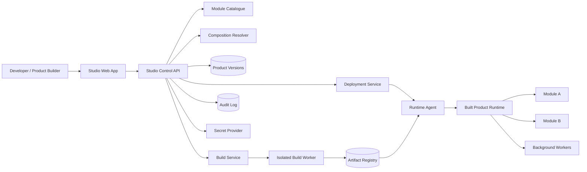
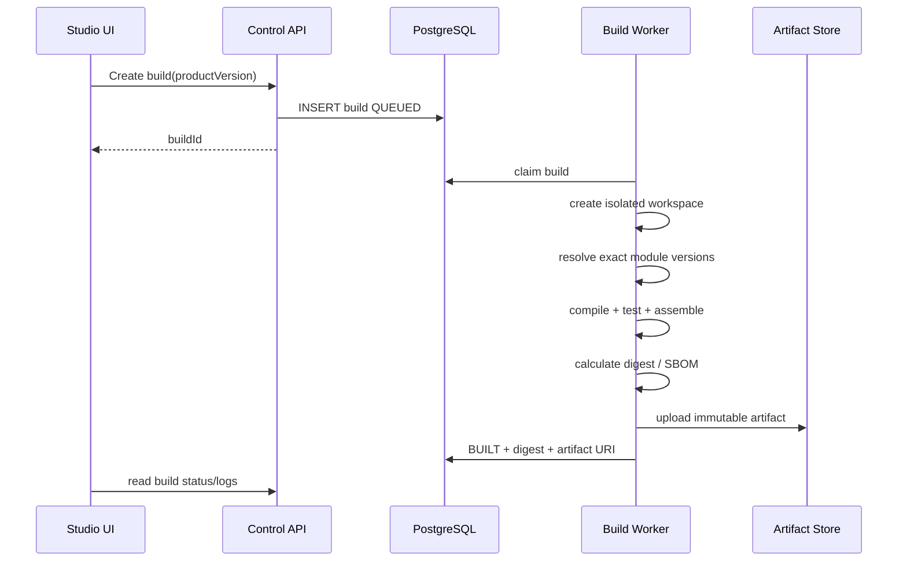

# Quadbridge Product Studio — How to Code It

## 1. What this ZIP already is

Do **not** rebuild this repository from zero.

The uploaded repository already has a real, tested construction kernel:

- `packages/contracts` — public ABI, request scope, module/product contracts.
- `packages/composition` — deterministic product/module resolver.
- `packages/backend-host` — module registration, route ownership and lifecycle.
- `packages/web-shell` — runtime application shell and workspace loading.
- `packages/worker-host` — durable background-job execution contract.
- `packages/sqlite` / `packages/local-access` — local developer adapters.
- `packages/connections` — explicit local/HTTP cross-product calls.
- `modules/*` — example domain-owned modules.
- `products/*/product.json` — real product definitions.
- `tools/studio.mjs` + `tools/studio-manager.mjs` — paired local Studio operator.
- `tools/build.mjs` — compiler + immutable product artifact construction.
- `apps/runtime` — executes a selected built product.
- `visual/studio.js` — current Studio presentation layer.

The compiled framework/runtime test suite was run against this extracted ZIP on Node `22.16.0`:

- 98 tests passed
- 0 failed

That means the first coding job is **not** “create the platform”. The first job is to turn the existing local developer framework into a proper Product Studio while preserving its tested contracts.

---

# 2. Target product

The production Product Studio should work like this:



There are two different systems here:

1. **Studio control plane** — defines, validates, builds, versions and deploys products.
2. **Product runtime** — runs the built product and its selected business modules.

Never push normal business traffic through the Studio control plane.

---

# 3. Preserve these current rules

These are good architectural decisions already present in the code and must stay:

1. `packages/*` remain product-neutral.
2. A module owns its own business records and schema.
3. A product selects modules; the platform does not hard-code product names.
4. Cross-module/cross-product work uses explicit public contracts.
5. Product definitions are data, not executable code.
6. Runtime modules are built from reviewed source; no arbitrary remote-code URL loading.
7. Running releases are immutable snapshots.
8. A source rebuild must not silently mutate a running release.
9. Permissions are checked at execution time, not inferred from module selection.
10. Background execution and external effects preserve idempotency and original command identity.

Do not replace these with one giant generic service or one shared domain database.

---

# 4. The coding order

## Phase 0 — Freeze the baseline

### Goal
Create a known-good branch before changing the Studio.

### Do

```bash
npm run setup
npm run test:compiled
```

If development dependencies are available:

```bash
npm ci
npm run verify
```

Record the passing baseline.

### Do not

- change module ABI yet;
- change SQLite behavior yet;
- rewrite runtime construction;
- add production deployment behavior to `tools/studio.mjs`.

---

# 5. Phase 1 — Build the real React Product Studio first

This is the first useful implementation milestone.

The existing visual Studio is mainly `visual/studio.js`. Keep its visual direction, but stop growing this single file.

Create:

```text
apps/
  studio-web/
    src/
      app/
      api/
      components/
      features/
        catalogue/
        composer/
        architecture/
        builds/
        runtimes/
      routes/
      main.tsx
    package.json
    vite.config.ts
```

Recommended frontend stack:

- React + TypeScript
- Vite
- React Router
- TanStack Query for API state
- ordinary CSS/CSS modules first; do not introduce a second design system unnecessarily

## 5.1 Do not duplicate the composition resolver in React

Current truth already exists in:

```text
packages/composition/src/index.ts
packages/composition/src/studio.ts
```

The UI should submit a draft to the existing API:

```http
POST /studio-api/preview
```

Input:

```json
{
  "id": "facility-ops",
  "title": "Facility Operations",
  "selected": ["knowledge", "handoff"],
  "layout": "sidebar",
  "choices": {
    "handoff:desk.requests.create.v2": "local"
  }
}
```

The server calls `composeDraft()` and returns the canonical resolved definition/explanation.

The browser displays the result. It does **not** implement its own dependency algorithm.

## 5.2 First React screens

Build only these screens first:

### `/`
Product Studio home.

Show:

- current products;
- modules available;
- recent builds;
- running local applications.

### `/composer/new`
Product builder.

Fields:

- product ID;
- title;
- navigation layout;
- selected modules;
- connection/binding choices.

Right side:

- automatically required modules;
- exposed workspaces;
- public contracts;
- worker requirement;
- validation problems.

### `/modules`
Catalogue generated from `module.json` files.

### `/products/:id`
Resolved product architecture.

### `/products/:id/builds`
Build state and logs.

### `/runtime`
Locally launched product instances and readiness.

## 5.3 React API client

Create:

```text
apps/studio-web/src/api/studio.ts
```

Interface:

```ts
export interface StudioApi {
  connect(code: string): Promise<void>;
  catalogue(): Promise<StudioCatalogue>;
  preview(input: StudioInput): Promise<StudioDraftResult>;
  saveProduct(input: StudioInput): Promise<ProductDefinition>;
  build(productId: string): Promise<BuildJob>;
  launch(productId: string): Promise<RuntimeInstance>;
  stop(productId: string): Promise<void>;
  status(): Promise<StudioStatus>;
}
```

Every mutation continues to use the current paired same-origin Studio boundary.

## 5.4 Acceptance test for Phase 1

A developer must be able to do this entirely from the React Studio:

1. pair browser;
2. open module catalogue;
3. create a new product;
4. select modules;
5. see automatically required modules;
6. resolve connection choices;
7. save a new source definition;
8. build;
9. see build result/log;
10. launch locally;
11. open the actual generated application;
12. stop it.

Until this works, do not start production deployment work.

---

# 6. Phase 2 — Create a real Module SDK

The Studio becomes useful only when teams can add serious modules without editing framework internals.

Create:

```text
packages/module-sdk/
  src/
    define-module.ts
    define-route.ts
    define-workspace.ts
    define-worker.ts
    contracts.ts
    test-harness.ts
```

The SDK should be a thin typed layer over `@quadbridge/contracts`, not a second architecture.

Example usage:

```ts
export default defineModule({
  manifest,
  register(env) {
    return {
      routes,
      services,
      workers,
      close
    };
  }
});
```

## Add a generated module shape

```text
modules/checklist/
  module.json
  package.json
  src/
    index.ts
    domain/
    application/
    persistence/
    api/
    ui/
      workspace.tsx
  tests/
```

Do not generate fake business logic. Generate the correct ownership/lifecycle skeleton.

---

# 7. Phase 3 — Version the Module Manifest instead of endlessly adding fields to v1

Do not break `quadbridge.module.v1` immediately.

Keep v1 valid. Introduce an optional Studio metadata companion first, for example:

```text
module.json
studio.json
```

`studio.json` can contain presentation/build-time metadata:

```json
{
  "displayName": "2D Operations Map",
  "description": "Spatial operational workspace",
  "category": "operations",
  "icon": "map",
  "configurationSchema": "./config.schema.json",
  "documentation": "./README.md"
}
```

Only introduce `quadbridge.module.v2` when runtime semantics actually change.

A future v2 may support explicit declarations for:

- UI contributions;
- backend operations;
- workers;
- events/subscriptions;
- configuration schema;
- health probes;
- resource requirements;
- migration compatibility;
- optional runtime sidecars.

Large features such as a spatial map, AI analytics package or reporting package should still arrive as modules/capabilities, not as `if product === ...` branches in the Studio.

---

# 8. Phase 4 — Replace source-directory products with durable product versions

The current local Studio writes:

```text
products/<id>/product.json
```

That is appropriate for the developer edition, but not enough for a multi-user Studio.

Create a control-plane database.

Use PostgreSQL initially. Do not add Redis/Kafka just because the system might scale one day.

## Core tables

```text
organizations
projects
module_packages
module_versions
products
product_versions
product_version_modules
product_version_bindings
builds
artifacts
environments
deployments
deployment_instances
secret_references
audit_events
```

Important rule:

`product_versions` are immutable after a build starts.

A product edit creates a new draft version.

## Product version lifecycle

```text
DRAFT
  -> VALIDATED
  -> BUILDING
  -> BUILT
  -> RELEASED
  -> ARCHIVED
```

Do not edit a RELEASED version in place.

---

# 9. Phase 5 — Introduce the Studio Control API

Create:

```text
apps/control-api/
  src/
    auth/
    catalogue/
    products/
    composition/
    builds/
    artifacts/
    environments/
    deployments/
    audit/
```

Use the existing pure composition packages inside this API.

The control API owns Studio metadata and lifecycle only. It does not own module business data.

Recommended first API surface:

```text
GET    /api/catalogue/modules
GET    /api/products
POST   /api/products
GET    /api/products/:id/versions/:version
POST   /api/products/:id/versions/:version/validate
POST   /api/products/:id/versions/:version/builds
GET    /api/builds/:id
GET    /api/builds/:id/logs
POST   /api/environments
POST   /api/deployments
GET    /api/deployments/:id
POST   /api/deployments/:id/rollback
```

Use OpenAPI/JSON schema at the API boundary.

Keep `packages/composition` framework-independent.

---

# 10. Phase 6 — Build in an isolated worker, not inside the API process

The current `StudioManager` invokes the build directly from the local checkout. Keep that for developer mode.

Production build path:



## Build worker rules

The worker must receive only:

- product-version ID;
- exact module versions;
- source package references;
- approved build profile.

It must **not** receive an arbitrary shell command from the browser.

Run builds in an isolated process/container with:

- CPU limit;
- memory limit;
- timeout;
- writable temporary workspace;
- no customer runtime secrets;
- controlled network access;
- artifact size limits.

## Artifact contents

Each built artifact should contain at minimum:

```text
release.json
plan.json
backend runtime files
browser runtime files
module assets
migration metadata
SBOM
checksums.json
```

Then sign `checksums.json` or the release manifest before production deployment.

---

# 11. Phase 7 — Artifact Registry

Use S3-compatible object storage first (AWS S3, MinIO or the cloud equivalent).

Do not put large release ZIPs in PostgreSQL.

Database stores metadata:

```text
artifact_id
product_version_id
sha256
size_bytes
storage_key
created_at
signature_state
sbom_key
```

Artifact files are immutable.

A deployment references an artifact digest, never “latest”.

---

# 12. Phase 8 — Deployment Service + Runtime Agent

For local/on-prem/customer environments, use an outbound-connected Runtime Agent.

Create:

```text
apps/runtime-agent/
  src/
    enrollment/
    desired-state/
    artifacts/
    verifier/
    process-supervisor/
    health/
    reporting/
```

The agent should:

1. authenticate to the control plane;
2. receive desired release ID;
3. fetch the immutable artifact;
4. verify digest/signature;
5. prepare release directory;
6. run migration prechecks;
7. start web/backend and required worker processes;
8. wait for readiness;
9. report exact running release;
10. preserve old release for rollback.

The Studio must never SSH into arbitrary customer machines from browser code.

## Desired-state deployment

Store:

```text
environment desired_release = R17
agent actual_release = R16
```

The agent converges to R17 and reports success/failure.

This is safer than issuing a one-time “run this shell command” request.

---

# 13. Phase 9 — Identity, tenant and permissions

The current `local-access` package should remain for local development.

Add a production access adapter instead of replacing the neutral host.

Create:

```text
packages/oidc-access/
```

Responsibilities:

- verify OIDC identity;
- resolve organization/project membership;
- resolve product/environment role;
- provide the existing `AccessPort` semantics to the runtime where appropriate.

Use an external IdP such as Entra ID, Keycloak, Auth0 or another reviewed OIDC provider.

Do not store user passwords in Product Studio.

---

# 14. Phase 10 — Secrets and connections

Current connected definitions correctly avoid embedding service credentials.

Keep that rule.

Database stores only a reference:

```text
secret_ref = "vault://prod/service-desk/token"
```

The environment/runtime resolves the secret from the configured provider.

Do not return secrets to the Studio browser after creation.

Connection configuration should be separate from module business logic:

```text
ConnectionDefinition
- id
- contract
- source product/environment
- destination product/environment
- tenant mapping
- identity reference
- transport
- policy
```

---

# 15. Phase 11 — Observability and audit

Add this before calling the platform production-ready.

Studio audit events:

```text
PRODUCT_DRAFT_CREATED
PRODUCT_VERSION_VALIDATED
BUILD_REQUESTED
BUILD_COMPLETED
BUILD_FAILED
RELEASE_PROMOTED
DEPLOYMENT_REQUESTED
DEPLOYMENT_SUCCEEDED
DEPLOYMENT_FAILED
ROLLBACK_REQUESTED
SECRET_REFERENCE_CHANGED
MODULE_VERSION_ADDED
```

Every record should include:

- organization;
- actor;
- request ID;
- target ID;
- old/new version where applicable;
- timestamp;
- result.

Runtime telemetry is separate from Studio audit history.

---

# 16. Exact local flow that exists today

Understanding this path prevents unnecessary rewrites.

## User presses Preview

```text
visual/studio.js
  -> POST /studio-api/preview
  -> tools/studio.mjs
  -> read catalogue
  -> packages/composition/src/studio.ts::composeDraft()
  -> packages/composition/src/index.ts::resolve()
  -> canonical product definition + explanation
  -> browser
```

## User presses Save

```text
visual/studio.js
  -> POST /studio-api/products
  -> StudioManager.save()
  -> tools/product-source.mjs
  -> products/<new-id>/product.json
```

Existing product directories are intentionally not overwritten.

## User presses Build

```text
POST /studio-api/products/:id/build
  -> StudioManager.build()
  -> tools/build.mjs
  -> TypeScript compile
  -> resolve product
  -> frontend closure
  -> .artifacts/<product>/...
  -> release.json checksums
  -> StudioManager.stage()
  -> immutable exported snapshot
```

## User presses Launch

```text
POST /studio-api/products/:id/launch
  -> StudioManager.launch()
  -> exported snapshot/tools/demo.mjs
  -> apps/runtime
  -> createRuntime()
  -> ApplicationHost
  -> selected modules
  -> local HTTP server
  -> optional WorkerHost
```

This chain is the seed of the production system. Productionize each boundary; do not throw the chain away.

---

# 17. How a module is coded today

Use `service-desk` as the simple reference.

## Step 1 — Manifest

`modules/service-desk/module.json`

It declares:

- module ID/version;
- permissions;
- public contracts;
- API routes;
- workspaces;
- schema compatibility;
- background requirement.

## Step 2 — Backend

`modules/service-desk/src/index.ts`

It:

1. migrates its own DB;
2. parses/validates input;
3. performs tenant-scoped commands;
4. owns idempotency receipts;
5. exports public services;
6. registers route implementations.

## Step 3 — UI

`modules/service-desk/src/ui.ts`

It exports the workspace declared in the manifest.

The Web shell loads only workspaces declared by selected modules.

## Step 4 — Product selection

`products/service-desk/product.json`

The product includes `service-desk@0.2.0`.

## Step 5 — Build

`tools/build.mjs` resolves the product and includes only the selected module/backend/browser assets in the release.

That same pattern should remain for future real modules.

---

# 18. How to code a large plugin/module

Example: a future spatial operations module.

Do **not** modify `web-shell` with spatial-specific logic.

Create:

```text
modules/spatial-operations/
  module.json
  package.json
  src/
    index.ts
    domain/
      map.ts
      layer.ts
      entity.ts
    application/
      commands.ts
      queries.ts
    persistence/
      migrations.ts
      repository.ts
    api/
      routes.ts
    workers/
      projection-worker.ts
    ui/
      workspace.tsx
      components/
      hooks/
```

It may provide contracts such as:

```text
spatial.entity.project.v1
spatial.map.read.v1
```

Other modules consume those public contracts through bindings.

The Studio only sees the manifest/catalogue contribution and composition requirements.

---

# 19. Data ownership rule

For each domain module:

```text
module owns:
- schema
- migrations
- records
- commands
- queries
- business rules
```

The platform owns:

```text
- identity context
- product composition
- module lifecycle
- connection lifecycle
- build/release/deployment lifecycle
- artifact integrity
- audit
```

The platform must not create a generic `entities` table and force every business module into it.

---

# 20. Repository shape after the next major implementation

```text
apps/
  studio-web/          # React Product Studio
  control-api/         # production Studio control plane
  build-worker/        # isolated build executor
  runtime/             # existing product runtime
  runtime-agent/       # environment deployment agent

packages/
  contracts/           # existing neutral ABI
  composition/         # existing resolver
  backend-host/        # existing runtime host
  web-shell/           # runtime product shell
  worker-host/         # existing worker execution
  connections/         # existing explicit cross-product connections
  module-sdk/          # new developer SDK
  control-contracts/   # Studio API/domain contracts
  postgres-control/    # Studio persistence adapter
  artifact-store/      # S3-compatible storage adapter
  oidc-access/         # production identity/access adapter
  deployment-protocol/ # control plane <-> agent contracts

modules/
  service-desk/
  knowledge/
  handoff/
  ...new domain modules

products/
  ...developer-mode checked-in definitions only

infra/
  docker/
  compose/
  kubernetes/          # later, only if required
```

---

# 21. What not to build yet

Do not start with:

- Kubernetes operators;
- Kafka;
- a generic workflow engine;
- a plugin marketplace;
- arbitrary third-party runtime code;
- customer production deployment from the current loopback Studio;
- a universal business data model;
- a second composition engine;
- a second permission engine;
- AI generation of executable module source inside the trusted runtime path.

First prove the full Product Studio path with the existing resolver and runtime.

---

# 22. First implementation backlog

## PR-1 — React Studio shell

Create `apps/studio-web` and reproduce current Studio navigation/layout.

Acceptance:

- catalogue loads from API;
- pairing works;
- no business/build behavior changed.

## PR-2 — Composer

Move Composer UI from `visual/studio.js` to React.

Acceptance:

- browser uses `/studio-api/preview`;
- automatically required modules display correctly;
- invalid binding/product definitions are blocked by server resolver.

## PR-3 — Product detail / architecture

Render the canonical `CompositionPlan`.

Acceptance:

- selected modules;
- construction order;
- public provides/requires;
- bindings;
- workspaces;
- worker requirement.

No invented runtime telemetry.

## PR-4 — Build + runtime management

Connect React to existing build/launch/stop endpoints.

Acceptance:

- build logs shown;
- immutable release digest shown;
- running URL/readiness shown;
- stop works;
- browser cannot submit arbitrary commands.

## PR-5 — Module SDK

Create typed module helper + test harness.

Acceptance:

- existing modules can migrate incrementally;
- one generated reference module builds without changing Studio source.

## PR-6 — Product version domain

Introduce production control contracts and PostgreSQL schema without touching local developer flow.

## PR-7 — Control API

Durable products, product versions, validation and build records.

## PR-8 — Build worker + artifact store

Isolated builds and immutable artifact upload.

## PR-9 — Environments + runtime agent

Desired-state deploy, readiness and rollback.

## PR-10 — OIDC + secrets + audit + signed releases

Production hardening.

---

# 23. The first Codex implementation prompt

Use the following as the first coding task, not “build the whole Product Studio”.

```text
Repository: Quadbridge_Product_Studio

Goal: implement Phase 1, PR-1 only: create the real React/TypeScript Studio shell while preserving all existing backend, composition, runtime and security behavior.

Read first:
- AGENTS.md
- README.md
- PLATFORM_ARCHITECTURE.md
- docs/STATUS.md
- docs/STUDIO_INTEGRATION.md
- HOW_TO_CODE_PRODUCT_STUDIO.md

Hard rules:
1. Do not change packages/contracts ABI.
2. Do not change packages/composition behavior.
3. Do not change module data ownership or schemas.
4. Do not weaken Studio pairing, same-origin, Host/Origin or confirmation checks.
5. Do not duplicate composition/dependency resolution in React.
6. The React application must consume the existing /studio-api catalogue/status endpoints.
7. Keep OPEN_PLATFORM.html available as the existing offline explorer until React feature parity is proven.
8. Build before testing edited TypeScript.

Implement:
- apps/studio-web as a workspace package
- React + TypeScript + Vite
- routes: Home, Composer placeholder, Modules, Product detail placeholder, Build/Runtime placeholder
- typed Studio API client
- pairing screen using POST /studio-api/session
- catalogue loading using GET /studio-api/catalogue
- status loading using GET /studio-api/status
- preserve the current visual direction from OPEN_PLATFORM.html / visual/studio.css
- no fake sample business records in the new connected Studio shell

Tests:
- existing compiled tests must remain green
- add frontend unit tests for API state and catalogue rendering
- add an integration test proving the backend Studio still refuses unauthenticated catalogue access
- record any real-browser limitation as blocked, not passed

Deliver:
- source changes
- exact commands run
- test output
- changed-file summary
- remaining work for PR-2 only
```

---

# 24. Definition of “Product Studio v1 is ready”

Do not call it ready only because the UI can draw a product.

V1 is ready when a developer can:

1. publish/register a reviewed module version;
2. compose modules into a product version;
3. see dependency/binding consequences;
4. validate it through the canonical resolver;
5. build in isolation;
6. produce an immutable, checksummed artifact;
7. deploy it to a registered environment;
8. verify the environment is running that exact digest;
9. roll back to the previous release;
10. inspect build/deployment/audit evidence;
11. restart without losing control-plane state;
12. do all of this without exposing arbitrary shell/filesystem/secrets to the browser.

That is the line between the current excellent local construction prototype and a real Product Studio platform.
