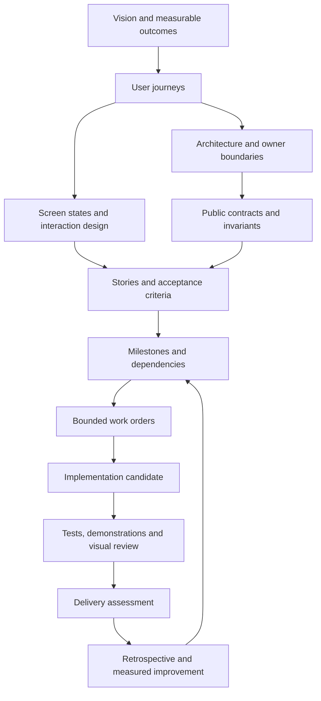
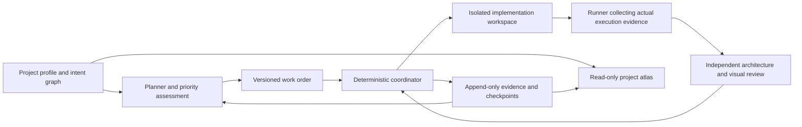

# Reusable Brain architecture and delivery model

Brain should maintain a clear destination and a buildable route for each project, then compare delivery with that route. The user established this direction on 2026-10-01 and selected reuse across multiple projects immediately. This document defines the complete target. The initial atlas implementation covers structured planning, linked views and source drift inspection; it does not implement the autonomous execution controller described below.

The project owner supplies intent and remains the authority for changed outcomes and external commitments. Brain owns planning, sequencing, work preparation, evidence reconciliation and improvement within that intent. Implementation agents receive bounded work. A diagram, role prompt or passing test never grants new authority or proves the whole product works.

## Destination before construction

Every project starts with a concise vision, intended users, user outcomes, explicit exclusions and observable success criteria. Before coding a milestone, Brain prepares its user journey, screen states, owner boundaries, public contracts, dependencies, file ownership, construction steps and acceptance demonstration. The whole destination has a map; the next milestone has enough detail to build.

Unknowns remain visible. A reversible design choice can be resolved within the existing authorization. An uncertainty that could invalidate the architecture gets a bounded experiment and a decision. Later details may evolve through recorded impact assessment; attempting to specify every implementation detail up front would create another delay.

The reusable core contains no Quadbridge module names, permitted-product list or domain database abstraction. Each repository owns its profile and domain semantics. Explicit cross-project dependencies describe an interface or deliverable; they do not grant filesystem, credential, spending or deployment access.

## One project graph and separate evidence



Plan nodes have stable project-local IDs, owners, intent status, priority reasons, dependencies and source references. Observations are separate records with provenance, time, limitations and candidate identity where available. A source file can establish that code exists; it cannot establish that an interaction passed in a browser. Historical acceptance remains historical when source changes.

The atlas is a projection over this information. Architecture, roadmap, backlog and progress views must not maintain independent completion flags. Existing canonical source and execution records remain authoritative. The first atlas profile is a source-backed planning snapshot; rebuilding its page checks referenced file hashes but does not semantically reconcile changed documents. Reconciliation is a coordinator action until the controller exists.

## Reusable system boundaries



| Owner | Responsibility | Boundary |
| --- | --- | --- |
| Project profile | Vision, source locations, conventions, user journeys, risks and success criteria | No executable URLs or implicit authority |
| Planning model | Explain choices, map dependencies, prepare work and propose replanning | Cannot change its own acceptance requirements silently |
| Coordinator | Select eligible work, bind project/candidate/contract, limit writers, reconcile results | A model recommendation is input, not a permission grant |
| Execution adapter | Dispatch an authorized worker and collect process results | Restricted workspace and explicit tool permissions |
| Verification adapter | Build, run relevant checks, preserve artifacts and exit results | Exit zero alone is not product acceptance |
| Review adapter | Compare implementation with architecture, contracts and user experience | Independent review distinguished from self-review |
| Evidence store | Retain original failures, observations, reviews and decisions | Never overwrite uncertainty with an optimistic summary |
| Atlas renderer | Show intent, evidence, gaps, dependencies and current priorities | Read-only offline page; no build or filesystem privileges |

For multiple projects, each root gets its own identity, plan, evidence and coordinator state. A future portfolio view may aggregate explicit references read-only. Shared memory should contain reusable engineering lessons with provenance, not secrets or another project's domain records. Dispatch must revalidate the selected project and work order at execution time.

## File structure

```text
tools/
  brain-atlas.mjs              reusable atlas init, validate and render commands
  brain.mjs                   existing evidence workflow CLI
  brain-core.mjs              existing record and checkpoint implementation
docs/brain/
  ARCHITECTURE.md              reusable target operating model
  README.md                   atlas usage and current capability boundaries
.brain/
  project.json                existing canonical project bindings
  atlas/
    project.json              project-specific intent and attributed observations
    PROJECT_ATLAS.html         generated read-only snapshot
  workflow/                   existing immutable execution records
  tasks/                      bounded work contracts
```

Future coordinator, runner and dispatch adapters should remain separate from the renderer and from domain packages. A portable installation must copy the reusable tool and both guides, then initialize a fresh profile and adopt the entry procedure in that project's agent instructions. The existing evidence CLI is a separate installation. Never copy another project's evidence or acceptance labels as a new project's baseline.

## UI and UX preparation and review

For each milestone, the screen contract identifies its user, entry point, primary action, information hierarchy and destination after success. It covers loading, empty, successful, denied, failed and recovery states when applicable. It specifies keyboard behavior, focus movement, labels, responsive layout and preservation of user work. Mark irrelevant states explicitly rather than inventing functionality.

The intended design needs reviewable wireframes or prototypes before visual implementation. Existing UI source and offline samples are context, not evidence of an approved final design. A proposed redesign must be labelled proposed. The first atlas maps screens and acceptance expectations; it does not claim to have completed all project wireframes.

A visual review record should bind project, story, screen, candidate, environment, viewport, screenshot, interaction steps, expected result, actual result, reviewer, findings and disposition. Compare actual rendered behavior with the accepted design. Automated DOM assertions, screenshot comparison and human judgment answer different questions. An unavailable or policy-blocked browser remains blocked.

## Priorities and agile delivery

Order work by the next usable outcome and its real dependencies. Essential correctness, authorization and data integrity for that outcome come first. Finish a coherent vertical slice before adding another partially working surface. Prefer one implementation writer per owned integration scope; parallelize independent investigation and review.

Every story describes a user action and benefit, with observable acceptance criteria. Before implementation, it needs a linked outcome, dependencies, relevant design, owner, allowed files, checks and a stopping condition. Completion requires the agreed demonstration and evidence, with unresolved findings visible. Story counts, lines of code and test counts are not product completion percentages.

Use an ordered backlog rather than invented delivery dates or velocity. A later item records why it is deferred and what event should reconsider it. Cosmetic polish, speculative generalization and unrelated extreme-case campaigns normally wait while a core journey is unfinished. A concrete defect that prevents that journey or violates its essential invariants is core work even if the reproduction is unusual.

If an investigation stops answering a named acceptance question, checkpoint the evidence, classify the remaining uncertainty and either timebox the next experiment or defer it. Numeric budgets, deadlines and retry limits come from explicit project policy; unknown usage or budget remains unknown.

## Continuous delivery control

The target loop runs on meaningful events: a new request, planned work start, changed source, completed check, review finding, milestone demonstration or detected drift. It should not trigger a new review campaign on every keystroke.

1. Load project intent, current candidate, work order and unresolved evidence.
2. Check whether the next action still advances the current core outcome.
3. Reconcile changed dependencies, architecture decisions and design gaps.
4. Prepare and dispatch one bounded eligible implementation step.
5. Collect actual build, behavior and visual evidence through execution adapters.
6. Review against the pinned criteria; repair in scope without lowering the bar.
7. Checkpoint the result and choose the next eligible step or a truthful stop.

Stop or escalate when required authority is missing, an external action is unapproved, evidence cannot resolve a material risk, or a configured budget is reached. Repeated failure triggers diagnosis, not endless identical retries. A paused chat is not an unattended service: persistent execution needs a separately implemented and authorized runtime.

The existing evidence Brain and new atlas do not yet enforce this loop. They cannot restrict arbitrary editors, independently authenticate an agent's report or guarantee the correctness of a design. The controller's eventual acceptance must demonstrate these controls through actual executions.

## Drift and retrospectives

Drift questions are concrete: does this story still serve the outcome; did a dependency or API contract change; does the UI still match the intended journey; are several documents claiming different next milestones; are checks repeatedly producing no new information; is optional work delaying a core demonstration?

A retrospective records an observed problem and source evidence, a causal hypothesis, a chosen action, an owner, and a future measurement. Keep observations separate from causal claims. The present Quadbridge planning snapshot records stale next-step pointers as observed drift; it does not assert that their removal has already improved delivery speed.

Use the Define, Measure, Analyze, Improve and Control cycle as a practical process:

| Measure | Definition | Interpretation |
| --- | --- | --- |
| Core outcome cycle time | Elapsed time from the agreed ready point to demonstrated acceptance, with blocked time reported separately | Compare similar work and preserve missing timestamps |
| Review rework | Candidate revisions required after a defined independent review checkpoint | Classify the causes; a lower count alone does not prove better review |
| Escaped defects | Confirmed defects first found after the defined acceptance boundary | Record severity, exposure window and affected outcome |
| First pass yield | Comparable work items accepted at their first defined verification attempt divided by all eligible items | Define denominator and exclude neither failures nor inconvenient cases |
| Priority diversion | Recorded effort on later items while a core outcome is blocked | Report only when actual effort data exists |

No measurements are populated merely to decorate a dashboard. No sigma level, capability index or defect-free claim follows from a small or undefined sample. Stronger proofs can cover explicit properties under explicit assumptions; the project still needs integration evidence and real user validation.

## Delivery sequence for Brain itself

| Increment | User-visible result | Acceptance demonstration |
| --- | --- | --- |
| Atlas foundation | Reusable profile, visual project map, priorities, evidence gaps and drift warnings | Two isolated project fixtures, valid links, safe rendering, no cross-root writes |
| Planning and design preparation | A request becomes a complete bounded milestone packet with journeys, wireframes, contracts, stories and construction order | One real milestone reviewed against the user's intent; unresolved assumptions visible |
| Evidence runner | The coordinator captures real build/test/browser results for an exact candidate | Passing, failing, blocked and interrupted runs retain truthful identity |
| Controlled agent execution | Approved work dispatches in an isolated workspace, returns a bounded patch and gets independent review | Out-of-scope edits rejected; criteria changes require explicit review; conflicting candidates are not silently integrated |
| Adaptive delivery and improvement | Core work selection, drift detection and retrospectives influence the next step | Real examples of useful reprioritization with measured outcomes and stopping behavior |
| Portfolio coordination | Multiple independent projects can be inspected and deliberately scheduled | Project identities, records, permissions and budgets remain isolated |

Only the atlas foundation is in this increment. The roadmap describes the remaining system; it is not an implementation claim or an authorization for external execution.
