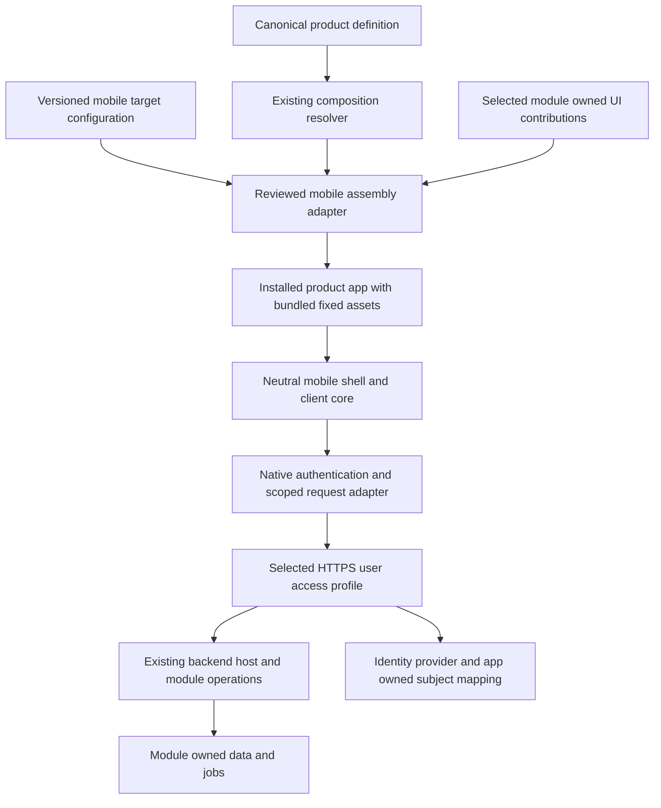

# Mobile app shell architecture and delivery plan

Status: proposed design, 2 October 2026. The user confirmed that the shell runs the product apps generated by Quadbridge. This document plans implementation; it does not activate a mobile task, change the platform checkpoint, install tools, or qualify a mobile release.

Build one reusable mobile host that assembles selected product workspaces, preserves the server's ownership and access rules, and produces a separate installed application for each product. The first useful outcome is a phone user signing in, selecting a tenant, viewing and creating a Service Desk request, and seeing the same committed record through the existing application.

The recommended first renderer is **Capacitor with a mobile DOM layout**, reusing compatible module UI code. Android first and iOS next is a provisional delivery assumption; the platform preference has not yet been confirmed. See [the visual review](MOBILE_APP_SHELL_REVIEW.html) for the architecture, phone wireframes and milestone sequence.

## Current facts and prerequisites

Read-only inspection found the following. Line references identify the inspected source, not permanent line numbers.

| Existing authority | Finding and consequence |
| --- | --- |
| `packages/contracts/src/index.ts:210` | Workspaces mount into `HTMLElement`. Capacitor can reuse this DOM contract; React Native cannot directly render these workspaces. |
| `packages/web-shell/src/index.ts:44` | Session state, scope fencing, DOM navigation and same-origin requests are coupled. Reuse these protections through a small client core rather than copy their implementation. |
| `modules/service-desk/src/ui.ts:2`, equivalent Knowledge and Handoff files | Domain UI belongs to its module and uses web-shell DOM helpers. Adapt responsive layouts in those owners; keep business rules and persistence on the server. |
| `tools/build.mjs:64`, `tools/frontend-closure.mjs:55` | Current assembly always starts web-shell and supports a restricted native-ESM closure. A mobile target needs its own reviewed packaging adapter and actual dependency inventory. |
| `tools/factory.mjs:63`, `packages/composition/src/workspace-closure.ts:18` | Current exports contain a Node backend/runtime. They are not phone bundles. Extract only selected public client assets into the mobile artifact. |
| `packages/backend-host/src/http.ts:22`, `:78`, `:87`, `:127` | HTTP is loopback-only, with local Host checks, same-origin mutations and an HttpOnly session cookie. A phone needs a separately reviewed network and user-authentication profile. |
| `packages/local-access/src/index.ts:71` | Existing bearer credentials represent service principals. They must not become mobile user credentials. |
| `modules/service-desk/src/index.ts:43` | The existing human create route and v2 committed-receipt route have different operation identities. Recovery must remain within the chosen operation. |
| `docs/STATUS.md` | Local registry limits are 8 MiB per file and 64 MiB per artifact. Mobile binaries must not be silently forced through the existing Node-snapshot registry or enlarge its limits. |

At inspection, Brain checkpoint 55 mapped to accepted `KERNEL-CI-002`; atlas revision 18 focused on `M-KERNEL-CI`. Record integrity and atlas sources were VALID, all 55 source references checked, and current readiness was READY. The validator reported 12 informational planning gaps. Those facts qualify the existing workflow, not this proposal. The mapped next program step already calls for a concrete operating profile; mobile authentication and connectivity should share that work. Older roadmap/outcome next-step prose remains historical.

## Technology decision

| Option | Fit for this repository | Proposed decision |
| --- | --- | --- |
| Capacitor and mobile DOM UI | Hosts web assets in Android/iOS containers with native integration ports. Existing DOM module contributions can be adapted and reused. A packaged entry page and mobile build adapter are still needed. | First supported mobile renderer, subject to a short real-device feasibility gate. |
| React Native with Expo | Native components require separate module-owned screens and a separate build/renderer contract. Existing ReactDOM adapter does not provide that contract. | Keep as a later alternative if measured device UX or workload requirements justify the rewrite. |
| Responsive browser or PWA | Useful for early screen review, but does not establish installed-app lifecycle, native authentication or signed delivery. | Preview surface, not the mobile completion criterion. |

Capacitor's [runtime documentation](https://capacitorjs.com/docs) establishes the web-based approach; [React Native's component model](https://reactnative.dev/docs/intro-react-native-components) establishes the separate native UI model. The recommendation above is an engineering inference from those models and this repository's DOM implementation. No Ionic UI dependency is required by this plan. Pin exact versions and native toolchains during the feasibility gate; do not use floating latest versions in builds.

## Architecture and ownership



The mobile application is a client. Backend processes, owner databases, job workers and solution service credentials remain outside it. Each product receives its own built app identity; this is not a container that downloads arbitrary product code after installation.

Proposed paths describe responsibility, not files already implemented:

```text
packages/client-core/             Scope/session generations, cancellation, operation client ports
packages/web-shell/               Existing web renderer consuming the shared core
packages/mobile-shell/            Mobile DOM chrome, workspace lifecycle, navigation, safe areas
packages/mobile-native/           Reviewed native auth, credential custody and request adapter
packages/hosted-access/           Selected user identity/session adapter shared with hosted web work
apps/mobile-runtime/              Neutral maintained mobile composition entry
modules/<owner>/src/ui/           Module-owned responsive workspaces and optional mobile presentation
products/<product>/mobile.json   Versioned mobile build target; no independent module selection
tools/mobile/                    Fixed assembly, packaging, inventory and validation recipes
templates/mobile/                Maintained native project templates
tests/mobile/                    Portable lifecycle and composition tests plus device scenarios
```

Keep `packages/*` free of imports from `modules/*`, `products/*` and `solutions/*`. The mobile host receives generated static registrations, just as the web host does. Native bridge implementation belongs in the native adapter, not every domain workspace. Extract only client logic exercised by the first journey; do not undertake a general renderer rewrite.

## Contracts to settle before implementation

1. **Mobile target definition.** Proposed `quadbridge.mobile-target.v1` references the exact canonical product identity/version and supplies bundle/application IDs, display metadata, icons, chosen platforms, a fixed endpoint-profile identifier and reviewed native capability requirements. It cannot repeat module selection, supply script/import URLs or contain secrets. Existing `ProductDefinition` remains valid; `sidebar | top` does not acquire a misleading native value. Studio saves and hashes the product plus target as one immutable build input once target support is added.
2. **Client contribution metadata.** Extend the reviewed source manifest schema with explicit target support for DOM workspaces. Existing modules remain web-only until qualified for the mobile DOM profile. Resolve selected exports and assets from source; reject unsupported required workspaces before building. Do not silently hide them or maintain a second hard-coded allowed-module list. Validate backward compatibility and version the affected manifests deliberately.
3. **Session and request ports.** `client-core` owns accepted scope, session generation, request cancellation and stale-result rejection. A workspace receives its existing limited own-module API and read-only scope, never a token or arbitrary URL fetch capability. Navigation authority comes from authenticated bootstrap intersected with compiled contributions. Server permission checks remain decisive.
4. **Native bridge.** The host receives narrow operations for login/logout, session availability, lifecycle events and scoped API requests. Fixed endpoint, method/path, size and identity checks must also be enforced inside the adapter. Domain code does not receive generic HTTP, file, SQL or plugin invocation. All bundled JavaScript is reviewed trusted application code; these interfaces are not a sandbox between mutually hostile modules. Never execute remote scripts or render untrusted domain content as executable HTML.
5. **Client and server compatibility.** A proposed mobile bootstrap envelope identifies server product/instance, supported client protocol version, selected workspace/operation contracts and module versions. Compare with compiled requirements before mounting. An older installed app must remain supported by an explicit compatibility policy or receive an update-required screen. Matching ABI alone is insufficient. Avoid a rule that unnecessarily requires every unrelated server rebuild to reinstall every phone.
6. **Mobile artifact manifest.** Bind product version, resolved-plan digest, target digest, selected client assets, dependency locks, native template/plugin versions, toolchain identity, API compatibility contract and final package hash. Record debug/release signing status separately. Inventory checks establish provenance, not byte-for-byte reproducibility of signed native packages. Mobile outputs are a new artifact kind with reviewed bounds and download/signing behavior.

The current generic build scans every `apps/*` directory for TypeScript references. Introducing a native project therefore also requires explicit build-profile routing and exclusion of native generated/build directories from source copies. Do not allow Android/iOS outputs or credentials to enter web/server snapshots accidentally.

## Authentication and network profile

Use a selected HTTPS endpoint and an OIDC authorization-code flow with PKCE through the operating system's browser authentication session. The native app is a public client: no embedded client secret. Validate issuer, audience, callback, state/nonce, expiry and one-time code handling using a maintained protocol implementation. This follows [OAuth for native apps](https://www.rfc-editor.org/info/rfc8252/).

The server maps the verified issuer/subject to an application-owned principal, then applies existing product/instance/tenant grants and module modes. Identity claims do not create permissions. Define token renewal, revocation and original-session rechecks before writes. The native adapter owns credentials; persistent material uses reviewed OS-protected storage, not localStorage or ordinary preferences. Clear access on logout and require the same authorized principal for pending-command recovery. See [Capacitor's credential-storage guidance](https://capacitorjs.com/docs/guides/security).

For v1, use a narrow native request adapter rather than remote cookie authentication inside the WebView. Specify exact trusted destinations, normal certificate validation and redirect rejection; browser origin checks are not native-client authentication. Keep the current loopback adapter unchanged. Production profile ownership includes TLS termination, trusted forwarding configuration, bounded requests and access lifecycle; none is obtained by exposing the current developer port.

The packaged app loads bundled local assets. A remote live-reload URL, unrestricted WebView navigation, mixed content, certificate bypass or globally weakened CSP is not a delivery profile; [Capacitor configuration](https://capacitorjs.com/docs/config) explicitly distinguishes development settings. Provider choice, issuer/client registration and a device-reachable test endpoint are open prerequisites for the first authenticated device demonstration. No credentials or deployment are created by this proposal.

## User journey and screen specification

Primary journey: **open app → sign in → select tenant → open Service Desk → create request → see committed request → background and resume → sign out**. The neutral reference product shows an intentional no-workspaces state. A second composed product demonstrates reuse after the first journey works.

| Screen or state | Required behavior |
| --- | --- |
| Launch and compatibility | Product identity and loading state; validate environment/session/version before showing protected content. Explain unavailable or update-required states. |
| Sign in | Open system-browser authentication; return safely to the app. Handle cancelled, expired and failed login without exposing protocol data. |
| Tenant selection | Show only granted tenants. Switching immediately clears old workspace content and pending responses. No automatic grant or tenant creation. |
| Workspace navigation | Derive entries from the selected product and authorized bootstrap. On phones, up to four primary destinations plus More; on larger screens, use a rail. Include account/tenant access and visible current tenant. |
| Request list and details | Service Desk owns list, empty/error state and detail presentation. Use records returned by existing bounded list/create operations; do not invent an item-by-ID endpoint or promise full search/pagination. |
| Create request | Labeled title/details, validation, visible primary action, duplicate-tap prevention and retained in-flight identity. Show success only after owner-confirmed result. |
| Connection lost | Explain offline status. Disable new server writes; do not quietly queue them. Distinguish an unsent form from a sent request whose outcome is unknown. |
| Unknown submission | Show recovery under the original principal/tenant/command. Explicit retry uses the same operation, normalized input and key. No automatic new-key retry. |
| Resume and session expiry | Revalidate session, permissions and compatibility before restoring content. Abort obsolete reads; accepted server jobs continue independently. |
| Read-only, disabled or denied | Reflect server module mode and permission. Show a useful explanation; never treat a visible button as authority. |

Proposed usability targets: no horizontal scrolling at 360 CSS px, usable keyboard and safe-area layouts, screen-reader labels and logical focus, text usable at 200% scaling, and touch targets of at least 44 CSS px in the web content. Test the native result with TalkBack/VoiceOver and system Back behavior. These are acceptance targets, not achieved measurements. Deep links into arbitrary records, global search and bespoke dashboards are deferred; authentication callback handling is core.

## Write uncertainty and local data

Keep the first user write on the existing `POST /api/requests` operation. Its owner already deduplicates matching principal, tenant, operation, input and command key within the destination store. A bounded protected pending-command record retains the compiled product ID, originally accepted server instance ID, protocol/operation contract, principal, tenant, normalized input and command key for an already-dispatched request, including across process death. This is recovery of one uncertain submission, not offline synchronization or a general command queue. Define its size limit, retention and confirmed-result cleanup in the first implementation contract.

After reconnect/re-authentication, allow an explicit same-key replay only under the original authorized identity, destination and current grants. Refuse recovery if authenticated bootstrap identifies a different product, instance or incompatible operation contract: a fixed HTTPS address can later serve a replacement instance with an independent receipt store. Changed input is a conflict. Lost/revoked access leaves the outcome unknown; do not grant access to resolve it. Do not query the v2 receipt route for a v1 create: it has a different namespace and permission. If a future workflow adopts `/commit` and receipt lookup, it must explicitly use that operation and its separately granted permissions throughout.

Domain records stay server-owned. V1 has no durable offline document cache, background write queue or local domain database. Pending recovery material is private and scoped; it must not appear in backups, logs or another user's session accidentally.

## Delivery sequence and evidence

All implementation milestones below are **NOT STARTED**. No schedule, effort estimate or percentage is inferred from this plan. Work can prepare M1 and the shared identity/network contract in parallel when file ownership permits; the first device acceptance requires both.

| Milestone | Coherent result | Dependency and completion evidence |
| --- | --- | --- |
| M0 Design and feasibility | Confirm Android/iOS order, approve first screen states, select native tooling and identity/network profile. Package a neutral fixed-asset probe. | Actual launch on an Android device; inspect bundled assets, safe areas, routing and browser-auth callback feasibility. Freeze exact tool/library choices. A fixture login is labeled a fixture. |
| M1 Shared client and mobile shell | Scope-safe neutral shell with mobile navigation, lifecycle handling and static contribution loading. | Extract client-core with parity checks against existing shell regressions. Neutral and Service Desk compositions render with controlled transports; no claim of real backend/device auth from fixtures. |
| M2 Authenticated device reads | Real user sign-in and permitted Service Desk reads over the selected HTTPS profile. | M0/M1 plus shared network/access adapter. Actual phone proof of login/cancel/logout/expiry, tenant isolation, grant revocation and incompatible server rejection. |
| M3 Complete Android pilot | Create and read one real request, repeated tap protection, interrupted-response recovery, process-death recovery and background/resume. | Fresh Android package; real device and server evidence tied to the same candidate. Existing desktop app sees the same record; wrong-tenant/actor requests denied; recovery to a replaced destination refused; duplicate count unchanged after recovery. |
| M4 Reusable factory and Studio target | Product-derived mobile builds through fixed recipes, separate mobile artifact verification, target diagnostics and qualification status. | Generate neutral plus a second composed product without mobile-host source edits. Prove source-driven selection and absence of backend files/secrets. Android output and server snapshot remain distinct. |
| M5 iOS and delivery qualification | The same core journey works on iOS, with platform-specific lifecycle, secure storage and accessibility verified. | macOS/Xcode build host and actual iPhone evidence. Signed release outputs and store distribution are separately authorized and recorded. Android success does not qualify iOS. |

The [native tooling requirements](https://capacitorjs.com/docs/getting-started/environment-setup) include Android tooling and a macOS/Xcode environment for iOS builds. This Windows workspace alone does not establish iOS build capability. The [packaging requirements](https://capacitorjs.com/docs/getting-started) include a complete web asset directory with an `index.html`; the current server-oriented export must be adapted deliberately.

For every source increment: fresh build before focused checks, `npm test`, independent review of the exact candidate, and separate native/browser/provider results. Add an explicit mobile test recipe because the current root test command discovers only `tests/*.test.mjs`. Portable CI, Android build/device checks and macOS/iOS checks report their actual scope. Missing SDKs, devices, signing identities or denied browser operations remain BLOCKED or NOT RUN. No source change, test suite, device run or tool installation is performed by this planning task.

## Brain adoption and human review

This packet supplies the missing mobile design material; it does not reconcile unrelated historical atlas gaps by changing their status. The shared-state coordinator should link it as a proposed outcome/journey/screen/contract/milestone set, with source digests, before mobile implementation is activated. Preserve current checkpoint/focus until an actual bounded mobile task and contract are adopted. Then validate atlas references, align the selected focus to that task and run preflight before admitting a writer.

For each milestone, the human review should show intended screens beside actual device captures, selected product and tenant, current candidate, acceptance criteria, observed checks, unresolved gaps and next action. Track first accepted end-to-end journey, cycle time, review rework, confirmed escaped defects and time spent on deferred work. Start with observed baselines; do not invent Six Sigma capability scores from test counts. A retrospective records actual deviation, its evidence and one corrective action.

## Deferred work and decision points

| Item | Why it waits |
| --- | --- |
| Offline writes and bidirectional synchronization | Requires domain-specific conflict and reconciliation semantics; not needed to prove the online shell. |
| Push, camera, GPS, file uploads and biometrics | No selected first journey needs these capabilities. A plugin alone does not supply server storage, grants or module semantics. |
| Mobile Product Studio administration | The user selected generated product apps. Operator build/deploy controls remain a separate experience. |
| React Native renderer and arbitrary plugin marketplace | Would multiply renderer, contribution and security contracts before the first accepted device journey. |
| Remote code updates and app-store automation | Separate distribution, compatibility, signing and external-action scope. V1 executes its installed fixed assets. |
| PostgreSQL conversion and broad provider work | Mobile requires reachable authorized APIs, not replacement of every server persistence adapter. Select only the operating profile needed for the pilot. |

Open decisions are the platform order, the exact identity/network pilot profile, available test devices/build hosts, and final branding/application identifiers. The next implementation contract should resolve these prerequisites and authorize M0/M1 only; completing a prototype must not be reported as completion of M2 through M5.

## Planning review and verification

Two read-only source audits covered the existing UI/build path and authentication/ownership boundaries. A separate architecture reviewer found a missing destination binding in command recovery; the plan now records the original server instance and refuses replay to a changed destination. The reviewer confirmed that correction and consistency of the visual companion. This is design review, not implementation acceptance.

The local-file browser preview was blocked by browser URL policy before rendering. Document structure and local links can be checked from source, but the companion's rendered layout remains visually unverified. No workaround was attempted, and no mobile SDK, application build, test suite or device session was run for this documentation-only proposal.
