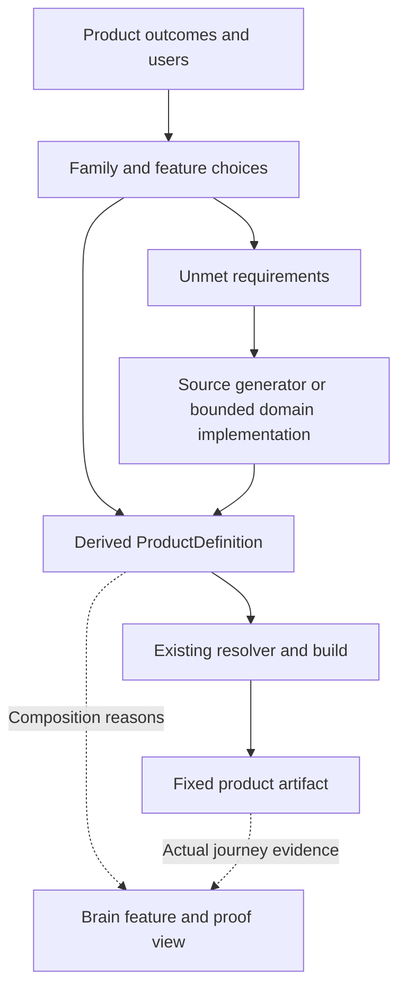

# Quadbridge SPLE and fast product builder plan

Prepared 2 October 2026 for the project owner. This plan covers a reusable builder for multiple product families, including management systems, ERP, knowledge products, CCTV AI and future domains. It proposes local construction work and measurable delivery gates. It does not record those proposed capabilities as implemented.

The repository already supplies useful application infrastructure and three small business modules. The next investment should make that infrastructure easier to apply: first select existing business features to produce a running product, then generate routine source for a new domain. Specialized behavior remains owned by domain modules and adapters.

This is a review document outside the shared source tree. The implementation coordinator in **worker1-Analyze creation process** owns canonical tasks, source coordination and Brain records. It should reconcile this plan into bounded contracts. This document neither replaces those records nor changes runtime authority.

## Current state and intended coverage

At inspection, Brain checkpoint 65 selected FRAMEWORK-RELIABILITY-001 as IMPLEMENTING. Its scope repairs runtime enrollment scanning, heartbeat evidence, access-store reseeding and rich metadata validation. The latest recorded audit before those repairs had 319 passes, two failures and one blocked skip. New repair acceptance remains pending. Atlas structure and 74 source references validated, with 12 informational planning gaps. These observations are a dated baseline, not a live status feed.

The owner requested coverage across all the discussed product categories and other future products. Accordingly, Service Operations is an early verification example, not the product scope of the platform. A second, newly generated domain must prove that reuse extends beyond existing modules.

The target has four complementary parts:

1. **A common platform** provides scoped execution, identity integration, data ownership, jobs, application shells, composition and artifact construction.
2. **Reusable capabilities and domain packs** provide actual business behavior and UI, such as requests, document search, inventory or approvals. Only the first small Desk, Knowledge and Handoff domains exist today.
3. **Product families and blueprints** describe approved combinations, business choices, user journeys and product-specific requirements. They derive ordinary product definitions through the existing composer.
4. **Brain and Studio** explain decisions, prepare work for missing behavior, build selected products and show actual verification evidence.

Breadth comes from adding implemented packs and reviewed adapters. A finite platform cannot already contain every business rule, user experience or execution engine needed by every possible application.

## What can be reused from the repository

The following classifications distinguish available mechanisms from finished product functionality. Implemented local behavior still requires renewed qualification after the current repairs.

| Area | Available now | Adoption work or limitation |
|---|---|---|
| Product composition | Exact module versions, dependency and binding checks, deterministic resolved plans, source-derived catalogues | Select implemented capabilities and reviewed wiring. Business-feature derivation is proposed. |
| Backend construction | Module registration, routes, services, actor/product/instance/tenant context and authorization boundaries | Implement domain handlers, input validation and business invariants. A general external operation schema is planned. |
| Business data | Module-owned SQLite stores, migrations and command receipts | Define each domain schema. Production database replacement and cross-version data adoption are separate work. |
| Access | Local sessions, permissions and tenant/module gates | Fix the current reseeding gap. Production identity, provisioning and administration require a chosen profile. |
| Background work | Durable queue/handler contracts, claims, retries, cancellation, fencing and a worker process | Write the actual job. No generic video/GPU execution service or workload capacity guarantee is supplied. |
| Cross-module workflows | Public contracts, local/HTTP wiring and the demonstrated Handoff receipt/reconciliation pattern | New business workflows and adapters need implementation. Managed Studio currently permits local bindings only. |
| Web shell | Login/tenant navigation, workspace loading, scoped API client, cancellation and lifecycle behavior | New domain screens need code. DOM helpers are small primitives, not a form/grid designer. |
| Mobile shell | Shared client behavior, browser presentation and client-only native packaging scaffold | Native identity/API, device binaries, secure storage and delivery remain separate qualification. |
| Business modules | Desk create/list/close; Knowledge text entry/index/search/cited extraction; Handoff document-to-request behavior | Assignment, attachments, approvals, reporting and most other business features are absent. Knowledge answers do not use a model provider. |
| Product construction | Definition preview/save, fixed build/export, immutable artifact registry/promotion, managed local runtime and private same-instance recovery | One supported local operating path. Hosted deployment requests are not a production deployment controller. |
| AI foundation | Pipeline validation/planning and a bounded provider seam with local extractive behavior | Implement and qualify inference, embeddings, retrieval adapters and model-serving infrastructure when needed. |
| Brain | Architecture atlas, task contracts, evidence records and coordination tooling | Add variant-specific feature/proof projections. Current declarations and historical acceptance do not establish current feature success. |

There are four reference products: Neutral, Service Desk, Knowledge and Combined. They demonstrate composition; they are not four complete commercial product families.

## What the current generator actually produces

The current `create-module` path creates six files: package metadata, TypeScript configuration, a module manifest, backend source, UI source and a README. Its backend owns an `items(id, tenant, title)` table. It supports a capped list and an idempotent create operation. Its UI contains a required Title input, an Add item button and a list.

It does not generate detail/edit/delete behavior, pagination, search, typed fields, relationships, approval states, public services, jobs or regression tests. ProductDefinition editing selects existing modules and bindings; it cannot create these missing behaviors.

The shortest route to a new domain today is to generate that starter, implement the domain's storage, rules and workspace, select it in a product, then build and verify it. Maintained hosts should not need domain-specific edits. The proposed builder removes much of the repetitive work in that middle step.

## How much reuse is realistic

There is no defensible universal reuse percentage without a product's requirements and operating target. Reusing ten infrastructure packages does not mean ten business workflows are complete, and lines of reused code are not a measure of remaining effort.

For each product, prepare a requirement ledger with four decisions: **reuse unchanged**, **configure**, **extend**, or **implement new**. Attach a capability owner, an acceptance criterion and current evidence to every claimed reuse. Report the number of must-have outcomes already demonstrated out of the agreed total, while retaining effort and risk separately. Do not turn that requirement count into a time-saving percentage.

| Product family | Useful reuse today | Main additional work |
|---|---|---|
| Support desk and runbooks | The closest existing end-to-end domain flow plus platform infrastructure | Product policies, usability, assignment/filtering/editing and selected operational profile |
| Document knowledge hub | Text documents, indexing/search, cited extraction, jobs and access boundaries | Files/object storage, ingestion/OCR, revisions, connectors and optionally real model-backed retrieval |
| Asset or approval management | Hosts, tenant scope, owner storage, commands, shell and construction workflow | Domain fields, lifecycle, approval authority, reports and business-specific screens |
| CRM, HR or project management | The same platform and, once built, record/form/workflow patterns | Contacts or employees or projects, relationships, domain policies, reporting and integrations |
| ERP | Platform mechanisms and reusable module boundaries | Accounting, inventory, purchasing and other selected domains; precision, cross-domain invariants, migrations, reporting and production operations |
| Commerce, booking or logistics | Application and integration foundations | Availability/reservations, pricing, payments, reconciliation, fulfilment and specialist UX |
| CCTV AI | Useful control-plane, composition, permission and ordinary job patterns | Streams, recording, playback, live delivery, inference/tracking, GPUs, device integration and camera-specific UX |
| Mobile and field applications | Browser shell/client packaging and business APIs | Native sign-in, offline synchronization, conflict behavior, notifications, device integrations and store delivery |
| Other specialist software | Reuse relevant platform services and contracts | Games, embedded control, scientific computing and similar domains may require their own execution/rendering engines connected through reviewed adapters |

ERP and CCTV should normally be separate domain families sharing appropriate foundations. New domains must not be forced into one universal entity table or a generic JSON worker when their semantics require specialized systems.

## The fast builder experience

The intended local journey is:

1. Describe the product's users, core outcomes and operating needs.
2. Select a reviewed product family or start a new domain blueprint.
3. Choose implemented features. The builder shows dependencies and unmet requirements.
4. Derive the normal ProductDefinition and display the exact composition and why it was selected.
5. For missing routine record behavior, generate reviewed domain-owned source. For distinctive rules, prepare a bounded implementation task with explicit acceptance criteria.
6. Preview, save, build and operate through the existing confirmed local workflow.
7. Show a working user journey and its evidence beside the feature map.

The first lane is configuration-only assembly of existing features. The second lane produces source for new behavior and requires build, execution and review. AI assistance can help prepare and implement bounded tasks; a feature label cannot count as an implementation.

This is a proposed flow. The resolver/build/artifact portions exist; the business-feature selector, richer generator and combined proof view need implementation.

## Product family derivation

Start with a pure operation such as `deriveFamily(familyDefinition, selection, productIdentity, sourceCatalogue)`, returning a product, resolved plan and explanation. This is an interface proposal, not an existing exported API.

Family mappings stay outside maintained hosts. The generic mechanism receives them as data and delegates to `composeDraft` and `resolve`. Technical requirements and versions come from source contracts. Only genuine business-choice constraints belong in the family definition. A disagreement must be reported rather than concealed by silently altering the user's choices.

Keep ProductDefinition's closed shape and existing validation. Store family version/selection provenance beside it. If new family inputs affect builds, add them deliberately to reviewed build-input inventories and candidate fingerprints.

The first family makes Desk mandatory, makes Knowledge optional, and permits Handoff only with its Knowledge source and Desk destination. Select the reviewed local wiring choices explicitly by identifier. An explicit request for Handoff without Knowledge must produce a readable diagnostic. Derive technical requirement checks from the existing contracts rather than maintaining another independent module catalogue.

The first family proof has three variants:

| Variant | Modules | Worker and wiring | Required demonstration |
|---|---|---|---|
| Desk | Service Desk | No worker or cross-module bindings | Create, read and close an authorized request |
| Desk and library | Service Desk, Knowledge | Worker; no Handoff bindings | Persist a request; add, index, search and read a document |
| Desk and document handoff | Service Desk, Knowledge, Handoff | Worker; explicit local Knowledge-read and Desk-create bindings | Complete document-to-request delivery and retain the destination receipt |

The middle composition is supported by current declarations but needs its own actual execution proof. Existing `products/knowledge/product.json` includes Handoff and an HTTP Desk connection, so it must not be used as shorthand for that middle variant.

Reject unknown features, unavailable implementations and contradictory selections with readable diagnostics. Show required dependencies before building. Equivalent reordered inputs should derive the same normalized definition. Verify that excluded modules, routes and public assets are absent from the artifact.

Product inclusion, tenant module mode and actor authorization remain separate. A feature selection does not grant permissions or reseed accounts. A built composition can also be unsupported by a particular operating profile; report composition validity and profile qualification separately.

## Source generation for common record applications

After executable operation contracts and the first family are qualified, extend the existing factory path with a bounded entity-spec-to-source generator. This should produce ordinary inspectable domain code.

Initial input scope: one module-owned entity; bounded text, integer, boolean and enum fields; required/default/range rules; list/form presentation; and explicit read/write operations. Avoid guessing financial precision, relationships, approval semantics or external effects from field labels.

Output should include:

- An owner migration and matching backend validation.
- Operation descriptors bound to actual handlers and permission requirements.
- List/create/edit behavior with explicit command identity and optimistic concurrency for edits.
- A usable form/list/detail presentation with loading, empty, error and denied states.
- A module manifest, source-derived registration and selected-asset packaging.
- Meaningful acceptance fixtures for the generated behavior.

Generate into a new module directory and refuse occupied destinations. Unsafe identifiers and unsupported specifications fail explicitly. Updating existing data schemas or regenerating over handwritten logic needs a separate reviewed migration/diff workflow; the first generator must not overwrite custom code.

First proof: generate a four-field Asset Register, build it, use it through the ordinary API and browser, restart and recover records. Then generate a differently shaped entity using the same mechanism. Assemble the two entities into two independently named and versioned products, each with its own selected artifact and data. Verify that each excludes the other's unselected module and public assets. Use sequential execution where the managed profile has one runtime slot; this does not claim fleet support. These two results demonstrate bounded multi-product generation beyond a hard-coded asset example.

Check server-side validation against forged input, denied writes, tenant separation, read-only mode, repeated command identity and stale concurrent edits. Generated tests are supporting evidence; an independent consumer test must exercise the produced application. A test that only repeats generator output is insufficient.

A CLI is enough to prove the generator. A visual specification editor can follow through the same implementation. The offline explorer retains no filesystem/build privileges; any paired source-generation operation must be fixed, bounded, reviewed and explicitly confirmed.

## Reusable presentation and business packs

Build presentation reuse around actual repetition: accessible fields, validation summaries, paginated lists, detail views, empty/error/loading states and scoped lookups. These components should consume operation contracts while domain modules retain policy and ownership. The existing shell remains the session and workspace orchestrator.

Implement trusted UI contribution slots only where they enable demonstrated reuse, initially a Knowledge panel and its standalone workspace. Preserve scope, cancellation and disposal. Backend modules currently share a Node process and UI shares an origin; this does not provide an untrusted-plugin sandbox.

Keep a prioritized capability backlog for attachments, search, approvals, notifications, reporting and import/export. Implement a capability when a named product journey needs it. An approval pack, for example, needs executable transition and authorization semantics; registering an `approval` label is not delivery.

Maintain separate domain families for ERP, knowledge, operations, commerce and video. Each can reuse common components without transferring ownership of its data or business rules to the platform.

## Plugin and operating profile branches

MCP should consume the same qualified operation catalogue and existing authorization path. Its initial gate is a local protocol client invoking real authorized Knowledge search/read operations. Optional MCP Apps UI is a separate bridge to supported external host surfaces. The current DOM workspace and loopback cookies do not automatically become portable external UI/authentication.

Product extension slots and MCP are complementary. Neither is required to delay the first usable variant builder. Exact protocol/SDK versions and host support must be checked against official documentation at implementation time.

Select one production identity, network/API, persistence and runtime profile when product requirements make that choice concrete. Require actual login, tenant enforcement, startup, recovery, observability and target execution evidence. Native mobile needs separate identity, binary/device and distribution evidence. Configuration labels do not establish production, mobile or provider qualification.

Package evolution must cover exact provenance/version selection, compatibility, owner migrations, access revocation, disable/remove/data retention and observed upgrade behavior. Begin with reviewed rebuilds into immutable snapshots. A marketplace, arbitrary hot-loading and untrusted extension isolation are later work with distinct contracts.

## Delivery sequence and completion gates

The sequence below is proposed for adoption by the implementation coordinator. Each row needs a finite contract and source/evidence boundary. It does not authorize external deployment, credentials, spending or changes to unrelated repositories.

Every implementation increment must build edited source before testing, run appropriate focused checks and the required complete `npm test`, and receive independent review of the exact candidate and actual results. Browser, protocol, device and provider claims need their own real observations; retain skipped, blocked and unrun coverage explicitly. No plan row or generated fixture substitutes for these checks.

| Order | Deliverable | Completion gate |
|---|---|---|
| 0 | Finish active reliability repairs | Fresh build; targeted enrollment/access/native/metadata checks; required full suite with zero failures/cancellations/TODO and only the named blocked skip; independent review |
| 1 | Executable operation SDK | Real Knowledge search/read and one idempotent owner write through existing authorization; schema, revocation, cancellation and packaging checks; working developer example |
| 2 | Product-family builder and feature explanation | Derive, build and run all three Service Operations variants through existing workflow; readable invalid-choice diagnostics; excluded code/assets absent; evidence per variant |
| 3 | Useful trusted UI slots | Same Knowledge owner behavior in a standalone workspace and composed panel; actual browser/lifecycle proof and selected packaging |
| 4 | Rapid domain source generator and reusable data UI | Two differently shaped entities in independently named/versioned products with separate artifacts/data; unselected code/assets absent; list/create/edit, persistence and concurrency/access negatives; no maintained host edits or manual generated-source repair for supported specs |
| 5 | Domain pack expansion from real requirements | A new product family completes its core journey using shared capabilities; all new domain invariants and integrations have owners and execution evidence |
| Branch after 1 | MCP tools and optional app UI | Local protocol-to-owner execution verified first; host UI and real connection qualification kept separate |
| Selected operating branch | Production and native mobile profiles | Chosen target identity/runtime/storage/device behavior actually exercised; unresolved environment inputs remain visible |
| Subsequent adoption | Package lifecycle and wider ecosystem | Independent package adoption and a version change with verified compatibility/data handling; no silent snapshot data reuse |

**The existing-feature fast builder becomes useful at order 2.** It should not wait for every provider, domain pack or marketplace. **Fast creation of a new common record domain is proved at order 4.** Orders 5 and the operating branches extend coverage, rather than retroactively claiming all products were already supported.

Brain oversight is incremental throughout these orders, not a large final rewrite. Keep the current reliability work uninterrupted and one implementation writer active.

## Human review and evidence

For each selected feature, show:

1. The intended user outcome and selection reason.
2. Exact module versions, public operations, bindings and UI placement.
3. Product/version, composition identity, artifact/source identity, operating profile and acceptance criterion.
4. Actual execution result and evidence, including failed, blocked and unrun cases.
5. The remaining requirement and next bounded work item.

Derive these views from the family provenance, ProductDefinition, resolved plan, source contracts and existing Brain evidence. Atlas outcome/story/journey nodes can supply planning labels and relationships, but cannot authorize execution or replace executable definitions. Avoid a separately maintained `implemented: true` field.

Historical acceptance and current regression health must remain visible separately. A global test count, a valid manifest or an observed build cannot establish a feature journey. Metadata names such as vectors, RAG or model generation must never substitute for actual provider execution.

For a product change, show the before/after feature and composition difference, affected owners and verification obligations. Make planned UI states and actual screenshots distinguishable. Human review should reveal drift while the project is being built, not only at a final release.

## Measuring speed without inventing savings

Record baselines from the next real demonstrations; do not fabricate percentages or calendar estimates.

| Measurement | What to capture |
|---|---|
| Time to first runnable variant | Start from a reviewed selection; record generation, build, setup and successful user-journey times separately |
| Time to first new domain | Record specification, source generation, domain customization, test/review and repair time |
| Reuse | Unchanged modules/components, configured bindings, modified source, new domain code/migrations/adapters and unmet criteria |
| Host stability | Existing-feature variants need zero maintained-host edits; generated supported record domains also need zero host edits |
| Generator completeness | Supported examples need zero manual repairs to generated source before their defined journeys run |
| Delivery quality | Invalid configurations caught before build, regression results, blocked coverage, rework and confirmed escaped defects |

Count repairs and blocked time rather than hiding them. Use these observations to decide which repeated work deserves the next reusable capability. Do not infer speed from the number of generated files or passed unit tests.

## Decisions and work kept outside the first builder

The broad multi-product scope is confirmed by the owner. Early examples establish reusable construction mechanisms; they do not limit future families. Exact ERP domains, CCTV infrastructure and other product-specific requirements still need individual discovery before implementation estimates are meaningful.

The first builder remains on the qualified local profile. Production identity/API selection, native mobile delivery, external integrations and target capacity remain explicit choices. Continue independent local work while those choices are unresolved.

Defer a universal domain database, arbitrary workflow engine, every-provider catalogue, exhaustive feature solver, plugin marketplace and automatic migrations across all versions. Revisit each only when a concrete product and evidence demonstrate the need. Essential domain correctness, tenant isolation, owner boundaries and current regression repairs remain core work.

## Source basis

This plan combines repository inspection, three read-only specialist reviews and the current implementation chat's status. No application build/test was run and no repository source or canonical Brain record was changed by this planning turn.

- [Current implementation work](D:/professional-works/company-works/Quadbridge/CORE-FRAMEWORKS/.brain/tasks/FRAMEWORK-RELIABILITY-001.md)
- [Coordinator program plan](D:/professional-works/company-works/Quadbridge/CORE-FRAMEWORKS/.brain/evidence/framework-next-core-plan.md)
- [Project architecture](D:/professional-works/company-works/Quadbridge/CORE-FRAMEWORKS/PLATFORM_ARCHITECTURE.md)
- [Product definition and scope contracts](D:/professional-works/company-works/Quadbridge/CORE-FRAMEWORKS/packages/contracts/src/index.ts:104)
- [Composition resolver](D:/professional-works/company-works/Quadbridge/CORE-FRAMEWORKS/packages/composition/src/index.ts:8)
- [Product composition helpers](D:/professional-works/company-works/Quadbridge/CORE-FRAMEWORKS/packages/composition/src/studio.ts:24)
- [Factory generator](D:/professional-works/company-works/Quadbridge/CORE-FRAMEWORKS/tools/factory.mjs:48)
- [Backend starter](D:/professional-works/company-works/Quadbridge/CORE-FRAMEWORKS/templates/module-backend.ts.txt:5)
- [UI starter](D:/professional-works/company-works/Quadbridge/CORE-FRAMEWORKS/templates/module-ui.ts.txt:3)
- [Shell UI primitives](D:/professional-works/company-works/Quadbridge/CORE-FRAMEWORKS/packages/web-shell/src/dom.ts:1)
- [Generated module execution test](D:/professional-works/company-works/Quadbridge/CORE-FRAMEWORKS/tests/factory-lifecycle.test.mjs:60)
- [Knowledge module](D:/professional-works/company-works/Quadbridge/CORE-FRAMEWORKS/modules/knowledge/module.json)
- [Existing connected Knowledge product](D:/professional-works/company-works/Quadbridge/CORE-FRAMEWORKS/products/knowledge/product.json)
- [Local Combined product](D:/professional-works/company-works/Quadbridge/CORE-FRAMEWORKS/products/combined/product.json)
- [Managed runtime binding boundary](D:/professional-works/company-works/Quadbridge/CORE-FRAMEWORKS/apps/control-plane/src/runtime-manager.ts:250)
- [Mobile scope](D:/professional-works/company-works/Quadbridge/CORE-FRAMEWORKS/docs/MOBILE_APP_SHELL.md)

SPLE is treated here as planned reuse and controlled variation across related products, consistent with [SEI's product-line framework](https://www.sei.cmu.edu/library/a-framework-for-software-product-line-practice-version-50/). Keeping variation explicit and bounded follows the concerns described in [SEI's variability report](https://www.sei.cmu.edu/library/variability-in-software-product-lines/). Those references support the engineering approach; they are not evidence that Quadbridge implements the proposed features. The official pages were successfully read during the preceding analysis; a refresh during this planning turn timed out.
