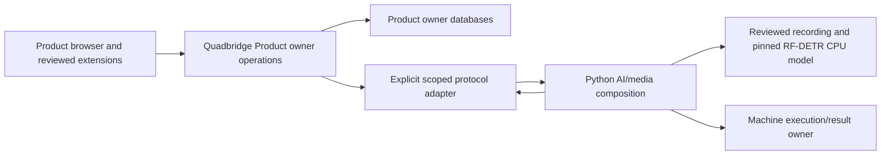

# Veyviz local video-review product

Build one usable end-to-end local product first: sign in, register an authorized recording, submit bounded analysis, run real RF-DETR CPU inference on three actual sampled frames, adopt a typed result durably, display it in a browser and retain it after a normal restart. A second selected product composition proves reuse and reviewed extension contributions. These are acceptance targets, not implemented or passed claims.

## Ownership and dependency direction

Quadbridge commit 3b666e9 supplies operation contracts, host/session/access/tenant boundaries, owner persistence/jobs, web workspaces and reviewed static UI contributions, exact composition/build/export and local recovery/upgrade mechanisms. Maintained hosts and packages remain upstream source authority.

Product-owned TypeScript modules own source inventory, analysis commands, result adoption and customer views. The root-owned solution adapter calls the Python plane through contracts/veyviz-product-ai/v1. Python owns decoded media/model execution and temporary machine facts. No direct owner-database access crosses that boundary. An authenticated service identity does not automatically confer a human user's authority; the contract must explicitly bind verified actor/product/instance/tenant/source scope and preserve the original command identity.

The new product supplies the Product/customer UI implementation intentionally external to the Veyviz AI architecture. Selected Veyviz source/wheel closures are reused with provenance. The legacy app, deployment files, secret stores, databases and virtual environments are excluded. Original source is preserved.

Desired, applied, observed, execution complete, machine accepted and Product accepted are separate. Input registration does not attest commissioning. Job acceptance is not completion. A detection is not a verified occupancy or absence fact. Python outage or missing model produces visible failure/unavailable state.

## Extensibility

Trusted build-selected module workspaces/actions consume the existing reviewed contribution contracts. Exact-version Python distributions extend AI behavior behind owned ports. Product definitions select the implementation closure; grants independently authorize actors. The local product does not promise arbitrary third-party sandboxing, hot installation or an OpenAI MCP integration. Prove a second product variant without editing maintained hosts.

## Construction order

1. Capture clean framework provenance and exact selected Veyviz source; freeze root-owned wire protocol and finite writer manifests.
2. Create product source/job/result modules and the Python service with separate ownership. Root integrates build/dependencies and reviewed startup/stop.
3. Exercise actual three-sample RF-DETR CPU inference through the real product flow. Retain model/input hashes and original command/result identities.
4. Exercise tenant denial, revocation, retries, restart, native cleanup and result adoption boundaries.
5. Build/run the second exact product variant and actual browser journey.
6. Run fresh build, required full suite, Python installed tests, clean construction/export and independent review against the frozen candidate.

Local acceptance excludes cloud deployment, physical live cameras, continuous live video, GPU performance, native mobile binaries/devices, external identity-provider qualification and production scale. Those remain explicit backlog/profile gates; broad user ambition is retained without claiming them complete.

## Selected integration profile

The frozen first protocol uses inherited anonymous pipes, shell-disabled launch and a fixed installed Python runner. It is not a public inference HTTP service. Sources select the admitted mivia-vid0062 fixture and rfdetr-small-cpu-v1 profile through opaque IDs. Exact recording/model bytes live in digest-bound private companion assets rather than being misrepresented as part of the small Quadbridge export. Read the root-owned contracts/veyviz-product-ai/v1/README.md for request/response bounds, source version, revocation/lease rechecks, cleanup and result-proposal behavior.

Modules: veyviz-sources, veyviz-analysis and veyviz-rfdetr. veyviz-review selects all three; veyviz-catalog selects sources alone. solutions/veyviz owns explicit binding translation. Root owns the separate runner/profile/inventory verification and launcher lifecycle.
