# Veyviz Platform Architecture Authority

**Revision:** 1.6  
**Date:** 27 September 2026  
**Status:** Target architecture authority for implementation; not a claim of deployed/qualified behavior.  
**Purpose:** Consolidate the approved architecture decisions for building Veyviz as one maintainable, extensible, product-composable CCTV/AI operational intelligence platform.

**Normative language:** `MUST` / `MUST NOT` are binding architecture constraints; `SHOULD` / `SHOULD NOT` are defaults that require a recorded reason to vary; `MAY` identifies permitted options. Where this document uses ordinary imperative wording without those keywords, treat it as binding when it appears under Non-negotiable Rules, ownership, security, authority, lifecycle, cutover, or contract sections.

---

## 1. What this document decides

This document defines the architecture to use when building and evolving Veyviz. It separates:

- product-line composition from runtime execution;
- business authority from AI execution;
- logical modules from deployed processes;
- customer configuration from installed software;
- desired configuration from what is actually running;
- observations/measurements from business situations and alerts;
- Product truth from read projections;
- live media from business APIs;
- connected edge, autonomous site, hybrid site and larger SaaS/on-prem deployment profiles.

Where existing Veyviz components already own valid behavior, they are to be reused and incrementally brought under these boundaries rather than replaced merely to match this target structure.

### 1.1 Authority of this specification

This document is the top-level **target architecture authority** for Veyviz. Where an older target-architecture document conflicts with this specification, this specification takes precedence. Older documents remain valid only as implementation evidence, historical rationale, source-specific detail, or explicitly referenced subordinate specifications.

An exception to a `MUST` / `MUST NOT` in this document requires a short Architecture Decision Record containing:

- the exact rule being varied;
- scope and affected product/deployment profile;
- reason and trade-off;
- owner;
- security/reliability implications;
- review or expiry condition.

### 1.2 Migration principle

Architecture ownership is migrated through controlled cutover, not duplicate authority:

```text
Current authoritative owner
        ↓
freeze/fence new writes
        ↓
transfer authoritative generation / ownership
        ↓
new owner accepts authority
        ↓
old owner becomes read-only / retired
```

Shadow paths MAY compare outputs, but MUST NOT emit customer-authoritative effects before cutover.

---


### 1.3 Current implementation binding / status convention

This architecture remains the **target authority**. Current repository implementation is recorded only to prevent engineers from rebuilding paths that already exist or treating draft code as a second authority.

Status words used in this revision:

```text
TARGET
    normative architecture decision

IMPLEMENTED-BRANCH
    source exists on the current implementation branch,
    but this label alone does not prove release acceptance

QUALIFIED
    focused tests/builds/acceptance evidence have proven the
    selected implementation profile

DEPLOYED
    installed in the explicitly approved Veyviz environment
```

An `IMPLEMENTED-BRANCH` item does not automatically become `QUALIFIED`, `USABLE`, or `DEPLOYED`.

Current implementation checkpoint at the time of this revision:

```text
Product repository:
  accumenbridge/veyviz-mobile-app-v1

Base branch:
  integration/mtp

Working branch:
  codex/extension-spatial-e0-sp1-20260927

Draft PR:
  #8 — extension registry + spatial projection v1 foundation

Latest branch SHA verified while preparing this revision:
  1d5f7f97a9edf446a5bb638190293dda7022e3e1
```

No architectural rule in this document depends on that SHA remaining current. Implementation work MUST refresh the branch/PR before acting.


# 2. Single master system map

```mermaid
flowchart TB

  subgraph RELEASE[Vendor product-line / extension / release environment]
    CAPCAT[CapabilityPack Catalog\n+ Extension Descriptors]
    PROD[Product / Edition Definitions]
    TPROF[Tenant / Deployment Profiles]
    EXTRES[Extension + Dependency Resolver]
    EXTREG[Resolved Extension Registry]
    AICAT[AI Component / Recipe / Qualification Catalog]
    LOCK[Resolved Release Lock]
    FACT[Release Builder / Variant Tests / SBOM / Signing]

    CAPCAT --> EXTRES
    PROD --> EXTRES
    TPROF --> EXTRES
    AICAT --> EXTRES
    EXTRES --> EXTREG
    EXTREG --> LOCK
    LOCK --> FACT
  end

  subgraph EXPERIENCE[Customer Experience / Maintained Frontend]
    SHELL[Web / PWA App Shell\nAuth / tenant-site / routing / navigation]
    EXTHOST[Extension Registry Provider\nWorkspace Host / Extension SDK]
    STDUI[Built-in Workspaces]
    LARGE[Large Workspace Plugins\nDigital Twin / Command Center / Future]
    SMALL[Widgets / Panels / Canvas Layers / Setup Tools]

    SHELL --> EXTHOST
    EXTHOST --> STDUI
    EXTHOST --> LARGE
    EXTHOST --> SMALL
  end

  subgraph PRODUCT[Veyviz Product - Business Authority]
    API[Human + Machine APIs]
    FOUND[Shared Platform Foundation\nIdentity / tenancy / permissions / entitlements / audit]
    TOPO[Topology / Cameras / Drawing / Spatial]
    SETUP[Camera AI Setup / Runtime Plan]
    RULES[Rules / Policy]
    OBS[Accepted Observations / Facts]
    MEAS[Measurements]
    SIT[Situations / Episodes]
    ALERTS[Alerts / Incidents]
    WORK[Operational Work]
    EVID[Evidence Owner / Manifest]
    DOMAIN[Visitors / Contractors / Vehicles / Pool / Other Apps]
    INV[Investigation]
    AN[Analytics / Reports / Forecasting]
    BG[Background Workers\nOutbox / timers / delivery / projections]
    WSG[Permission-filtered Realtime Gateway]

    API --> FOUND
    API --> TOPO
    API --> SETUP
    API --> RULES
    API --> ALERTS
    API --> WORK
    API --> INV
    API --> AN

    TOPO --> SETUP
    TOPO --> RULES
    OBS --> MEAS
    OBS --> RULES
    MEAS --> RULES
    RULES --> SIT
    SIT --> ALERTS
    ALERTS --> WORK
    ALERTS --> EVID
    DOMAIN --> ALERTS
    ALERTS --> AN
    MEAS --> AN
    EVID --> INV
    OBS --> INV
    BG --> ALERTS
    BG --> WORK
    BG --> AN
  end

  subgraph DATA[Product Data / Projection Stores]
    MONGO[MongoDB Owner Stores]
    PG[Forensics PostgreSQL\nDerived search / retained derived catalogue]
    OBJ[Object / Media Storage]
    REDIS[Redis\nTransient internal fanout/cache]
  end

  subgraph SITE[Customer Site Control Plane]
    INST[Installation Control\nBinding / release verification / update / recovery]
    SUP[Site Supervisor\nWorker lifecycle / generations / resource admission]
    SITEPUB[AI Site Agent / Publisher\nPlan client / source binding / journal / publication]
    ADMIT[Resource Admission\nCPU / iGPU / NPU / GPU / decoder]
    JOURNAL[Bounded Local Journal / Retry State]

    INST --> SUP
    SUP --> ADMIT
    SUP --> SITEPUB
    SITEPUB --> JOURNAL
  end

  subgraph AI[Video / AI Runtime]
    MEDIA[Source Session / Decode / Buffers]
    PER[Perception Providers]
    TRACK[Tracking / Association when required]
    SPAT[Spatial Operators when required]
    TEMP[Temporal Operators when required]
    CAP[Capability DAG / Recipe]
    PUB[Typed Semantic Output]
    HFP[High-frequency Spatial Projection\nAuthorized / Ephemeral / Bounded]
    ECAP[Evidence Capture]

    MEDIA --> PER
    PER --> CAP
    TRACK --> CAP
    SPAT --> CAP
    TEMP --> CAP
    CAP --> PUB
    CAP --> HFP
    CAP --> ECAP
  end

  CAM[Cameras / NVR / VMS]
  MEDIA_GATE[MediaMTX / WHEP-WebRTC]
  EXT[Customer Enterprise / OT Systems\nPMS / Access / BMS / CMMS / ERP / Rosters]
  NATIVE[Native Safety / Protection / Control Systems]

  FACT -->|signed release / extension closure| INST
  EXTREG -->|frontend registry / packaged extensions| EXTHOST

  EXPERIENCE -->|HTTPS commands / queries| API
  PRODUCT --> MONGO
  PRODUCT --> PG
  EVID --> OBJ
  PRODUCT --> REDIS
  REDIS --> WSG
  WSG -->|durable projection snapshot/deltas| EXTHOST

  SETUP -->|Desired Runtime Plan| SITEPUB
  SITEPUB -->|Apply / Drift / Observed Health Receipt| SETUP
  SITEPUB --> SUP
  SUP -->|local lifecycle / assignment| AI

  CAM --> MEDIA
  PUB --> SITEPUB
  SITEPUB -->|Observations / Measurements / Findings / Reviews| API

  HFP -->|spatial.projection.v1| EXTHOST

  ECAP -->|Evidence manifest / reservation request| EVID
  EVID -->|scoped short-lived upload authorization| ECAP
  ECAP -->|authorized evidence bytes| OBJ

  CAM --> MEDIA_GATE
  API -->|short-lived authorized media session| MEDIA_GATE
  MEDIA_GATE --> EXTHOST

  EXT -->|owned APIs / events / records| API
  API -->|authorized integrations / effects| EXT
  NATIVE -->|approved observations / status only by default| API
```



### Interpretation

- The **Product** owns customer/business meaning and durable operational truth.
- The **AI runtime** owns source sessions, decode, inference, tracking and source-local temporal state.
- **Installation Control** owns installed-release trust/binding and update/recovery authority.
- The **Site Supervisor** owns worker lifecycle, generations/fencing and physical resource admission.
- The **AI Site Agent / Publisher** binds Product plans to the selected local runtime and publishes source-bound semantic results; it does not own customer business decisions.
- The **Release environment** composes and signs products but is not part of normal live operation.
- The **frontend** consumes Product truth; it does not become another source of truth.
- The **media plane** is separate from Product business APIs.
- **Customer enterprise/OT systems retain authority over their own records.** Veyviz consumes or acts through explicit governed integration contracts.
- **Native safety/protection/control systems remain authoritative for plant/device protection and control** unless a separately designed and qualified control integration explicitly says otherwise.
- The **existing Product CapabilityPack composition lineage remains the Product feature/plugin authority**; the Extension Registry is derived from it and is not a second catalog.
- **ServicePacks remain deployment projections**, not plugin identities.
- **Camera-scoped AI FeatureGrant keys remain operational AI grants**, not Product Feature Plugin IDs.
- The **Extension SDK is a stable host API**, not permission to import frontend internals.
- Durable Product realtime and **high-frequency spatial rendering projections are separate paths**; the latter is authorized/ephemeral and never a second business database.
- Initial plugins are **release-composed and statically packaged**; future signed installable bundles still pass through release/update compatibility and qualification.

---

# 3. Locked architecture pattern stack

## 3.1 Software Product Line Engineering

Use one maintained platform family. Customer and industry editions are assembled through explicit product/capability composition, not permanent customer branches or copied cores.

## 3.2 Controlled Capability / Plugin Architecture

Veyviz MUST be extensible through **versioned Extension Packages** resolved by the product-line/release system.

A customer-visible Feature Plugin MAY contribute, as one resolved extension unit:

- frontend routes/workspaces/widgets/canvas layers;
- backend application behavior;
- AI recipes/providers/model requirements;
- permissions;
- configuration schemas and setup UI;
- migrations/data declarations;
- localization/help assets;
- observability;
- deployment/resource constraints;
- qualification and tests.

The package is a **logical versioned bundle**: its frontend, backend, AI and model artifacts MAY live in different repositories/images, but one manifest/release lock binds the exact compatible set.

Initial Veyviz uses controlled first-party/reviewed extension packages selected at release assembly. It is **not** arbitrary customer JavaScript/Python/container/model execution inside Product. Future signed installable extension bundles are allowed only through the verified release/update architecture defined in §18.7; an unrestricted third-party plugin marketplace requires a separate security/isolation architecture.

## 3.3 Domain-oriented Modular Product Architecture

Default Product architecture is **logically modular** with explicit module ownership, not a network service per noun.

This is **not** an instruction to physically merge currently separate, functioning Veyviz Product services merely to match this document. Existing deployed service boundaries MAY remain while their logical ownership, contracts and data authority are brought under this architecture.

## 3.4 Vertical Slices inside Domain Owners

Use-case code such as Acknowledge Alert, Assign Work, Resolve Work or Publish Geometry is organized as vertical application slices inside its owning module.

## 3.5 Ports & Adapters

Use ports where isolation or replacement genuinely matters: persistence, source adapters, model runtimes, media, identity, external integrations and storage.

Do not create interfaces around trivial pure functions.

## 3.6 Selective Event-Driven Architecture

Use durable asynchronous delivery for side effects, background work, integrations, projections and long-running jobs. Ordinary CRUD, permissions and direct business commands remain synchronous.

## 3.7 Streaming / Dataflow for AI

CCTV runtime follows source → decode → perception → tracking → spatial/temporal processing → capability output. Raw frames stay in the media/AI plane.

## 3.8 Desired-State Reconciliation

Product says what should run; Site Agent reports what is actually applied and healthy.

## 3.9 Selective CQRS-style Read Projections

Live Operations, Analytics and Search may use optimized projections. They remain rebuildable/read-oriented and do not compete with authoritative owners.

## 3.10 Selective Microservices / Cells Later

Extract modules only for demonstrated scale, failure isolation, security, hardware/runtime, deployment or release/team needs.

---

# 4. Non-negotiable platform rules

1. Customer editions come from composition, not forks.
2. Capability is not a microservice.
3. Domain module is not a deployed process.
4. Every mutable business record/state transition has one authoritative owner.
5. Vertical slices organize behavior inside the owner.
6. Infrastructure is behind ports only where isolation/replacement matters.
7. Synchronous operations remain synchronous unless async brings real value.
8. Durable async side effects begin only after authoritative state commits.
9. Raw video stays in the media/AI runtime.
10. Product receives semantic AI outputs, not frame streams.
11. Edge configuration uses desired-vs-applied reconciliation.
12. Live, Analytics and Search are projections, not competing truth.
13. Microservices are introduced only for demonstrated operational reasons.
14. UI never owns durable Product truth.
15. Future non-CCTV products may reuse the shared foundation but do not inherit CCTV-specific domain concepts.
16. Event-time provenance and source continuity are mandatory for time-dependent AI/business semantics.
17. Corrections/retractions append new records; they do not rewrite immutable accepted observations/findings or human-response history.
18. Exactly one Product authority mode is active for a site at a time.
19. Native safety/protection/control systems are not replaced by Veyviz inference unless separately designed and qualified for control authority.
20. Existing functioning owners are adopted/bridged before any replacement owner is created.
21. Customer-visible Feature Plugin identity is rooted in the existing Product capability composition; do not create a second Product plugin catalog.
22. Extension Registry is a derived composition artifact, never an independent entitlement/authorization authority.
23. Plugin permission requirements do not create permissions; existing Product/IAM permission authority grants access.
24. Plugin-specific data belongs in plugin-owned extension records referencing core IDs unless the concept is deliberately promoted into the core domain.
25. Durable Product realtime and high-frequency render projections remain separate; renderer state never becomes durable Product truth.
26. Initial frontend plugins are release-composed/static imports with lazy loading; arbitrary remote JavaScript is not part of Level 1.
27. Shared AI work is reused only when source, preprocessing, task, cadence, quality, privacy and resource requirements are compatible.
28. Disable/deactivate is preferred over destructive uninstall when retained history/evidence/dependencies exist.
29. Packaged extension code MUST NOT execute tenant/site work unless the current Extension Activation Fence authorizes that exact extension/scope/revision.
30. Persistent extension upgrades/rollback MUST declare schema reader/writer compatibility; reinstalling old code is not a valid rollback plan by itself.
31. Release activation is checkpointed and generation-fenced; a release becomes `ACTIVE` only after its required health/compatibility gates pass.
32. Central/local Product synchronization MUST NOT merge two concurrent authoritative writers; authority transfer is explicit and generation-fenced.
33. Destructive plugin removal is prohibited unless retained-history/evidence interpretation has an approved reader/archive/migration/retention strategy.
34. Extension-point cardinality and ordering are owned by the host/Product Definition, not by arbitrary plugin priority values.
35. AI extension workloads MUST declare machine-readable resource demand/degradation requirements and pass the common Site Supervisor admission authority.
36. Shared inference is permitted only through an explicit compatibility key/decision; model-name equality alone is insufficient.

---

# 5. Major subsystem boundaries

## 5.1 Product-Line & Release

Owns:

- capability catalog;
- edition/product definitions;
- deployment profiles;
- dependency resolution;
- compatibility/qualification references;
- resolved release locks;
- release assembly and signing;
- customer distribution references.

Does not own live alerts, camera frames, incidents or operational state.

## 5.2 Shared Platform Foundation

Keep deliberately small and product-neutral:

- identity/access context;
- tenancy/resource scope;
- permissions;
- entitlements/capability grants;
- audit conventions;
- configuration/revision primitives;
- common durable-job lifecycle primitives;
- integration conventions;
- observability context;
- release/install metadata conventions;
- extension manifest/registry/SDK conventions.

Do not put Camera, Zone, Incident, Visitor, Document, Chunk or other product-domain concepts here.

## 5.3 Veyviz CCTV Product

Authoritative business modules include:

- Topology;
- Cameras;
- Drawing / Spatial;
- Camera AI Setup;
- Rules;
- Measurements;
- Situations;
- Alerts / Incidents;
- Operational Work;
- Evidence;
- Visitors / Guests;
- Contractors;
- Vehicles;
- Pool Safety and other selected applications;
- Investigation;
- Analytics;
- Reports;
- Forecasting.

## 5.4 AI Runtime

Owns:

- source/session lifecycle;
- decode/frame buffering;
- perception;
- tracking;
- spatial processing;
- temporal processing;
- AI capability execution;
- local scheduler/resource use;
- evidence capture;
- typed semantic publication;
- runtime health.

Does not own incident/workflow authority.

## 5.5 Site Control Plane

Site Control is one **logical control plane**, but it contains three distinct privilege/ownership roles. They MAY be co-located in one executable on a small appliance.

### Installation Control

Owns:

- installation identity/binding;
- installed release verification;
- trust bootstrap and local release admission;
- update/rollback/recovery coordination;
- ownership transfer/recovery generation where required.

### Site Supervisor

Owns:

- worker/process lifecycle;
- worker generations/fencing;
- hardware/resource discovery;
- one admission authority per constrained physical resource pool;
- runtime assignment and process-level observed health.

### AI Site Agent / Publisher

Owns:

- fetching/receiving the Product desired Runtime Plan;
- binding selected Product work to commissioned sources/local runtime assignments;
- bounded local result/retry journal;
- source-bound semantic publication;
- apply/drift/observed-health receipts back to Product.

None of these roles owns customer incident/workflow authority.

## 5.6 Client / Experience

Owns presentation and user intent only:

- shell/navigation;
- feature modules;
- query/cache;
- realtime client;
- media client;
- 2D twin/canvas;
- extension registry / workspace host;
- typed Extension SDK adapters;
- local UI state.

## 5.7 Customer enterprise / OT systems and native controls

External systems such as PMS, access control, BMS, CMMS, ERP, rosters, permits and customer ticketing systems remain authoritative for the records they own. Veyviz integrates through explicit ports/contracts and records external acceptance/receipts separately from Veyviz business state.

Native safety/protection/control systems remain authoritative for equipment protection and physical control. Veyviz may observe, advise, request or integrate only within an explicitly approved contract. A CCTV/VLM/AI conclusion MUST NOT silently become plant/device control authority.

---

# 6. Primary semantic flow

```text
Video / approved source
        ↓
Perception
        ↓
Observation / Measurement / Finding
        ↓
Product acceptance and provenance validation
        ↓
Rule / policy evaluation
        ↓
Situation
        ↓
Alert / Incident when attention/case management is required
        ↓
Work Item
        ↓
Assignment / Acceptance / Attendance / Action
        ↓
Verification
        ↓
Resolution
        ↓
Analytics / Reports / Investigation
```

### Meaning of key records

- **Observation:** semantic fact claimed by AI/source.
- **Measurement:** measured numeric/state value such as occupancy.
- **Finding:** higher-level AI conclusion/candidate with provenance/evidence.
- **Situation:** Product interpretation in customer context.
- **Alert:** attention-worthy customer record.
- **Incident:** longer-lived operational case grouping related activity.
- **Work Item:** explicit action obligation assigned to a person/team/system.

AI detection must not automatically equal Alert.

## 6.1 Temporal semantics and source continuity

Time is a first-class architecture concern. Every time-dependent semantic output MUST preserve the fields required to distinguish when something happened, when it was processed and whether source continuity is trustworthy.

Canonical concepts:

- **Observed / capture time (`observed_at`)** — when the source evidence says the event/measurement occurred.
- **Source epoch/session** — continuity boundary for one admitted source session. Reconnect/replacement normally creates a new epoch unless a qualified state-transfer mechanism exists.
- **Source sequence** — source-local ordering where available; sequence alone is not a global clock.
- **Emitted time (`emitted_at`)** — when the producer created the semantic result.
- **Received time (`received_at`)** — when the receiving boundary obtained the message.
- **Accepted time (`accepted_at`)** — when the authoritative owner durably committed it.
- **Business timezone** — Topology-owned policy used for schedules, business-day/report boundaries and display. It does not replace UTC event timestamps.
- **Clock quality** — trusted / uncertain / discontinuity (or an equivalent typed state). Clock uncertainty MUST be visible to consumers whose semantics depend on time.
- **Gap / missingness** — source loss or unassessable intervals are explicit gaps, not zeros and not continuous support.
- **Late / out-of-order event policy** — each owner/capability that accepts late data MUST declare whether it updates history only, recomputes projections, or may still produce current business effects.

Temporal operators such as dwell, sequence, queue duration, presence and journey continuity MUST reset, censor or explicitly migrate state across source gaps/epoch changes according to their capability contract.

---

# 7. Authoritative data ownership

| Record / Concept | Authoritative owner |
|---|---|
| Organization / Tenant | Platform/Tenant owner |
| Entitlement / Capability grant | Platform/Operator owner |
| Site / Floor / Area / Camera placement / Site time | Topology |
| Camera identity/source registration | Cameras / Topology according to existing Product boundary |
| Geometry / Boundary / Calibration | Drawing / Spatial |
| Camera AI Setup | Camera AI Setup |
| Rule / Policy | Rules |
| Runtime Plan | Product AI configuration/deployment owner |
| Applied Plan local state | Site Supervisor / AI Site Agent locally; Product records accepted receipt |
| Accepted Observation / semantic fact | accepting Product fact/observation owner |
| Measurement | Measurements |
| Accepted Finding | accepting Product finding owner |
| Live Track / source-local temporal track | AI Runtime |
| Retained Track Segment / searchable track projection | Forensics / Investigation projection |
| Situation | Situation/Evaluation owner |
| Alert | Alerts |
| Incident | Incident owner |
| Work Item | Operational Work |
| Evidence metadata/lifecycle | Evidence |
| Evidence bytes | Object/media storage through Evidence owner |
| AI Job / Result | AI Job owner |
| Visitor / Contractor / Vehicle journey | respective domain owner |
| Search request / association hypothesis | Investigation |
| Analytics projection | Analytics, rebuildable |
| Report artifact | Reports |
| Forecast | Forecasting; never current fact |
| Correction / Retraction | same owner as the corrected record; immutable relation to original |

### Cross-owner rule

A module may use another owner's public query/command/event contract. It must not directly mutate another owner's persistence.

### 7.1 Logical owner does not imply service extraction

`Situation`, `Incident`, `Work Item`, `Evidence` and `AI Job` are semantic ownership boundaries. They do not require one network service each.

Initial implementation MAY map them to existing Veyviz owners where that preserves one-writer authority, for example:

- Situation may be represented by an existing rule/source episode owner;
- Incident may initially remain inside the existing Alerts owner;
- Work Item may initially remain inside the existing staff-workflow owner;
- Evidence metadata may remain with the current evidence owner while bytes remain in object/media storage.

Extraction happens only through a controlled authority transfer when there is a demonstrated operational reason.

### 7.2 Immutable correction / retraction rule

Accepted observations, measurements, findings and staff actions MUST NOT be rewritten in place to make history appear as though the original never existed.

A correction/retraction:

```text
Original immutable record
        ↑
Correction / Retraction record
        ↓
affected projections recompute where policy permits
```

Human acknowledgement, attendance, delivery attempts, evidence already retained and other independently true history remain preserved.

### 7.3 Authority cutover protocol

When ownership moves from one implementation to another:

1. establish exact source/target scope and compatibility;
2. freeze/fence new authoritative writes in the old owner;
3. transfer durable state and current generation/ownership marker;
4. activate the new owner;
5. prove old writer cannot emit authoritative effects;
6. only then retire/remove the old path.

Shadow execution MAY compare results but MUST remain non-authoritative.

### 7.4 Product authority handover and reconciliation

`CENTRAL_PRODUCT` and `LOCAL_PRODUCT` are authority modes, not replication preferences.

For an autonomous/local-first site, `LOCAL_PRODUCT` SHOULD normally remain authoritative during WAN loss; central systems receive approved replicas/projections when connectivity exists. Reconnection is then **catch-up synchronization**, not a database merge and not an authority switch.

A site operating as `CENTRAL_PRODUCT` MUST NOT automatically promote itself to full local Product authority merely because WAN connectivity is lost. Only the bounded offline behaviors explicitly delegated to Site Control may continue unless a pre-approved authority-transfer protocol completes.

Every authority transfer carries a monotonic **Product Authority Generation** and an exact scope.

Required transfer sequence:

```text
request authority transfer
→ verify target trust / release / schema / time compatibility
→ freeze/fence old authoritative writes for the transfer scope
→ record old-owner cutover cursor / generation
→ bring target durable state to that exact cutover point
→ issue next authority generation
→ target accepts authority and records acceptance receipt
→ old owner rejects authoritative writes for the new generation
→ resume projection/synchronization
```

Reconciliation after local operation MUST preserve:

- stable command/event identities;
- accepted record versions;
- evidence relationships;
- external delivery/effect receipts;
- source/event-time provenance;
- correction/retraction history;
- time-untrusted markers where applicable.

If a local authoritative operation has already produced an external effect, central replay records/reconciles that effect; it MUST NOT blindly execute it again.

No conflict algorithm may legitimize simultaneous authoritative writes. If both sides contain writes that claim the same authority generation when they should not, the scope enters explicit **AUTHORITY_CONFLICT / recovery-required** state rather than guessing a winner.

---

# 8. Cross-subsystem contracts

## 8.1 UI ↔ Product

Use HTTPS commands/queries plus permission-filtered realtime projections.

Commands express intent, for example:

- AcknowledgeAlert;
- AssignWork;
- MarkAttended;
- VerifyOutcome;
- PublishGeometry;
- MakeAISetupDesired.

Avoid generic status patches.

## 8.2 Product ↔ Site Control

Primary records:

- Runtime Plan;
- Apply Receipt;
- Drift / observed runtime status;
- capability assessability inputs.

The AI Site Agent / Supervisor reports stages such as received, validated, prepared, activated, healthy or rejected rather than `success=true`.

**Health authority is layered:**

- AI Runtime produces raw source/process/inference diagnostics.
- Site Supervisor owns the observed installation/pipeline health view used for local control.
- Product records the accepted health/apply projection and derives customer-facing readiness/`USABLE` state from authoritative configuration, qualification, apply and freshness inputs.
- A raw AI health message MUST NOT independently set Product `USABLE` state.

## 8.3 Site Supervisor / AI Site Agent ↔ AI Runtime

Local/private control contract:

- PreparePipeline;
- ActivatePipeline;
- Stop/RestartPipeline;
- StartSpecialistJob;
- CancelAttempt;
- GetPipelineStatus;
- GetResourceUsage.

## 8.4 AI Runtime / Site Publisher → Product

Use separate typed semantic contract families:

- Observation / Fact where required;
- Measurement;
- Finding;
- Review Result.

Raw runtime health is first consumed by the local Site Supervisor; Product receives accepted observed-health/readiness projections through the Site Control boundary.

Every durable semantic output includes stable event identity, source/session information, event time, relevant model/pipeline/configuration revisions, quality and evidence references.

### Machine-ingestion identity / idempotency

Authorization scope is derived from authenticated machine/installation binding, never from a caller-supplied tenant field.

A durable machine result MUST have a stable identity composed from the authenticated producer context and contract semantics, including at minimum:

```text
publisher / installation binding
producer generation
contract family + contract version
source event/result identity
```

The receiver also computes a canonical payload digest.

Rules:

```text
same stable identity + same digest
    → exact retry; return/reconcile the original receipt

same stable identity + different digest
    → immutable conflict / quarantine

old producer generation
    → no new current effect
```

Transport retries preserve the same identity; they do not create a new business event.

## 8.5 Product Module ↔ Product Module

Only three interaction styles:

- Query another owner for information needed now;
- Command another owner to attempt a state change;
- Publish/consume an event after something has already happened.

## 8.6 Release → Installation

Release changes software/models/native assets/UI/migrations. Runtime configuration changes cameras/zones/schedules/thresholds/recipients/rules inside an approved envelope.

## 8.7 Extension composition / SDK boundary

The Product-line system resolves extensions before release/runtime activation:

```text
CapabilityPack selection
→ optional extension descriptor
→ extension/dependency resolution
→ Resolved Extension Registry
→ release feature_set / Release Lock
→ packaged Product
→ tenant/site capability projection
→ shell ExtensionRegistryProvider / WorkspaceHost
```

The Resolved Extension Registry is derived from the same selected Product capability authority that drives entitlements/deployment. It MUST NOT be hand-maintained as a separate source of truth.

Frontend extension code receives only versioned Extension SDK host capabilities. Product/backend extensions use public owner contracts. AI extensions reference qualified AI capability/provider/recipe identities.

---

## 8.8 Runtime Extension Registry Projection

Build/release composition and runtime activation use the same Product vocabulary but remain separate concerns.

Build/release derivation:

```text
TenantDeploymentProfile
+ CAPABILITY_PACK_CATALOG
+ SERVICE_PACK_CATALOG
        ↓
pure Extension Resolver
        ↓
extension-registry.v1.json
```

Runtime tenant projection:

```text
current Tenancy entitlement state
        ↓
enabled CapabilityPack IDs
        ↓
same Product Extension Resolver
        ↓
veyviz.runtime-extension-registry.v1
        ↓
Web shell / Product activation checks
```

The runtime projection MUST:

- use Tenancy as current entitlement authority;
- use the same Product CapabilityPack/Extension metadata as release composition;
- refuse inconsistent entitlement revisions observed during one resolution;
- produce a deterministic `extensionRegistryRevision`;
- fail closed when entitlement state is unresolved/unavailable;
- never become another writable plugin catalog.

The runtime registry projection is **what the currently authenticated tenant may compose now**. It does not by itself prove:

```text
specific user permission
site/floor/camera scope
AI qualification
desired/applied runtime state
hardware admission
```

Those checks remain owned by the corresponding Product/IAM/Site/AI authorities.

For browser consumption the current Product binding exposes a read-only projection:

```text
GET /api/extensions/registry
→ veyviz.runtime-extension-registry.v1
```

The browser never supplies its own resolved extension registry.


# 9. Lifecycle architecture

## 9.0 Canonical capability/readiness vocabulary

These states are distinct and MUST use the same meanings across Product APIs, UI, release tooling and operational reporting:

- **PACKAGED** — software/artifact is included in the resolved release.
- **INSTALLED** — required artifact exists at the installation.
- **ENTITLED** — customer is currently permitted to use the capability.
- **CONFIGURED** — a valid Product configuration exists.
- **QUALIFIED** — the selected capability/provider/runtime/hardware profile has required acceptance evidence.
- **DESIRED** — Product wants an exact runtime/config revision active.
- **APPLIED** — Site Control reports that exact desired revision is active.
- **HEALTHY** — required runtime/source/process health conditions are satisfied.
- **ASSESSABLE** — sufficiently fresh/valid observations can currently be produced for the declared purpose.
- **USABLE** — customer-facing projection requiring, at minimum, ENTITLED + CONFIGURED + QUALIFIED + APPLIED + ASSESSABLE, plus any capability-specific prerequisites.

`HEALTHY`, `ASSESSABLE` and `USABLE` are related but not synonyms.

## 9.1 Camera AI Setup / Runtime Plan

Desired configuration lifecycle:

```text
DRAFT → VALIDATED → APPROVED → DESIRED → SUPERSEDED
```

Per-target apply lifecycle:

```text
PENDING → DELIVERING → APPLYING → APPLIED
```

Exception states:

```text
REJECTED / DRIFTED / STALE / SUPERSEDED
```

A rejected new setup leaves the previous known-working setup running.

`APPLIED` and `HEALTHY` are separate facts.

## 9.2 Situation

```text
ACTIVE → ENDED
ACTIVE → INVALIDATED   (when justified by correction/retraction)
```

## 9.3 Alert

```text
OPEN → ACKNOWLEDGED → CLOSED
OPEN → SUPPRESSED     (policy-controlled only)
```

## 9.4 Incident

```text
OPEN → INVESTIGATING → RESOLUTION_PENDING → RESOLVED
RESOLVED → REOPENED → INVESTIGATING
```

## 9.5 Work Item

```text
REQUESTED
  → ASSIGNED
  → ACCEPTED
  → ATTENDED
  → ACTION_REPORTED
  → VERIFICATION_PENDING
  → RESOLVED
```

Optional terminal outcomes: CANCELLED / EXPIRED.

Escalation is a separate durable obligation, not a replacement state.

## 9.6 Delivery Attempt

```text
QUEUED → ATTEMPTING → PROVIDER_ACCEPTED → DELIVERED
               ├→ FAILED_RETRYABLE → QUEUED
               ├→ FAILED_FINAL
               └→ UNKNOWN
```

Delivery is not acceptance/attendance/resolution.

## 9.7 AI Job

```text
REQUESTED → QUEUED → RUNNING
                     ├→ SUCCEEDED
                     ├→ FAILED
                     ├→ EXPIRED
                     └→ CANCEL_REQUESTED → CANCELLED
```

Each execution attempt carries attempt identity, worker identity, lease/fence and heartbeat state.

## 9.8 Evidence

Acquisition:

```text
REQUESTED → LOCATED → ACQUIRING → VERIFIED → AVAILABLE
```

Alternatives: UNAVAILABLE / PARTIAL / FAILED.

Retention/access is separate: ACTIVE / HELD / EXPIRED / REVOKED / DELETED according to policy.

## 9.9 Runtime Health

```text
STARTING → WARMING → HEALTHY ↔ DEGRADED → STALE → OFFLINE
STOPPING → STOPPED
```

## 9.10 Release / Installation

Artifact lifecycle:

```text
CANDIDATE → QUALIFIED → APPROVED → SIGNED → RELEASED → SUPERSEDED/REVOKED
```

Installation activation:

```text
AVAILABLE → IMPORTED → VERIFIED → PREFLIGHT_PASSED → STAGED
→ PREPARED → ACTIVATING → HEALTH_VERIFYING → ACTIVE
```

Rollback is a compatibility/recovery operation, not merely another state.

## 9.11 Extension execution / activation fence

`PACKAGED` or `INSTALLED` does not authorize execution.

For each tenant/site scope, Product maintains or derives an **Extension Activation Projection** bound to:

```text
extension_id
extension_version
resolved extension-registry revision
tenant/site scope
entitlement/capability state
required permission/purpose
configuration revision
qualification profile
desired/applied/readiness state where applicable
```

Any extension-owned execution entry point MUST check an activation fence before starting new work.

This includes, as applicable:

- Product API commands;
- Product queries that expose plugin-only data;
- background/scheduled jobs;
- durable timers;
- realtime subscriptions;
- projection workers;
- integration dispatchers;
- Runtime Plan contribution;
- AI job/capability activation.

Frontend menu/route hiding is only a presentation projection and never substitutes for this fence.

A packaged-but-not-entitled extension:

```text
may exist in the process/bundle
but
MUST NOT start tenant work
MUST NOT contribute new Runtime Plan work
MUST NOT expose unauthorized data
```

Revocation/disable stops **new** work immediately after the accepted revision becomes current. In-flight work follows its owner's explicit cancellation/commit semantics; the system must not invent a half-committed state.

The activation check MAY be implemented in-process as a shared policy/library/projection. This rule does not require a separate network service.

## 9.12 Extension schema migration / rollback lifecycle

A persistent Extension Package MUST declare a schema compatibility envelope.

At minimum:

```text
extension version
schema generation
readable schema generations/range
writable schema generation/range
ordered migration IDs
migration owner
rollback-compatible-through generation
destructive-contract earliest eligible release
```

Migration follows:

```text
PRECHECK
→ EXPAND
→ MIGRATE
→ VERIFY
→ ACTIVATE NEW WRITER
→ OBSERVE ROLLBACK WINDOW
→ CONTRACT when old reader/writer support is no longer required
```

Rules:

- only one migration owner writes a given schema/store generation;
- migrations are idempotent or durably checkpointed;
- rollback is allowed only when the target old version can read the current durable schema/data;
- destructive contraction MUST NOT occur inside the declared rollback window;
- a migration completion marker does not by itself make the new Product release `ACTIVE`;
- schema compatibility is checked again during release activation/recovery.

If rollback compatibility has been lost, recovery must roll forward or use an explicitly approved data restore path; it must not start incompatible old code.

---

# 10. API architecture

## 10.1 Human API

Use explicit Product APIs for commands and queries. Examples:

```text
GET  /api/v1/sites
GET  /api/v1/cameras
GET  /api/v1/alerts
GET  /api/v1/incidents/{id}
GET  /api/v1/work-items

POST /api/v1/alerts/{id}/acknowledge
POST /api/v1/work-items/{id}/accept
POST /api/v1/work-items/{id}/attend
POST /api/v1/work-items/{id}/report-action
POST /api/v1/work-items/{id}/verify
```

State-changing commands use idempotency/command identity and expected record version where needed.

## 10.2 Machine API

Separate machine boundary, conceptually:

```text
GET  /machine/v1/installations/{id}/runtime-plan
POST /machine/v1/runtime-plan-receipts
POST /machine/v1/measurements
POST /machine/v1/findings
POST /machine/v1/reviews
POST /machine/v1/health
```

Machine identity never relies on human login.

## 10.3 Realtime

Pattern:

```text
GET durable snapshot → cursor
connect WebSocket(cursor)
receive versioned deltas
replay when possible; otherwise refresh snapshot
```

WebSocket/Redis never become durable truth.

## 10.4 Media

Browser requests a short-lived authorized media session from Product. Media bytes flow through the approved media plane (e.g. MediaMTX/WHEP-WebRTC), not through business REST or WebSocket messages.

## 10.5 Extension SDK host clients

Frontend plugins do not receive arbitrary internal clients. The Extension SDK exposes small, versioned host capabilities such as:

```text
product.commands.v1
product.queries.v1
realtime.projections.v1
media.sessions.v1
topology.read.v1
evidence.read.v1
navigation.v1
localization.v1
design.tokens.v1
telemetry.client.v1
spatial.projection.v1
```

The normal extension API MUST NOT expose raw database clients, Redis, raw auth tokens, camera credentials, private Zustand stores, arbitrary internal-service RPC or unrestricted fetch-to-anywhere helpers.

Where practical, Product query/command clients use generated contract keys/types rather than arbitrary endpoint strings.

---

# 11. Persistence architecture

Retain existing Product storage ownership unless a deliberate migration is approved.

## 11.1 MongoDB owner stores

Use for operational Product owners such as topology, configuration, measurements/analytics, alerts/work, maintenance and other current Product owners according to actual existing boundaries.

## 11.2 Forensics PostgreSQL

Derived search/index/track-event catalogue. It is not mutable operational truth.

A projection is rebuildable only while its authoritative source history is still retained and accessible. Any derived record intentionally retained beyond source expiry MUST declare its own retention/provenance policy; it must not be described as freely rebuildable after its source has expired.

## 11.3 Object/media storage

Images, clips, maps, report artifacts and other media/evidence bytes. Authorization is through Product/Evidence ownership, not by knowing an object path.

## 11.4 Redis

Transient cache/fanout/presence/rate-limit support only. Never the only copy of business truth, AI jobs, runtime plans or delivery obligations.

## 11.5 Edge local storage

Bounded local journal/retry state, runtime state, model/artifact cache and approved evidence buffers.

## 11.6 Plugin-owned extension records

A plugin MAY own new records that genuinely belong to its domain, but plugin-only fields MUST NOT be added casually to core records such as Site, Camera, Zone or Alert.

Prefer:

```text
DigitalTwinSiteSettings(siteId, ...)
WarehouseDockConfiguration(areaId, ...)
HotelAreaConfiguration(areaId, ...)
```

over:

```text
Site.digitalTwinMapStyle
Site.warehouseDockCode
Site.hotelGuestAreaType
```

Each plugin-owned store/model declares:

- authoritative owner;
- tenant/resource scope;
- schema/migrations;
- retention;
- disable behavior;
- removal/uninstall behavior;
- historical-read compatibility.

Promote a field into core only when it is demonstrably a core concept reused across product domains.

---

# 12. Transaction, inbox and outbox rules

- Keep an invariant under one authoritative owner if it requires one atomic transaction.
- Save business state and the owner's outbox obligation in the same durable transaction where possible.
- Inbound machine/integration messages use stable identity/digest and an owner inbox/receipt to prevent duplicate effects.
- Do not claim a transaction across MongoDB + PostgreSQL + object storage + external providers.
- Object evidence follows reserve → write temporary bytes → verify → finalize → mark available.
- Ambiguous external outcomes are reconciled rather than blindly repeated under a new identity.

---

# 13. Deployment profiles

## 13.1 Connected Intel Edge — first edge target

Central Product authority; customer-site Intel Ultra mini-PC runs:

- Site Agent;
- Video/AI Worker;
- OpenVINO profile;
- local retry journal;
- bounded evidence buffer;
- model/artifact cache.

WAN loss may allow bounded AI continuation under the last valid authority/profile, but does not create a second Product incident/workflow authority.

No camera-count claim exists until the exact Intel CPU/RAM/driver/model/source workload is benchmarked.

## 13.2 Autonomous Customer Site

Everything required for ordinary operation is local:

- Product backend;
- frontend;
- identity;
- Product stores;
- Forensics;
- evidence storage;
- Site Agent;
- AI runtime;
- media gateway;
- local DNS/time/trust/backup/update support.

No required vendor/cloud path exists for ordinary installation, startup, administration, operation or recovery.

## 13.3 Hybrid Multi-Site

Every site has an explicit authority mode:

```text
CENTRAL_PRODUCT
or
LOCAL_PRODUCT
```

Exactly one Product authority mode is active for a site at a time.

- In `CENTRAL_PRODUCT`, the central Product owns mutable operational truth; site runtime may continue only the bounded offline behavior explicitly granted to it.
- In `LOCAL_PRODUCT`, the local Product owns mutable operational truth; central systems consume approved projections/analytics/fleet information.

A central command addressed to a `LOCAL_PRODUCT` site remains **pending** until accepted/committed by the local owner. A site authority transfer uses the cutover protocol in §7.3; central and local writers MUST NOT both be authoritative.

## 13.4 Larger SaaS / Enterprise On-Prem

Scale through deployment cells/stamps and selective extraction. Stateless APIs, workers, search and other components may scale independently when demonstrated. Do not turn every module into a microservice by default.

For shared SaaS cells, a reviewed frontend/backend release MAY package a superset of Extension Packages while each tenant activates only its entitled/resolved subset.

```text
PACKAGED
    may be cell/release wide

ENTITLED / CONFIGURED / DESIRED / APPLIED / USABLE
    remain tenant/site scoped
```

Dedicated/autonomous releases MAY package only the selected customer's resolved extension closure.

Shared-cell superset packaging is valid only when the Extension Activation Fence in §9.11 is enforced across Product APIs, jobs, projections, realtime and AI Runtime Plan contribution. "The code is installed" is never sufficient authorization to execute tenant work.

---

# 14. Security architecture

## 14.1 Identity is not authorization

Human identity → verified AccessContext → owner-level authorization.

Machine certificate → installation identity → current assignment/generation → owner acceptance.

## 14.2 Authorization dimensions

Use role + action + resource + scope + purpose.

Apply authorization at:

- HTTP command/query;
- authoritative module;
- persistence query scope;
- WebSocket subscription;
- Forensics/search;
- evidence/media access;
- exports/reports;
- AI jobs;
- machine ingestion;
- external delivery.

## 14.3 Tenant isolation

Tenant/resource scope applies to records, unique keys, jobs, caches, object keys, search, realtime, exports and internal messages. Request-supplied tenant IDs never grant authority.

## 14.4 Machine fencing

An old/replaced worker cannot create current effects simply because its certificate is still cryptographically valid. Current producer generation/assignment must also match.

## 14.5 Secrets

Secrets do not belong in Git, images, release manifests, browser code, prompts or logs. Store references in configuration; actual credentials stay in controlled secret stores.

## 14.6 Support access

Vendor/support access is explicitly scoped, time-bounded and audited. Diagnostics access, media access and configuration modification are separate privileges.

## 14.7 Model/LLM safety boundary

Model/VLM/LLM outputs are data/proposals, never authorization. Application policy validates any consequential action independently of prompt content.

## 14.8 Sensitive identity / search capabilities

Permissions and purpose for ordinary camera viewing MUST NOT automatically grant higher-sensitivity operations.

Treat these as separately governed capability classes where applicable:

- anonymous tracking;
- person/photo search;
- face embedding/biometric search;
- named-person identification;
- watchlist matching;
- license-plate search;
- visitor/employee/contractor identity association.

Each selected profile must declare permitted purpose, access scope, retention, audit and disclosure rules. Track identity is not automatically human identity.

Customer footage, embeddings, labels, operator feedback or retained evidence MUST NOT be treated as model-training data merely because Veyviz can access it operationally. Training/evaluation use requires an explicitly approved data purpose and rights basis.

## 14.9 Offline trust and time

Autonomous/offline deployments require local trust roots, credential/certificate lifecycle, revocation/import procedure, protected key custody and trusted-time recovery.

If trusted wall-clock validity cannot be established after a reboot or clock discontinuity, the installation MUST enter an explicit `TIME_UNTRUSTED` (or equivalent) degraded state for operations whose certificate/lease/event-time validity depends on trusted time. It MUST NOT solve the problem by disabling expiry or silently extending credentials.

## 14.10 Extension least privilege

Extension manifests declare permission/purpose/network/resource requirements; declarations are not grants.

For Product Feature Plugins:

- existing Product/IAM permission authority remains authoritative;
- required plugin permissions MUST be satisfied by the owning CapabilityPack/entitlement projection;
- frontend visibility never substitutes for server authorization;
- plugins cannot choose arbitrary egress destinations from event data;
- plugin UI cannot replace shell auth/tenant/site boundaries;
- AI plugins cannot bypass Site Supervisor resource admission.

Future less-trusted/third-party runtime plugins require additional isolation/sandbox architecture and are not implied by this specification.

---

# 15. Reliability and degraded operation

Core rule:

```text
Failure → contain → preserve authority → degrade only affected functions → expose degradation → reconcile/recover
```

Never convert missing/stale/failed information into a positive business fact.

### Required distinctions

- UNKNOWN ≠ ZERO;
- STALE ≠ CURRENT;
- OFFLINE ≠ EMPTY;
- PARTIAL COVERAGE ≠ FULL COVERAGE;
- DELIVERY ≠ ATTENDANCE;
- PROCESS ALIVE ≠ CAPABILITY HEALTHY.

### Failure examples

| Failure | Required result |
|---|---|
| Camera/source loss | gap/unknown; dependent temporal state stops extending |
| AI failure | affected capability becomes stale/degraded; unaffected capabilities continue |
| Worker death | fence generation, reconcile resources, restart with new epoch |
| Product DB unavailable | no false commit receipt |
| Redis unavailable | durable Product work continues; realtime degrades/resyncs |
| Forensics unavailable | Search unavailable/lagging; Product operation continues |
| Evidence storage failure | alert/work remains; evidence shows pending/unavailable/failed |
| Notification timeout | UNKNOWN/reconcile; do not invent delivery or staff response |
| WAN failure | only approved local behavior continues; coverage/sync status visible |
| Resource saturation | admission rejects/degrades explicitly; no invisible queue growth |

All queues are bounded. Live/required AI receives protected capacity separate from optional/bulk work.

### Resource admission and workload classes

Each constrained physical pool (CPU, iGPU, NPU, GPU, decoder, critical disk/network budget) has **one admission authority** for the resources it owns. Independent schedulers MUST NOT each assume the full capacity of the same physical device.

Deployment profiles SHOULD classify work so that lower-priority jobs cannot consume reservations needed by required live monitoring. A practical profile may distinguish:

```text
control / authority work
required live AI
required operational effects
supporting / specialist AI
background / replay / reports
```

Exact numeric budgets are profile qualification data, not universal architecture constants.

### Resource Demand & Admission Contract v1

Every admitted AI/runtime workload MUST have a machine-readable demand declaration appropriate to its runtime.

The declaration includes, where applicable:

```text
workload / capability / recipe identity
source/input set
codec/decode profile
input resolution/crop
preprocessing identity
provider/model/runtime identity
target cadence / minimum acceptable cadence
latency class
steady/peak CPU
steady/peak iGPU/NPU/GPU/VRAM
memory
decoder demand
disk/network budget
temporal-state memory
workload class / criticality
startup/warm-up cost
degrade ladder
preemption/defer policy
```

The Site Supervisor produces an explicit admission result, for example:

```text
ADMITTED_TARGET
ADMITTED_DEGRADED
DEFERRED
REJECTED_RESOURCE
REJECTED_INCOMPATIBLE
```

If a degraded admission falls below the capability's declared minimum semantic/coverage requirement, Product MUST NOT continue projecting `USABLE=true`.

Resource estimates are qualification/profile data and may be updated by measured evidence. Plugins do not self-allocate around the Site Supervisor.

### Shared Inference Compatibility Contract

Lower-level inference/tracking work may be shared only after an explicit compatibility decision using normalized requirements such as:

```text
source/input identity
crop/ROI
resolution
preprocess contract
model/provider/version
cadence
semantic output contract
quality threshold
latency requirement
privacy/purpose boundary
retention/evidence implications
```

Compatible consumers may reference one admitted shared producer while retaining independent:

- entitlement;
- policy;
- business state;
- quotas;
- downstream temporal logic;
- failure/readiness projection.

A shared producer is released only when its last admitted consumer no longer needs it.

### Extension failure containment

A failed optional extension MUST NOT make unrelated Product areas unavailable.

- frontend contributions run within extension/workspace error boundaries;
- backend plugin queues/jobs are bounded;
- AI extension work is admitted and health-scoped by capability;
- fallback workspaces are presentation fallbacks only and do not transfer business authority;
- extension disablement may remove new work while retained historical records remain readable according to policy.

---

# 16. Observability

Use four separate signal families:

- metrics;
- logs;
- traces;
- security audit.

Correlate with deployment, installation, source/session, runtime-plan revision, job/event, business record and `extension_id`/`extension_version` identities as appropriate.

Key operational measures include:

- source freshness;
- observation age;
- capability assessability;
- monitoring coverage;
- source→observation latency;
- observation→decision latency;
- decision→delivery latency;
- queue age/drops;
- resource allocation;
- durable backlog;
- evidence finalization;
- delivery acceptance;
- recovery time.

Operational coverage is separate from model accuracy.

---

# 17. Frontend architecture

## 17.1 Structure

```text
app shell
  + feature modules
  + shared UI/live-canvas/media/api/localization
  + composition / extension registry
  + named UI extension points
```

No initial microfrontend platform. Initial Feature Plugin UI is **release-composed into the maintained frontend** through typed extension registrations; the browser does not fetch and execute arbitrary remote plugin code at runtime.

## 17.2 State ownership

- Server-owned Product state: API/query cache.
- Realtime Product projections: WebSocket updates same server-state cache.
- Local UI-only state: Zustand.

Do not create a giant client-side business database.

## 17.3 Live / 2D Twin

Dashboard and Live reuse the same Topology spatial model. Static topology and high-frequency overlays are rendered in separate layers so track updates do not rerender the entire application.

The default operational experience is a source-bound spatial canvas with prioritized situations, relevant media and staff work—not a universal wall of camera tiles.

## 17.4 Command UX

High-value business actions remain pending until Product confirms commit. Optimistic UI is reserved mainly for harmless local presentation/draft state.

## 17.5 Offline/PWA

Cache shell/assets/help/translations and selected low-risk drafts. Do not silently queue high-risk business commands for execution hours later.

## 17.6 Large workspace-provider architecture

Small and medium UI extensions can add widgets, panels, canvas layers and setup sections. A **large Feature Plugin** MAY instead provide the primary implementation of a named Product workspace.

The shell owns stable **workspace slots**. Initial slots SHOULD include:

```text
dashboard.main
live.main
operations.main
investigation.main
analytics.main
camera.detail.main
administration.main
```

A slot is not a route implementation and not a database owner. It is a stable UI composition contract.

For example:

```text
route: /live
shell-owned route + auth + tenant/site context
        ↓
workspace slot: live.main
        ↓
selected provider:
    StandardLiveWorkspace
        or
    DigitalTwinWorkspace
```

A resolved Product MUST have exactly one active primary provider for each required exclusive workspace slot. Alternative/fallback providers MAY be declared explicitly. Two plugins cannot both silently become the primary owner of `live.main`.

### 17.6.1 Workspace provider modes

A provider registration declares one of:

- **PRIMARY** — selected implementation of the slot for the resolved product/profile;
- **ALTERNATE** — selectable implementation where the Product definition intentionally exposes a workspace choice;
- **FALLBACK** — lower-capability implementation used only when the primary is unavailable and the Product profile explicitly permits fallback;
- **AUXILIARY** — non-exclusive contribution rendered within the primary provider through ordinary named extension points.

The resolver rejects ambiguous multiple-primary ownership unless the Product definition explicitly selects one.

### 17.6.2 Shell versus workspace ownership

The Veyviz shell always owns:

- login/session and AccessContext;
- tenant/site switching;
- global navigation;
- route boundary and deep-link parsing;
- capability/permission gating;
- global error/update boundary;
- localization direction/language;
- design tokens/theme;
- global telemetry;
- frontend release/version compatibility.

A large workspace provider owns only the content surface assigned to its slot.

Therefore a Digital Twin plugin can completely redesign the `live.main` working surface without taking over authentication, routing authority, tenant isolation, global navigation or Product data ownership.

### 17.6.3 Workspace Host Context

The shell exposes a stable typed host context rather than allowing large plugins to import internal application state.

Conceptually:

```ts
interface WorkspaceHostContext {
  access: AccessContextView;
  tenant: TenantContextView;
  site: SiteContextView;

  capabilities: CapabilityProjection;
  permissions: PermissionProjection;

  api: ProductReadWriteClients;
  queryCache: ProductQueryCache;
  realtime: RealtimeProjectionClient;
  media: AuthorizedMediaSessionClient;

  topology: TopologyReadClient;
  evidence: EvidenceReadClient;

  navigation: WorkspaceNavigation;
  localization: LocalizationContext;
  design: DesignSystemTokens;
  telemetry: ClientTelemetry;
}
```

The exact language/interface names are implementation details, but the boundary is mandatory:

- the host context exposes public Product/shared contracts only;
- it MUST NOT expose raw database clients, Redis, camera credentials or another plugin's private store;
- server-owned state remains Product/query-cache state;
- provider-local state is view/session/draft state only.

### 17.6.4 Workspace layout contract

A large provider may control its complete slot surface, including its own internal panes, canvas, timeline and contextual controls.

For consistency, it MUST still honor shell-level contracts for:

- responsive/mobile breakpoints;
- accessibility and keyboard navigation;
- LTR/RTL/localization;
- global header/navigation safe areas;
- loading/empty/forbidden/stale/offline semantics;
- route/deep-link restoration;
- session/permission revocation;
- frontend update/reload behavior.

The Product does not require every workspace to look identical. It requires them to behave consistently at the shell, security and state boundaries.

### 17.6.5 Failure and fallback

Every workspace provider runs inside an appropriate frontend fault boundary.

If a large plugin fails:

```text
plugin workspace fails
        ↓
shell/navigation/auth remain alive
        ↓
Product state remains authoritative
        ↓
show bounded workspace failure
        ↓
use declared FALLBACK provider if allowed
```

A plugin exception MUST NOT take down unrelated Alerts, Cameras, Administration or other Product surfaces.

Fallback never changes business authority. It changes only the presentation/workspace provider.

### 17.6.6 Cross-plugin interaction

Large plugins MUST NOT reach into each other's private React state or internal modules.

Cross-plugin coordination uses:

- shared Product records;
- public Product commands/queries/events;
- shared shell context;
- typed extension-point contracts;
- explicitly declared extension dependencies.

If Plugin B requires a public UI/service contribution from Plugin A, that dependency belongs in the Extension Package manifest and the resolver must verify it.

### 17.6.7 Stable routes and deep links

Core Product routes SHOULD remain stable even when a workspace provider changes.

Example:

```text
/live
    remains /live

StandardLiveWorkspace
    replaced by
DigitalTwinWorkspace
```

Entity/resource deep links SHOULD identify Product resources rather than plugin-private component state wherever possible.

A removed/replaced plugin must not leave critical Product links permanently unusable; the release/update plan must provide redirect, fallback or retained read compatibility where required.

### 17.6.8 Digital Twin example

A future `digital-twin` Feature Plugin can declare:

```yaml
frontend:
  workspace_providers:
    - slot: live.main
      provider: DigitalTwinWorkspace
      mode: PRIMARY
      fallback: StandardLiveWorkspace

  extensions:
    - point: incident.context.panel
      component: TwinIncidentContext
    - point: camera.setup.section
      component: TwinCameraPlacement
    - point: drawing.tool
      component: SpatialMappingTool
    - point: analytics.section
      component: TwinHistoricalAnalysis
```

Its workspace may contain:

```text
DigitalTwinWorkspace
  ├── spatial canvas
  │    ├── map/floor layer
  │    ├── camera/FOV layer
  │    ├── geometry layer
  │    ├── live track layer
  │    ├── situation layer
  │    ├── staff/work layer
  │    └── coverage/health layer
  ├── contextual media panel
  ├── prioritized situations rail
  └── replay/timeline controls
```

All authoritative topology, camera, geometry, situation, work, health and evidence data still comes from the existing Product owners.

## 17.7 Extension SDK v1 host contract

The frontend Extension SDK is versioned independently of Veyviz private implementation.

Conceptually:

```ts
interface WorkspaceHostContextV1 {
  sdkVersion: "1";
  release: {
    releaseId: string;
    extensionRegistryId: string;
  };

  context: {
    tenantId: string;
    siteId?: string;
    locale: string;
    direction: "ltr" | "rtl";
  };

  access: AccessContextView;

  get<K extends HostCapabilityNameV1>(
    capability: K
  ): HostCapabilityMapV1[K];

  signal: AbortSignal;
}
```

The context itself remains small. Plugins request small host capabilities through `get()` instead of receiving a giant shell object.

Large plugins MUST:

- cancel work/subscriptions on abort/unmount;
- release media sessions;
- clear old tenant/site renderer state on context change;
- react to permission/capability revocation;
- keep only presentation/session/draft state locally.

## 17.8 Durable realtime versus high-frequency spatial projection

Normal Product realtime remains:

```text
durable snapshot
→ cursor
→ versioned deltas
→ replay/resync
→ Product query/cache state
```

Use this for Alerts, Situations, Work, accepted Measurements, configuration, health and other durable business projections.

Digital Twin-class rendering uses a separate authorized bounded contract:

```text
veyviz.spatial.projection.v1
```

### 17.8.1 Purpose

The spatial stream carries **ephemeral renderer-oriented state**, including:

- live source-local tracks;
- site/floor fused tracks only where an explicitly qualified fusion capability exists;
- temporary trails;
- short-lived spatial markers/overlays;
- renderer coverage/freshness state.

It is not the authority for:

```text
Alert
Situation
Incident
Work Item
Evidence
Topology / Drawing
retained Forensics Track Segment
named person identity / biometric identity
```

### 17.8.2 v1 message model

Version 1 defines exactly:

```text
SNAPSHOT
DELTA
HEARTBEAT
GAP
RESET
```

Conceptual client flow:

```text
authorized session
→ SNAPSHOT
→ DELTA*
→ GAP / RESET when continuity cannot be trusted
→ fresh SNAPSHOT
```

Reconnect does not depend on durable replay.

### 17.8.3 Concrete Veyviz projection identity

The Product wire MUST preserve the current Veyviz spatial authority fields rather than translating them into a weaker generic frame identity:

```text
tenantId
siteId
floorId
registryId
mapAssetRevision
projectionRevision
sourceFrameId
sourceFrameRevision
sourceGeneration
trackId
entityClass
position
observedAt
expiresAt
precision
```

Initial current-repository `trackScope` is:

```text
SOURCE_LOCAL
```

Cross-camera/site-fused continuity requires another explicitly qualified capability and MUST NOT be inferred by the renderer.

### 17.8.4 Track identity is not person identity

`trackId` / projection-track identity is renderer continuity only.

Ordinary spatial projection payloads MUST NOT carry:

```text
person name
employee ID
visitor identity
face embedding
watchlist match
plate value
photo-search identity
```

Purpose-specific identity is composed separately after Product authorization.

### 17.8.5 Topology remains calibration authority

The live path references the current Product spatial identities:

```text
mapAssetRevision
projectionRevision
sourceFrameId
sourceFrameRevision
```

The renderer MUST NOT silently display an entity against an incompatible map/projection/frame revision.

On invalidation:

```text
RESET
→ fetch/resolve current Topology material
→ fresh SNAPSHOT
```

### 17.8.6 Time / freshness / gaps

Every renderable live entity preserves enough temporal/source continuity to avoid false motion:

```text
observedAt
expiresAt / freshness
sourceGeneration
stream instance
stream sequence
```

Known continuity loss is explicit.

Examples:

```text
source restart
producer reset
relay loss
clock discontinuity
projection/topology invalidation
```

A `LOST` track is not automatically interpreted as `LEFT_SCOPE` or `ENDED`.

### 17.8.7 Backpressure

The spatial stream is latest-state-oriented.

The relay MAY:

- coalesce updates;
- drop obsolete intermediate coordinates;
- reduce cadence to the qualified effective rate;
- reset to a fresh snapshot instead of replaying transient backlog.

It MUST NOT:

- create unbounded per-client queues;
- hide a known semantic gap as ordinary frame skipping;
- persist the entire high-rate stream merely for possible future replay.

### 17.8.8 Current Product transport binding

Initial Product implementation reuses the existing API Gateway WebSocket server/ticket/revocation infrastructure.

Conceptually:

```text
current spatial.entity producer
        ↓
existing Product Topology-current revision check
        ↓
SpatialProjectionRelay
        ↓
veyviz.spatial.projection.v1
        ↓
Extension SDK / renderer
```

This is an in-process extension of the current realtime gateway, **not a new spatial network service**.

Current ticket/session target is bound to:

```text
tenant
siteId
floorId
extensionId
extensionRegistryRevision
session/principal
ticket expiry
```

Site/camera authorization is resolved from Product/IAM authority and must not be substituted by a Dashboard preference such as `dwell_heatmap_conversion`.

### 17.8.9 Client state

High-frequency movement lives in a bounded renderer/projection store, not the normal Product query cache.

React receives coarse state transitions such as:

```text
connection/freshness changed
coverage degraded
selection changed
track removed
```

Track x/y motion does not require whole-application React rerenders.

### 17.8.10 Retention

If movement must be searchable/replayed:

```text
live track
→ qualified retained-track projection owner
→ Forensics / Investigation
```

That is a different durable contract.


## 17.9 Frontend packaging and performance

Level-1 frontend extensions are statically known at build/release time and lazy-loaded by package/registration identity.

Example:

```ts
const PACKAGED_EXTENSIONS = {
  "digital-twin": () =>
    import("@veyviz/ext-digital-twin").then(m => m.extensionRegistration),
};
```

Requirements:

- no arbitrary remote JS URL/eval;
- large workspace code splits;
- plugin package version pinned in the release;
- tenant registry decides which packaged extension may activate;
- browser startup verifies frontend release / extension-registry / backend compatibility;
- incompatible stale PWA bundles reload/update instead of mounting an unsafe provider.

Each large extension SHOULD declare/test browser bundle-size, memory, rendering-rate and device-class budgets appropriate to its workspace.

## 17.10 Extension-point cardinality and ordering

Every public UI extension point has a host-owned descriptor defining:

```text
extension-point ID + contract version
SINGLE or MULTI cardinality
composition mode
allowed contribution kind
host/Product-owned ordering policy
fault boundary
applicable performance budget class
```

Plugins MUST NOT gain precedence by choosing arbitrary unbounded numeric priorities.

Examples:

- `workspace.provider` — exactly one resolved PRIMARY for an exclusive slot;
- `live.canvas.layer` — MULTI, ordered into host-defined layer bands such as topology / geometry / observations / situations / interaction;
- navigation — host/Product Definition controls groups/order;
- incident/context panels — MULTI, ordered by host/Product Definition policy;
- setup/admin sections — MULTI with stable host-owned placement.

If two contributions cannot be composed unambiguously, the resolver fails the product variant; there is no last-writer-wins behavior.

Product profiles MAY define practical maximum contribution counts or density limits. Exact numeric limits are qualification/product-policy values, not universal constants.

## 17.11 Alternate workspace selection

An `ALTERNATE` provider is not automatically exposed as a user choice.

If the Product Definition allows user-selectable workspace alternatives:

- the shell owns the chooser;
- the default comes from the resolved Product Definition;
- a user preference is presentation state keyed by user + tenant/site + workspace slot;
- the saved provider ID is revalidated against the current resolved registry, entitlement and permission on every use;
- removal/revocation falls back to the current PRIMARY/FALLBACK provider;
- deep links identify Product resources and workspace slots rather than depending on private component state.

Changing workspace provider changes presentation, not Product business authority.

## 17.12 Frontend/plugin performance qualification

Every substantial frontend extension declares a qualification budget/profile appropriate to its target device class.

Measure, where relevant:

```text
lazy chunk compressed bytes
mount/interactive time
steady memory
peak memory
idle subscriptions
realtime update rate
main-thread blocking
renderer frame-rate / dropped-frame behavior
GPU/browser requirements
```

The architecture does not prescribe one universal number. Release qualification supplies target-profile limits and may reject an extension/variant that exceeds them.

A plugin that needs materially different browser/runtime characteristics may justify a dedicated workspace implementation or worker/rendering strategy; it does not get permission to degrade the whole shell.

---

# 18. Software Product Line / Product Composition

## 18.1 Four core records

1. **Product Selection** — requested features/profile/approved overrides.
2. **Resolved Release Lock** — exact artifacts/dependencies/schema/runtime envelope/qualification references.
3. **Installation Binding** — tenant/installation identity, trust, actual hardware/endpoints/storage/secret references.
4. **Runtime Plan** — live camera/zone/workflow assignments, revisions and workload limits.

## 18.2 Product-line terminology

Use these terms consistently:

- **Product Feature / Application** — customer-visible business behavior/workspace.
- **Capability** — reusable semantic function consumed by one or more applications.
- **Recipe** — selected composition/binding that realizes a feature/capability for an approved profile.
- **Provider / Adapter** — implementation of a task/capability/runtime boundary.
- **Artifact / Model** — immutable executable/model/native asset identified by version/digest.
- **Extension Package** — versioned composition/plugin unit whose manifest binds compatible Product/UI/AI/deployment contributions.
- **Feature Plugin** — an Extension Package of kind `feature` that exposes customer-visible business behavior/workspaces and MAY depend on reusable Capability/Provider packages.
- **Capability Plugin** — an Extension Package of kind `capability` that contributes a reusable semantic capability; it does not automatically create a customer-facing application.
- **Provider Plugin** — an Extension Package of kind `provider` implementing a capability/task/runtime port without becoming business authority.
- **Integration Plugin** — an Extension Package of kind `integration` implementing an approved external-system contract/adapter.

A model filename is not a capability, a capability is not automatically a Product feature, and a plugin/package is not automatically a deployed service.

## 18.3 Capability manifest

Each selectable capability describes:

- application/frontend/backend modules;
- required lower capabilities;
- AI recipes/providers;
- configuration schema;
- permissions;
- data ownership/consumption;
- supported deployment profiles;
- qualification requirements;
- acceptance tests;
- exclusions/alternatives.

## 18.4 Resolver

Resolve the complete closure:

```text
Feature
→ application
→ capability
→ task/provider
→ runtime/native assets
→ platform/infrastructure
→ client surfaces
→ schemas/migrations
```

Select only from eligible tested profiles. No autonomous arbitrary model/provider selection.

## 18.5 Capability state dimensions

Track the canonical dimensions from §9.0. Product-line/release tooling is primarily responsible for `PACKAGED`, `INSTALLED`, `ENTITLED` and `QUALIFIED`; Product/Site Control project `CONFIGURED`, `DESIRED`, `APPLIED`, `HEALTHY`, `ASSESSABLE` and `USABLE`.

Do not collapse these into `enabled=true`.

## 18.6 Industry profiles

Industry profiles provide reviewed defaults, recipes and presentation guidance. They do not create separate business engines or permanent source branches.

## 18.7 Formal Extension Package / Plugin Architecture

### 18.7.1 Goal

A Veyviz extension MUST be able to add a coherent product capability without editing unrelated core feature code.

For a customer-visible Feature Plugin, the selected package MAY bring together:

```text
Feature Plugin
   ├── UI contribution
   ├── Product/backend contribution
   ├── AI capability/recipe contribution
   ├── permissions
   ├── configuration + setup UI
   ├── data/migrations
   ├── localization/help
   ├── deployment/resource requirements
   ├── observability
   └── tests/qualification
```

The extension mechanism MUST preserve all existing authority rules. A plugin can own **new plugin-specific records** when declared, but it MUST NOT bypass or duplicate an existing owner merely because it is packaged as a plugin.

### 18.7.2 Extension Package structure

A logical Extension Package SHOULD be representable by one authoritative manifest with referenced artifacts, for example:

```text
extensions/
  pool-safety/
    extension.yaml
    contracts/
    frontend/
    backend/
    ai/
    config/
    migrations/
    localization/
    tests/
    qualification/
```

This is a conceptual packaging shape, not a requirement that all files live in one repository. The Release Lock binds the exact artifact/version/digest set across repositories.

### 18.7.3 Manifest identity and required declarations

Every Extension Package MUST declare, as applicable:

- `extension_id` and immutable version;
- `kind`: `feature`, `capability`, `provider`, or `integration`;
- compatible Veyviz/Product contract range;
- dependencies and alternatives;
- exclusions/conflicts;
- Product/backend entry points;
- frontend extension registrations;
- workspace-provider declarations, exclusive slot ownership and fallback/alternate rules where applicable;
- AI recipes/providers and semantic output contracts;
- permissions and purposes;
- configuration schema and configuration UI contribution;
- data ownership/consumption;
- migrations and migration owner;
- required secret **references** (never secret values);
- deployment/runtime/resource requirements;
- egress/integration requirements;
- localization/help assets;
- observability contribution;
- qualification/acceptance suites;
- uninstall/disable/retained-data policy.

An illustrative manifest shape:

```yaml
schema_version: 1
extension_id: pool-safety
version: 2.0.0
kind: feature

product:
  module: pool-safety
  consumes:
    - topology
    - alerts
    - evidence
    - operational-work

frontend:
  routes:
    - id: pool-safety
      path: /pool-safety
  navigation:
    - slot: operations
      route: pool-safety
  workspace_providers: []
  extensions:
    - point: live.canvas.layer
      component: PoolSafetyLiveLayer
    - point: incident.context.panel
      component: PoolSafetyIncidentPanel
    - point: camera.setup.section
      component: PoolSafetySetup

ai:
  requires:
    - person-detection
    - tracking
    - zone-membership
    - temporal-presence
  recipes:
    - pool-safety-v2

permissions:
  - pool_safety.view
  - pool_safety.configure
  - pool_safety.respond

config:
  schema: pool-safety-config-v2

deployment:
  supported_profiles:
    - intel-edge-v1
    - nvidia-edge-v1

qualification:
  suites:
    - pool-safety-contract
    - pool-safety-e2e
```

The repository implementation MAY use another serialization/schema, but the same architectural information must exist in one authoritative registration rather than several hand-maintained catalogs.

### 18.7.4 Named frontend extension points

The maintained frontend shell owns the extension registry. Feature Plugins MAY contribute only through declared, typed extension points.

Initial named extension points SHOULD include:

| Extension point | Purpose |
|---|---|
| `navigation.item` | capability/IAM-gated navigation entry |
| `route.workspace` | additional full route/workspace |
| `workspace.provider` | primary/alternate/fallback provider for a named shell-owned workspace slot |
| `dashboard.widget` | Product-read dashboard card/widget |
| `live.canvas.layer` | source-bound 2D-twin overlay/layer |
| `live.context.panel` | contextual live-operations panel |
| `incident.context.panel` | domain-specific incident/finding context |
| `camera.setup.section` | camera/capability setup form |
| `drawing.tool` | governed geometry/configuration tool |
| `analytics.section` | capability analytics/EDA presentation |
| `search.result.renderer` | typed result visualization |
| `admin.section` | capability administration/settings |
| `report.section` | capability-specific report composition/view |

Rules:

- The shell controls routing, authentication, tenant/site context, error boundaries and global layout.
- A plugin MUST NOT modify another feature's internal React tree or private store.
- A plugin uses approved shared UI/media/live-canvas/query/realtime/localization primitives.
- Server-owned plugin state remains in Product APIs/query cache; plugin UI MUST NOT create a competing durable client database.
- Extension registration MUST declare capability/permission gating.
- High-frequency canvas layers MUST use the shared spatial coordinate/topology model; they do not invent their own camera/floor geometry authority.
- `workspace.provider` registrations target shell-owned slots defined in §17.6 and must declare provider mode, permissions/capabilities and fallback/alternate behavior where applicable.
- The shell, not the plugin, owns the route/session/tenant/site/security boundary around a workspace provider.
- Route, navigation, workspace-slot and extension-point identity collisions are resolver/build errors.

### 18.7.5 Backend/Product extension points

A Feature/Capability Plugin MAY contribute Product behavior through controlled extension points such as:

- application module registration;
- explicit commands/queries;
- semantic result consumer/acceptor under an existing or declared owner;
- Runtime Plan contribution;
- rule observation/predicate **registration inside the one Product Rules engine**;
- read projection;
- durable timer/job handler;
- evidence metadata contribution;
- report/analytics contribution;
- integration adapter registration.

A plugin MUST NOT:

- write another owner's tables/collections directly;
- register a second generic rule engine;
- bypass AccessContext/tenant/resource authorization;
- obtain raw database handles as a general plugin API;
- execute arbitrary shell/generic HTTP/database-write tools;
- redefine core business record meaning without a versioned contract/ADR.

Plugin-specific persistence is allowed only when the plugin declares the owner, schema/migrations, tenant scope, retention and removal behavior.

### 18.7.6 AI/runtime extension points

Capability/Provider Plugins MAY contribute:

- perception/provider adapter;
- preprocessing/postprocessing adapter;
- tracker or association strategy;
- spatial/geometry operator;
- temporal operator;
- capability DAG/recipe;
- specialist job implementation;
- evidence-capture request;
- resource-demand declaration;
- runtime health/quality measurements;
- semantic output contract implementation.

They MUST use the common Site Supervisor resource-admission authority. A plugin does not receive an independent right to consume the whole CPU/iGPU/NPU/GPU.

AI/runtime plugins publish typed semantic outputs only. They do not gain Alert/Incident/Work authority by being installed.

### 18.7.7 Cross-cutting plugin contributions

An Extension Package MAY also declare:

- permissions/purposes;
- entitlement/capability IDs;
- configuration schemas/defaults;
- localization/help text;
- observability metrics/log/trace conventions;
- retention/data classification;
- external egress destinations;
- secret references;
- release/deployment prerequisites;
- migration/recovery steps;
- test and qualification suites.

These declarations are resolved into the same release/install/security systems used by built-in capabilities; plugins do not get a parallel governance path.

### 18.7.8 Extension loading levels

Veyviz defines three extension levels:

**Level 1 — Release-composed Extension Packages (initial mandatory model)**

```text
selected extension
→ dependency resolution
→ exact frontend/backend/AI artifacts
→ variant tests
→ Release Lock
→ signed customer release
```

UI/backend modules are built/assembled into the maintained Product release. No arbitrary remote code loading is required.

**Level 2 — Signed installable Extension Bundles (future supported evolution)**

A new extension MAY be installed after initial deployment only through the normal verified update flow:

```text
signed extension request
→ resolve full dependency closure
→ compatibility/preflight
→ migrations/resource checks
→ new Resolved Release Lock / installation state
→ staged activation
→ acceptance
```

Level 2 is not an out-of-band ZIP copy and not a hot bypass of release qualification.

**Level 3 — Arbitrary third-party/customer runtime plugins**

Not supported by this architecture version. A third-party marketplace that executes untrusted frontend/backend/AI code would require separate sandboxing, signature/trust delegation, API capability security, resource isolation, billing/support and supply-chain design.

### 18.7.9 Enable/disable is separate from install/remove

For a package already present in the Release Lock:

```text
INSTALLED
   ↓ entitlement/configuration
ENTITLED / CONFIGURED
   ↓ desired/apply
APPLIED / ASSESSABLE / USABLE
```

A customer may disable/deactivate a configured feature without uninstalling its code.

**Disable/deactivate** stops new authorized work according to policy and removes/gates active UI behavior while preserving retained records under access/retention rules.

**Remove/uninstall** is a release/update operation that must handle:

- dependent extensions;
- shared dependencies;
- in-flight jobs/work;
- migrations/data disposition;
- evidence holds/retention;
- historical read compatibility;
- frontend registrations;
- AI recipes/models;
- rollback compatibility.

### 18.7.10 Dependency resolution and shared work

The resolver MUST:

- detect dependency cycles;
- resolve exact compatible versions;
- reject missing/unsupported alternatives;
- reject route/permission/schema/migration/extension-point collisions;
- reject ambiguous multiple-primary workspace providers for the same exclusive slot;
- validate declared fallback providers and their dependency closure;
- validate deployment/hardware/profile requirements;
- preserve one owner per mutable record;
- include mandatory security/observability/test dependencies;
- produce an inspectable dependency explanation in the Release Lock.

Shared lower-level capabilities are included once where compatible. Runtime work may be shared only when input/source/preprocessing/task/quality/scope requirements are exactly compatible. Each consumer retains independent policy, state, quotas and business obligations.

Removing one Feature Plugin removes only its demand; a shared detector/tracker/provider remains while another admitted consumer still requires it.

### 18.7.11 Extension compatibility and versioning

Extension versioning is separate from Product API, machine contract, model artifact and deployment generation versions.

Every extension declares supported ranges for the public contracts it consumes/produces. Breaking semantic changes require a new compatible extension/contract version and the expand → migrate → contract process in §19.1.

A release MUST pin exact extension versions/digests. `latest` is never a release identity.

### 18.7.12 Security and supply-chain rules

Even first-party/reviewed plugins obey least privilege.

An Extension Package MUST NOT:

- embed secrets;
- choose arbitrary network destinations from event data;
- inject arbitrary remote JavaScript into the Product UI;
- replace the shell-owned authentication/tenant/site/permission boundary;
- bypass Product authorization because its menu/route is hidden;
- deserialize/execute arbitrary customer code;
- gain database access outside declared owner adapters;
- bypass Site Supervisor resource admission;
- widen sensitive person/biometric/search purposes implicitly;
- auto-download unapproved model/code dependencies at runtime.

Release qualification includes extension SBOM/artifact/model/native inventory and signed provenance as applicable.

### 18.7.13 Plugin observability and failure isolation

Each extension declares:

- health/assessability contribution;
- bounded queues/concurrency;
- critical vs optional workload classification;
- metrics/log/trace names with bounded labels;
- failure behavior;
- degraded UI state;
- recovery/restart expectations.

An optional plugin failure SHOULD NOT make unrelated Product modules unavailable. The shell/host must provide error/fault boundaries appropriate to the contribution type.

For a `workspace.provider`, conformance must additionally prove that shell navigation/auth remain operational when the provider faults and that an explicitly configured fallback can activate without mutating Product business state.

### 18.7.14 Plugin conformance tests

Every Extension Package must pass applicable tests for:

- manifest/schema validation;
- dependency closure;
- public-contract compatibility;
- permission/tenant/resource negative cases;
- UI extension registration and collision checks;
- workspace-slot primary/alternate/fallback resolution;
- shell survival when a large workspace provider fails;
- route/deep-link stability across provider replacement/removal;
- site/tenant switch and permission revocation while provider is open;
- responsive/mobile/RTL/accessibility behavior of workspace providers;
- UI reload/realtime/degraded behavior;
- Product owner/persistence boundary checks;
- AI semantic-output conformance;
- deployment/profile/resource prerequisites;
- install/upgrade/disable/remove behavior;
- exact selected product-variant tests;
- end-to-end customer journey.

A UI component rendering successfully is not plugin acceptance.

### 18.7.15 Example: one plugin extends the whole product coherently

For `pool-safety`:

```text
Pool Safety Extension Package
        │
        ├── Camera Setup
        │      Pool zone / capability configuration
        │
        ├── Drawing
        │      governed pool geometry tool
        │
        ├── AI
        │      selected person/tracking/zone/temporal recipe
        │
        ├── Product
        │      pool-safety application semantics
        │
        ├── Live Operations
        │      pool canvas layer + supervision panel
        │
        ├── Alerts / Incident
        │      pool-specific context panel
        │
        ├── Analytics
        │      monitoring/coverage metrics
        │
        └── Permissions / Tests / Qualification
```

All of those contributions are one resolved extension family; they do not become separate customer forks or unrelated manual edits.

## 18.8 Current Product composition binding — no second plugin catalog

The executing Product repository already has an authoritative composition spine. Extension architecture MUST extend it rather than create `PLUGIN_CATALOG`.

Current lineage:

```text
Plan / tenant module selection
        ↓
CapabilityPack selection
        ↓
CAPABILITY_PACK_CATALOG
        ├── menu IDs / routes
        ├── permissions
        ├── auth surface
        └── ServicePack refs
        ↓
TenantDeploymentProfile
        ↓
tenant deployment rendering
        ├── capability decisions
        ├── service-pack decisions
        └── menu projection
```

Binding rule:

```text
Customer-visible Feature Plugin identity
        =
CapabilityPack identity
```

`CapabilityPackCatalogEntry` gains an **optional** extension descriptor. Existing entries remain valid unchanged until deliberately migrated.

The descriptor may reference:

- frontend package/registration;
- workspace providers/contributions;
- required Extension SDK range;
- Product extension module;
- plugin-owned/consumed record types;
- required AI feature/capability/recipe identities;
- lifecycle/retention;
- qualification suites.

The existing top-level CapabilityPack `permissions` array remains the IAM grant. Extension permission declarations are requirements to validate against it, not a second grant.

## 18.9 ServicePack remains a deployment projection

`SERVICE_PACK_CATALOG` continues to answer deployment questions:

```text
services
allowed placements
shared dependencies
tenant-dedicated resources
validation checks
```

A Feature Plugin MAY reference one or more ServicePacks, but **plugin ≠ service**.

A UI-only or in-process Product plugin may require no new ServicePack. A separate projection worker/service is introduced only when scale/isolation/runtime needs justify it.

## 18.10 Tenant selection, derived Extension Registry and runtime projection

`TenantDeploymentProfile` remains the deployment/product-selection authority.

Do NOT add an independent:

```text
spec.plugins[]
```

Level-1 extension selection is rooted in enabled CapabilityPacks.

### Release/build projection

The deterministic renderer emits:

```text
extension-registry.v1.json
```

It is derived output, not hand-authored authority.

The current contract is:

```text
veyviz.extension-registry.v1
```

and contains, at minimum:

```text
tenant/profile identity
extension identity/version
CapabilityPack identity/version
SDK range
required permissions
dependencies
frontend package + registrations
workspace providers
Product contribution declaration
AI requirements
data/lifecycle/qualification declarations
```

### Runtime tenant projection

The running Product also needs the current tenant's extension composition after entitlement changes.

The runtime read is:

```text
Tenancy
  tenancy.runtime-capabilities.read
        ↓
RuntimeExtensionRegistryService
        ↓
same resolveExtensionRegistry()
        ↓
veyviz.runtime-extension-registry.v1
```

The projection contains:

```text
tenantId
extensionRegistryRevision
registry: veyviz.extension-registry.v1
```

`extensionRegistryRevision` is derived from:

```text
current entitlement revision
+ canonical resolved registry material
```

It changes when either the tenant's effective extension entitlement or the resolved extension material changes.

### Browser consumption

The current Product binding exposes:

```text
GET /api/extensions/registry
```

and the Web BFF proxy:

```text
GET /web-api/extensions/registry
```

The browser treats this as read-only Product projection.

### Activation rule

Being present in the runtime registry is necessary but not sufficient to execute a scoped operation.

For a spatial workspace, for example:

```text
extension in current runtime registry
+ extension declared spatial.projection.v1
+ current user permission
+ current site scope
+ current camera scope
+ exact floor/topology authority
        ↓
spatial session may be issued
```

No single browser-side check replaces the Product activation fence.


## 18.11 Menu/navigation migration

Current built-in menu structures may remain during migration.

Do NOT add every future plugin to a hard-coded top-level menu enum/schema.

Target navigation composition:

```text
Built-in/core navigation
        +
Resolved extension navigation contributions
        ↓
capability / permission / tenant override filtering
        ↓
final shell navigation
```

Existing tenant menu configuration remains a compatibility override/kill switch, not the reason a plugin exists.

Once proven, built-in capability navigation MAY gradually move through the same composition registry; no mass migration is required before the first plugin proof.

## 18.12 Commercial modules, FeatureGrants and IAM remain separate concerns

For sellable Feature Plugins:

```text
commercial module ID
    =
CapabilityPack ID
    =
Feature Plugin Product identity
```

Camera-scoped AI feature grants such as person count, dwell, after-hours, theft, tracking or LPR remain a separate operational vocabulary.

A Product Feature Plugin MAY depend on those AI grants/capabilities; its plugin ID is not itself automatically a camera FeatureGrant key.

IAM role/permission derivation remains rooted in the existing CapabilityPack permission authority.

## 18.13 AI repository composition remains an AI sub-resolver

The Product Extension SDK does not replace AI-internal composition.

Preserve the existing AI concepts:

- deterministic Component Manifest catalog;
- deployment/component graph compilation;
- current AI capability manifest material;
- immutable Pipeline Catalog / installed pipeline selection;
- qualification evidence.

Top-level extension resolution declares:

```text
Feature Plugin
    requires AI capability / recipe X
```

The AI resolver decides which exact qualified provider/component graph satisfies X for deployment profile/hardware Y.

Product MUST NOT copy the entire AI component graph into the Product Feature Plugin catalog.

## 18.14 Practical extensibility constraints and required countermeasures

| Challenge | Required architecture response |
|---|---|
| SDK drift | Version Extension SDK independently; preserve supported ranges in Release Lock. |
| "God" host API | Expose small named host capabilities, not app internals. |
| Large JS/UI bundles | Static package registration + route/workspace lazy loading + performance budgets. |
| High-frequency Digital Twin state | Separate bounded `spatial.projection.v1` path from durable Product query-cache realtime. |
| Core-record pollution | Plugin-owned extension records reference core IDs; promote only truly core concepts. |
| Plugin dependency explosion | Deterministic resolver, acyclic dependencies, exact versions and explicit alternatives/conflicts. |
| Multiple plugins want one major screen | Shell-owned workspace slots; one PRIMARY, explicit ALTERNATE/FALLBACK. |
| Backend hook explosion | Keep coarse public extension classes rather than hundreds of arbitrary hooks. |
| Migration/rollback risk | Expand → migrate → contract; avoid destructive changes inside rollback window. |
| Uninstall complexity | Prefer disable; uninstall requires retained-data/dependency/history policy. |
| Shared AI work | Reuse only when source/preprocess/task/quality/cadence/privacy requirements match. |
| Edge hardware overload | One Site Supervisor admission authority; every AI plugin declares demand. |
| Security isolation | Level 1 is reviewed/release-composed; untrusted plugins require separate sandbox design. |
| Combination-test explosion | Plugin contract tests + baseline/risk combinations + exact customer release tests. |
| Stale browser/PWA | Release/registry/backend compatibility handshake and safe forced update. |
| Support complexity | Support bundle includes release lock, registry, extension versions, dependency graph and health. |
| UX fragmentation | Shell/design-system/workspace conformance rules and product UX review. |

Do not build a large generic plugin framework without real consumers. Stabilize the SDK through structurally different proof extensions.

## 18.15 Product Extension ABI v1

Backend/Product extensions use a separate versioned **Product Extension ABI**. It is not the same contract as the frontend Extension SDK.

A Product extension registration declares only coarse, governed contribution classes such as:

```text
application module
public command handler / command declaration
public query / read-model contribution
semantic-result consumer under an existing/declared owner
Runtime Plan contributor
Rules-engine predicate/observation contributor
read projection
durable job/timer handler
evidence metadata contributor
report/analytics contributor
integration adapter
```

The host provides only approved ports/context required for the contribution.

A Product extension MUST NOT use the ABI to:

- register arbitrary global middleware/interceptors;
- intercept another owner's command privately;
- acquire unrestricted database/service-locator access;
- create a second generic rule engine;
- bypass AccessContext or the Extension Activation Fence;
- monkey-patch another extension/core module.

Cross-owner behavior still uses public command/query/event contracts.

An extension that owns new durable records receives persistence through its own declared owner/adapter boundary; the Product Extension ABI does not hand every plugin a generic database handle.

The ABI version is independent from:

```text
frontend Extension SDK
Product API contracts
database schema generation
AI recipe/provider versions
```

## 18.16 Extension-owned data declaration

A persistent Feature/Capability Plugin declares, as applicable:

```text
owner_id
record_types
store/adapter identity
tenant/resource scoping
schema generation
migration bundle/owner
retention class
legal/evidence hold interaction
disable behavior
historical-read behavior
uninstall/removal strategy
```

A plugin may reference core IDs but does not extend a core record's schema merely for convenience.

The release resolver/qualification checks that an extension-owned migration bundle has exactly one declared owner and that its schema compatibility envelope satisfies §9.12.

## 18.17 Extension dependency policy

Use explicit dependency kinds:

```text
REQUIRED
OPTIONAL_AUGMENTING
ALTERNATIVE
CONFLICTS
```

Rules:

- dependency cycles are invalid;
- an `OPTIONAL_AUGMENTING` dependency MUST have a valid absent-path and cannot secretly become mandatory at runtime;
- an `ALTERNATIVE` declares the compatibility predicate/selection rule;
- dependency/version resolution is deterministic;
- the selected release profile MAY define maximum direct/total dependency depth and total extension count;
- support diagnostics expose the resolved dependency explanation/graph.

There is no hidden dependency through private source imports.

## 18.18 Tenant Extension Activation Fence

The resolver produces what **could** be present; runtime activation determines what **may execute for this tenant/site now**.

The activation fence in §9.11 is therefore mandatory for shared-cell extension packaging and all plugin-owned runtime entry points.

Conceptually:

```text
is extension packaged?
        ↓
is this extension/version in current resolved registry?
        ↓
is tenant entitled?
        ↓
is site/resource applicable?
        ↓
is required permission/purpose present?
        ↓
is required configuration/qualification/apply/readiness satisfied?
        ↓
allow this exact operation
```

Different operations may require different readiness dimensions. A historical read may remain valid after runtime disable; a new AI job may not.

---

# 19. Release engineering

Release factory flow:

```text
Product Selection
→ extension/capability dependency resolution
→ frontend/backend/AI extension registration
→ compatibility / qualification checks
→ Resolved Release Lock
→ build/reuse selected artifacts
→ exact variant tests
→ SBOM / software / model / native inventory
→ approval
→ signing
→ customer release bundle
```

Customer bundle should contain, as applicable:

- release lock;
- signatures;
- software inventory/SBOM;
- OCI images/packages;
- model/native assets;
- frontend assets and resolved extension registry;
- Extension Package manifests/locks as applicable;
- configuration schemas;
- migrations;
- deployment profile;
- trust bootstrap;
- acceptance evidence;
- install/update/recovery/support instructions.

Updating/removing a feature handles dependencies, in-flight work, retained data/evidence and shared assets explicitly.

## 19.1 Contract and rolling-upgrade compatibility

Product, frontend, Site Control and AI runtime MUST NOT assume an atomic simultaneous upgrade, especially for autonomous installations.

Every Resolved Release Lock must declare supported compatibility windows for relevant public/machine contracts, including as applicable:

- Human Product API;
- machine result contracts;
- Runtime Plan / Apply Receipt;
- realtime snapshot/delta;
- Site Control ↔ AI local contract;
- database/schema migration window.

Prefer additive evolution and use an **expand → migrate → contract** sequence for breaking schema/protocol changes:

```text
add new compatible fields/readers
→ deploy compatible producers/consumers
→ migrate durable state
→ prove old dependency no longer needed
→ remove old contract/path
```

A JSON-shape-compatible change is still breaking if the semantic meaning of a field changes.

Autonomous/offline sites may remain on older supported locks; the factory/installer must reject unsupported cross-version combinations rather than relying on `latest`.

For a release that adds/removes/replaces a large workspace provider, the frontend bundle, Product API contracts and extension registry MUST come from one compatible Release Lock. A stale PWA/browser bundle must detect an incompatible frontend release and reload/update rather than rendering a provider against unsupported backend contracts.

## 19.2 Current Release Lock v1 extension binding

The current Release Lock v1 has a strict fixed digest set. Do not casually add a new `extension_set` field to that contract.

Initial binding:

```text
resolved extension closure
        ↓
canonical feature_set material
        ↓
feature_set digest
        ↓
Release Lock v1
```

The canonical feature-set material should contain/reference:

- selected CapabilityPacks;
- resolved extension registry;
- frontend registrations/package versions;
- Product module registrations;
- ServicePack refs;
- AI capability/recipe refs;
- permission set;
- configuration/schema/migration refs;
- qualification refs.

A future Release Lock v2 MAY introduce a dedicated extension digest if there is a demonstrated need.

## 19.3 Level-1 static extension packaging

Initial implementation uses build/release-time package composition:

```text
resolved extension
→ package dependency/static registration
→ code splitting
→ exact variant tests
→ feature_set / Release Lock
→ signed release
```

No arbitrary runtime code discovery/download is needed.

## 19.4 Level-2 signed installable bundles

Future installation of a new extension onto an existing installation remains a normal update operation:

```text
signed extension selection
→ resolve full closure
→ compatibility/security/resource preflight
→ migrations/staging
→ new Release Lock / installation state
→ activation / acceptance
```

Level 2 is not a side-loaded ZIP and does not bypass Product/AI/release qualification.

## 19.5 Machine-readable compatibility matrix

Every release family produces a canonical `compatibility-matrix.v1` (or equivalent versioned artifact) that is included under the existing signed release material rather than relying on documentation prose.

It records supported combinations/ranges for relevant boundaries such as:

```text
frontend release ↔ Product API contract set
frontend Extension SDK ↔ shell/host
extension package ↔ Product Extension ABI
extension registry ↔ packaged frontend registrations
Product ↔ machine result contracts
Product ↔ Runtime Plan / Apply Receipt
Site Control ↔ AI local runtime
extension version ↔ schema generation
database reader/writer schema ranges
```

Initial Release Lock v1 does not gain a new digest field merely for this matrix. The canonical matrix is covered by the appropriate existing signed bundle/digest (for example `api_contract`, `schema_bundle`, and/or `feature_set`) and cross-referenced consistently.

Preflight/startup rejects unsupported combinations; it does not depend on "best effort" runtime discovery.

## 19.6 Release Activation Transaction / checkpoint protocol

Each installation/cell has exactly one **activation owner** for a release generation:

- Installation Control for autonomous/site installations;
- the approved deployment controller for shared/central Product cells.

A durable activation record binds:

```text
current Release Lock
target Release Lock
activation generation
compatibility/preflight evidence
staged artifact digests
schema/migration checkpoint
frontend/Product readiness
Site Control/AI readiness where applicable
health-verification deadline
rollback eligibility
commit/rollback/recovery decision
```

Required sequence:

```text
VERIFY SIGNATURE / DIGESTS
→ PREFLIGHT COMPATIBILITY / CAPACITY / RIGHTS
→ STAGE ARTIFACTS
→ EXPAND SCHEMA where required
→ PREPARE NEW RUNTIME
→ APPLY MIGRATIONS / DATA TRANSFORM checkpoints
→ FENCE OLD WRITER GENERATIONS where required
→ ACTIVATE TARGET GENERATION
→ HEALTH / ACCEPTANCE VERIFY
→ COMMIT ACTIVE RELEASE
```

The target is not reported as `ACTIVE` before commit.

On failure:

```text
if previous release is still schema/runtime compatible
    → rollback through a recorded checkpoint
else
    → enter explicit recovery-required state / roll-forward plan
```

A partial update MUST NOT be reported as a successful active release merely because some processes are healthy.

Frontend/PWA activation participates through release/registry compatibility, not by assuming browser refresh is instantaneous.

## 19.7 Extension removal and retained history

Lifecycle operations are distinct:

```text
DISABLE
DETACH RUNTIME
REMOVE EXECUTABLES
PURGE DATA
```

They MUST NOT be collapsed into one "uninstall" button.

For an extension with retained durable records/evidence, executable removal is allowed only when one approved historical-interpretation strategy exists:

```text
A. retained compatible reader remains installed;
B. historical records are projected/exported into a stable archival representation;
C. records are migrated to a declared successor extension;
D. removal is prohibited until retention/hold expires.
```

Maintain extension tombstone/retention metadata sufficient to identify:

```text
extension_id
last installed version
last schema generation
disable/remove time
historical-reader/archive strategy
successor if any
retention/hold status
```

Historical Product records such as Alerts, Work and Evidence remain owned by their normal Product owners. Removing a plugin must not orphan their provenance or deep links.

Data purge is a separate retention/legal operation and is never implied by executable removal.

---

# 20. Codebase architecture

## 20.1 Repository boundaries

Maintain lifecycle-driven repositories rather than repository-per-feature:

- Product backend repository/repositories;
- Product client repository;
- `veyviz-ai-cctv-platform` for AI/runtime/site/release tooling;
- restricted distribution repository only where customer selections require separate access;
- artifact/model/evaluation stores outside normal source Git.

## 20.2 Module dependency rule

The modular Product architecture is a **logical ownership/dependency rule**, not a mandate to collapse or merge existing deployed Product services.

Domain logic must not depend on FastAPI, database drivers/ORMs, OpenVINO/ONNX/DeepStream, cloud SDKs or external provider SDKs.

Other modules import only public commands/queries/events/contracts, never another owner's private repository/internal code.

## 20.3 Contract ownership

One canonical contract generates/feeds language-specific DTOs, clients, schemas and fixtures where practical. Do not hand-maintain the same contract in Python, TypeScript, JSON, PDFs and vendor docs independently.

## 20.4 Extension SDK / registry code boundaries

Current target/current-branch binding:

```text
libs/contracts/
    extension-registry-v1.ts
    spatial-twin.ts
    # wire DTO/schema only

libs/extension-sdk/
    src/
      index.ts
      workspace.ts
      host-capabilities.ts
    # stable plugin-facing TypeScript API

libs/shared/src/domain/
    capability-pack-catalog.ts
    extension-resolution.ts
    tenant-deployment-rendering.ts
    # Product composition authority + pure resolver

services/api-gateway/src/api/ws/
    runtime-extension-registry.service.ts
    runtime-spatial-extension-activation.service.ts
    spatial-extension-activation.port.ts

services/api-gateway/src/api/extensions/
    runtime-extension-registry.controller.ts

services/api-gateway/src/ws/
    realtime-ws.service.ts
    spatial-projection-relay.ts

apps/web/lib/extensions/
    packaged-extensions.ts
    workspace-resolution.ts
    workspace-loader.ts

apps/web/components/extensions/
    workspace-host.tsx

apps/web/app/web-api/extensions/registry/
    route.ts
```

A frontend extension imports `@veyviz/extension-sdk`, not private `apps/web` stores/auth/hooks.

### 20.4.1 Static packaged extension registration

Level-1 packages are release-owned and statically enumerated:

```ts
export const PACKAGED_EXTENSIONS = {
  // explicit package ID -> static lazy import
};
```

Rules:

- runtime registry values may select only a statically packaged ID;
- runtime values MUST NOT become arbitrary dynamic import paths;
- no remote JavaScript URL/eval;
- package/extension/provider identities are checked against the runtime registry before mount;
- provider-required host capabilities must be declared by the extension registry.

At the current implementation checkpoint the package map is intentionally empty; this proves the host/fallback path without silently activating a Digital Twin package before E2.

### 20.4.2 Workspace host

The current shell host is bound into the existing `/live` route:

```text
/live
→ shell/MenuRouteGate
→ WorkspaceHost(slot="live.main")
→ selected packaged/resolved provider
→ otherwise existing LiveGrid fallback
```

The host:

- reads `veyviz.runtime-extension-registry.v1`;
- combines current Product access with the registry;
- filters against packaged extensions;
- verifies required permissions and host capabilities;
- lazy-loads the exact registration/provider export;
- verifies extension/provider identity;
- aborts the provider on context/load replacement;
- falls back to the existing core workspace if any selection/load condition is not satisfied.

This preserves the current Live experience while extension composition is incomplete.

### 20.4.3 Extension SDK v1

The initial SDK exposes typed workspace registration and small host capabilities.

Current host capability names:

```text
product.commands.v1
product.queries.v1
realtime.projections.v1
media.sessions.v1
topology.read.v1
evidence.read.v1
navigation.v1
localization.v1
design.tokens.v1
telemetry.client.v1
spatial.projection.v1
```

The interface existing does not mean every adapter is already wired.

Current `WorkspaceHost` accepts a supplied partial capability map. Missing required capabilities prevent a provider candidate from mounting.

This is deliberate fail-closed behavior.

### 20.4.4 Runtime extension registry service

The API Gateway currently projects runtime composition by:

```text
Tenancy current capability entitlement
        ↓
current Product CapabilityPack catalog
        ↓
same deterministic resolver
        ↓
runtime registry revision + registry
```

It holds no durable entitlement database and does not create a second plugin catalog.

### 20.4.5 Spatial activation

Spatial ticket activation consumes the runtime extension registry rather than re-implementing Product composition.

It then adds scoped runtime authority:

```text
current extension entitlement
+ required host capability declaration
+ IAM permissions
+ site/floor/camera scope
+ Topology authority
        ↓
signed short-lived spatial ticket
```

The WebSocket relay still performs current scope/revision filtering while delivering coordinates; ticket issuance is not permission to bypass later revocation/current-authority checks.

### 20.4.6 Current authorities that remain unchanged

```text
CAPABILITY_PACK_CATALOG       Product feature/plugin identity + permissions
SERVICE_PACK_CATALOG          deployment projection
TenantDeploymentProfile      deployment selection
Tenancy entitlement resolver current commercial/effective entitlement
Plan/module catalogue         commercial Product selection
FeatureGrant keys             camera-scoped AI operational grants
IAM                           human/machine authorization
Topology/Drawing              spatial/calibration authority
```

AI repository composition remains AI-internal:

```text
Component Manifest catalog
AI composition resolver
AI capability manifest material
Pipeline Catalog
Release Lock / qualification
```


## 20.5 Architecture fitness tests

Automate checks such as:

- no domain→adapter imports;
- no Product module→another module's persistence;
- no UI→database code;
- no AI capability→Product DB;
- no customer-ID conditions in shared core;
- no unregistered routes/jobs/capabilities;
- no extension-point/route/permission identifier collisions;
- no ambiguous multiple-primary workspace providers for one exclusive slot;
- no large workspace provider bypass of shell AccessContext/tenant/site boundaries;
- no plugin direct access to another owner's persistence;
- no plugin bypass of common resource admission;
- no arbitrary remote plugin script/model download in selected offline profiles;
- no packaged-but-not-entitled extension execution path that bypasses the activation fence;
- persistent extension versions declare compatible schema reader/writer ranges;
- release activation cannot mark ACTIVE before required checkpoints/health verification;
- extension executable removal with retained data has an approved historical-reader/archive/migration strategy;
- AI sharing is accepted only through explicit compatibility evaluation;
- no machine contract without version;
- no raw camera credentials in frontend bundles.

---

# 21. CI and testing architecture

Run in layers:

1. formatting/lint;
2. static typing;
3. unit/domain tests;
4. architecture-boundary tests;
5. package build + installed-package test;
6. public contract compatibility;
7. direct and affected transitive consumer tests;
8. adapter/integration tests;
9. AI replay/model qualification where relevant;
10. Extension Package/plugin conformance and collision tests;
11. workspace host / permission revoke / tenant-site switch / stale-client tests;
12. activation-fence tests across API/jobs/realtime/Runtime Plan contribution;
13. extension migration / rollback compatibility tests;
14. resource-admission / shared-inference compatibility tests where applicable;
15. release activation checkpoint / partial-failure / rollback tests;
16. exact product-variant tests;
17. deployment/failure/recovery tests;
18. end-to-end customer journey acceptance.

Use baseline product variants plus risk-directed combinations; do not attempt every theoretical feature combination.

---

# 22. Parallel engineering / Codex model

Parallel work begins after shared contracts are frozen.

Every implementation lane gets:

- owner;
- exact writable paths;
- contracts consumed;
- contracts produced;
- dependencies;
- tests;
- prohibited edit areas;
- integration gate.

Shared contracts, permission registries, migration numbering, root lockfiles and deployment have a single steward at a time.

Do not create a new service merely to avoid a source-code ownership conflict.

---

# 23. Implementation sequence

## Phase 0 — Reconcile existing owners

Map current and target owner/store/API/consumers for Topology, Cameras, Drawing, Rules, Measurements, Alerts, Work, Evidence, Search and Delivery.

Do not migrate before current authority is known.

## Phase 1 — Platform spine

**Adopt/bridge/complete existing implementations before creating anything new.** Implement only the reusable foundation still missing after Phase 0 reconciliation:

- AccessContext where the current owner lacks it;
- human/machine identity boundary completion;
- versioned machine envelopes/conformance;
- Runtime Plan/Receipt bridging over the existing configuration/planning owner;
- inbox/outbox/idempotency gaps;
- durable timers/jobs only where existing owner behavior requires them;
- existing Site Control/Site Agent adoption and missing Product binding;
- realtime snapshot/cursor/delta over existing transient fanout;
- existing Release Lock/Installation Binding adoption and missing integration;
- generated API clients/contracts where not already authoritative.

## Phase 2 — First complete vertical slice

Use **Restricted Area After Hours** as the architecture proof:

```text
Topology
→ Camera
→ Drawing/Zone
→ AI Setup
→ Runtime Plan
→ Site Agent
→ AI Runtime
→ selected qualified capability recipe
→ semantic zone/presence result
→ Finding
→ Rule
→ Situation
→ Alert/Incident
→ Work Item
→ Notification
→ Evidence
→ Live UI
→ Acknowledge
→ Attend
→ Verify/Resolve
```

Test camera loss, AI restart, duplicate finding, Product outage, evidence failure, delivery ambiguity and browser reconnect.

The architecture requires the semantic result and provenance, **not one mandatory internal algorithm**. Tracking, spatial and temporal stages are composed as a capability DAG and are used only where the selected recipe requires them.

## Phase 3 — Continuous operational intelligence

Integrate/qualify existing Occupancy, Directional Passage and Dwell implementations where present; build only missing owners/contracts. Prove measurements can power Live/Dashboard/Analytics without automatically becoming alerts. Build the 2D operational twin over proven Product data.

## Phase 4 — Operational hardening

Harden staff workflows, evidence, delivery receipts, timers, audit, recovery and degraded behavior.

## Phase 5 — Product-line proof

Create two materially different editions from the same shared baseline without editing shared code. Prove different route/backend/AI composition and different release locks.

## Phase 6 — Autonomous site

Package local Product + identity + stores + media + Site Agent + AI + update/recovery. Install/test on a clean disconnected target.

## Phase 7 — Investigation and intelligence

Expand Forensics, search/replay, Analytics/EDA, reports and forecasting over stable retained facts.

## Phase 8 — Capability expansion

Add pool safety, PPE, theft/object-interaction, visitor/contractor/vehicle journeys, selected person search, cross-camera checks and other domain applications as controlled capabilities.

## Phase 9 — Scale / Fleet / HA

Only after demonstrated demand: stateless scaling, DB HA, cell/stamp deployment, site-control failover and fleet automation.

## 23.10 Extensibility implementation stream

The plugin architecture is implemented against the current Product spine rather than as a parallel framework.

### E0 — Bind current composition authority — IMPLEMENTED-BRANCH

Current branch contains:

```text
CapabilityPack optional extension descriptor
→ ResolvedExtensionRegistryV1 contract
→ pure deterministic extension resolver
→ tenant deployment renderer emits extension-registry.v1.json
```

No second plugin catalog was introduced.

### E0.5 — Runtime activation hardening — PARTIALLY IMPLEMENTED-BRANCH

Current branch contains:

```text
veyviz.runtime-extension-registry.v1
RuntimeExtensionRegistryService
GET /api/extensions/registry
SpatialExtensionActivationReader
RuntimeSpatialExtensionActivationService
```

This closes the previously identified gap between build-time extension composition and current tenant entitlement.

Still separate/not complete merely because this slice exists:

```text
generic Product Extension ABI runtime
persistent plugin data/migration execution
compatibility-matrix.v1 release artifact
Release Activation Transaction implementation
Resource Demand & Admission implementation
autonomous authority-transfer implementation
```

### SP0 — Spatial contract alignment — IMPLEMENTED-BRANCH

Current Product contract family includes:

```text
veyviz.spatial.projection.v1
SNAPSHOT
DELTA
HEARTBEAT
GAP
RESET
```

and preserves the concrete Veyviz projection identities:

```text
mapAssetRevision
projectionRevision
sourceFrameId
sourceFrameRevision
registryId
sourceGeneration
trackId
```

### SP1 — Existing WebSocket spatial session/relay — IMPLEMENTED-BRANCH

Current branch reuses the API Gateway WebSocket/ticket/revocation path.

Implemented shape:

```text
spatial ticket
  exact siteId + floorId + extensionId + registry revision
        ↓
existing websocket server
        ↓
SpatialProjectionRelay
        ↓
SNAPSHOT / DELTA
```

The current source is still the existing Product `spatial.entity` path; AI publication has not yet been replaced.

### E1 — Extension SDK / Web host — IMPLEMENTED-BRANCH FOUNDATION

Current branch contains:

```text
@veyviz/extension-sdk
workspace.ts
host-capabilities.ts
WorkspaceHost
runtime registry BFF
workspace candidate resolution
static package loader
/live → WorkspaceHost("live.main")
```

The existing `LiveGrid` is retained as the safe fallback.

Important: `PACKAGED_EXTENSIONS` is still empty at this checkpoint. Therefore no extension workspace can replace the current Live screen yet.

Also, most host-capability **interfaces** exist before their concrete Web adapters. A plugin requiring an unwired capability is filtered out rather than mounted.

### E2 — Large-workspace proof — NEXT

Add `digital-twin-shell` explicitly to `PACKAGED_EXTENSIONS` as an **ALTERNATE** `live.main` provider.

Proof gates:

- exact CapabilityPack/runtime-registry identity;
- package/registration/provider identity checks;
- static lazy loading;
- current Topology through SDK;
- permission/site switch/revocation;
- fault/fallback isolation;
- no current Live regression;
- spatial session through `spatial.projection.v1`.

Do not make Digital Twin PRIMARY until these pass.

### SP2 — Spatial Extension SDK client — NEXT WITH E2

Wire the concrete Web host adapter for:

```text
spatial.projection.v1
```

It must:

```text
request exact site/floor spatial ticket
open existing gateway websocket
consume SNAPSHOT/DELTA/HEARTBEAT/GAP/RESET
maintain bounded renderer state
clear state on abort/site/floor/revision change
```

### SP3 — Dedicated transient spatial channel/state — AFTER E2 PROOF

Move Digital Twin high-rate traffic off the historical `alerts:realtime` channel into:

```text
spatial:projection:v1
```

with bounded transient bootstrap state.

Still:

```text
not durable Product truth
not a new database
not a new service by default
```

### SP4 — AI Site Agent transient publisher — AFTER SP3

Target:

```text
TrackBatch
→ qualified source-frame anchor
→ Site Agent transient spatial batch
→ Product machine ingress
→ Topology projection
→ spatial:projection:v1
```

Do not route each coordinate tick through durable result-delivery receipts.

### SP5 — Performance qualification

Measure:

```text
track count
effective Hz
batch size
gateway CPU/memory
Redis/network bandwidth
Topology projection cost
browser memory/main-thread/render frame behavior
Intel edge producer load
```

Production limits come from measured qualification.

### E3 — Medium Feature Plugin proof

Use Pool Safety or Vehicle Visits to prove:

```text
UI
+ Product module
+ AI dependency
+ config
+ permissions
+ semantic result
+ Alert/Work integration
```

### E4 — Spatial projection conformance — CONTRACT DEFINED / QUALIFICATION OPEN

The contract shape is now defined and Product-bound.

Remaining E4 work is conformance/performance qualification across:

```text
source restart
projection revision change
browser reconnect
permission revoke
slow consumer
Redis restart
high track count
```

### E5 — Level-2 installer only when needed

Post-install signed bundles remain deferred until Level-1 composition is stable and the migration/removal/release-activation rules in §§9.12, 19.5–19.7 are actually implemented and qualified.


---

# 24. First sellable platform foundation

The same architecture may be delivered in two increments without creating separate products.

## 24.1 Foundation Release

Must establish the complete authority/control/customer-response loop:

- existing Product shell;
- Topology and Cameras;
- Drawing / geometry;
- Camera AI Setup with Desired / Applied / Usable;
- Restricted Area / Restricted-Hours Presence architecture proof;
- existing Site Control / Site Agent binding;
- Intel edge runtime profile;
- Rules;
- Situation/Episode → Alert/Incident mapping under existing owners;
- existing staff/Operational Work path;
- Evidence;
- Live Operations using the shared spatial model;
- health/coverage;
- authentication/authorization/tenant isolation;
- audit;
- Runtime Plan / Apply Receipt;
- existing Mongo owner stores;
- object/media storage;
- Redis/WebSocket with snapshot/resync correctness;
- MediaMTX or selected media path;
- release lock / installer;
- backup/recovery baseline.

## 24.2 Operational Intelligence Increment

Builds on the same release family and owners:

- Occupancy;
- Directional Passage;
- Dwell;
- richer source-bound 2D twin overlays;
- historical measurement views/Analytics;
- Forensics/search foundation where required by the selected edition.

Later selected capabilities build on this same platform rather than forming separate applications.

---

# 25. Things intentionally NOT mandatory in the initial platform

Do not require these without demonstrated need:

- Kubernetes;
- Kafka/RabbitMQ everywhere;
- service mesh;
- service per domain noun;
- global event sourcing;
- universal workflow engine;
- graph database;
- vector database for core operation;
- arbitrary third-party/customer runtime code/plugin execution (controlled Extension Packages are supported);
- automatic AI model selection;
- multi-region active/active;
- universal HA;
- permanent customer/industry branches.

---

# 26. Architecture governance

Keep short Architecture Decision Records for structural choices. Examples:

- Product backend remains modular monolith initially;
- AI runtime is a separate process/runtime boundary;
- existing Product Mongo owner stores are retained;
- Forensics PostgreSQL is a derived projection;
- MQTT is hint/control only, not durable config/job truth;
- product variants use SPLE composition;
- no default broker/Kubernetes;
- desired/applied reconciliation is mandatory for site AI setup;
- Level 1 release-composed Extension Packages are the initial plugin model;
- Level 2 signed installable bundles may evolve only through verified release/update flow;
- arbitrary third-party runtime plugin execution is not implicitly enabled.

Architecture decisions should be backed by automated fitness tests where possible.

---

# 27. Definition of done for a capability

A capability is not complete until all applicable parts are integrated:

```text
Extension/Capability manifest registration
→ resolved UI/backend/AI extension contributions
→ Product module/use case
→ AI path where needed
→ Configuration + setup UI
→ Contracts
→ Persistence
→ Security
→ Frontend
→ Realtime
→ Failure/degraded states
→ Contract tests
→ Product-variant resolution
→ Deployment profile
→ End-to-end customer journey
```

For customer-facing actions, prove the full path:

```text
UI
→ permission
→ API
→ owner validation
→ durable save/read
→ background/outbox/realtime effects
→ UI refresh/reload
→ negative/error behavior
→ all correlated consuming surfaces
```

For an Extension Package, additionally prove:

```text
CapabilityPack selection
→ extension descriptor
→ dependency/slot/permission validation
→ resolved extension registry
→ exact packaged frontend/backend/AI closure
→ Release Lock
→ shell/host activation
→ disable/failure behavior
→ retained history/removal policy
```

A UI component rendering is not extension acceptance.

---

# 28. Open implementation facts that must still be measured/confirmed

The architecture does not invent these values:

- exact Intel Ultra 3 processor SKU;
- RAM/storage of the initial edge appliance;
- supported camera count;
- codec/resolution/FPS mix;
- analysis cadence per capability;
- exact OpenVINO/driver/runtime versions;
- performance/latency/coverage targets;
- RPO/RTO values;
- exact notification-provider limits;
- exact local/autonomous infrastructure sizing;
- which currently deployed Product service owns every existing record in the running branch;
- exact frontend/backend branch/commit selected for migration at execution time;
- exact model qualification thresholds per AI capability;
- exact existing-to-target logical owner mapping for Situation / Incident / Work / Evidence / AI Job in the executing Product branch;
- exact supported contract compatibility windows for each release family;
- exact trusted-time source/recovery mechanism for autonomous deployment profiles;
- exact repository schema/path for the authoritative Extension Package manifest beyond the current CapabilityPack extension descriptor / registry contracts;
- exact typed props/contracts for UI contribution points beyond the implemented workspace-provider v1 surface;
- exact workspace-slot catalog expansion beyond the currently named v1 slots;
- measured `veyviz.spatial.projection.v1` transport/batching/cadence limits per deployment/browser profile;
- exact large-plugin frontend bundle/memory/rendering budgets per browser/device profile;
- exact extension-point density/dependency limits per product/release profile;
- measured AI resource-demand values and degrade thresholds per qualified hardware/model/source profile;
- exact supported schema reader/writer windows per persistent extension release;
- exact release health-verification timeouts/checks per deployment profile;
- exact migration path from current hard-coded built-in menu entries to extension navigation where desired;
- exact qualification/readiness source used to derive plugin `USABLE` for capabilities whose current grant state reports qualification separately;
- which deployment profiles, if any, permit deliberate CENTRAL_PRODUCT ↔ LOCAL_PRODUCT authority transfer rather than fixed authority;
- exact historical-reader/archive representation selected by each removable persistent extension;
- exact Level-2 signed bundle packaging/installer format when that level is implemented.

These are qualification and implementation inputs, not architecture assumptions.

---

# 29. Source basis / precedence

This consolidation is based on the current Veyviz product-line, Product-wide binding, consolidated target architecture, backend architecture blueprint, edge AI handoff/execution material, Extension SDK v1 contract/current-repository binding, Spatial Projection v1 contract/current-repository binding, Architecture Stress Review v1.0, and the implementation binding verified on Product branch `codex/extension-spatial-e0-sp1-20260927` through SHA `1d5f7f97a9edf446a5bb638190293dda7022e3e1`.

**Precedence:** this v1.6 specification supersedes older Veyviz *target-architecture decisions* where they conflict. Older documents remain valid as implementation evidence, historical rationale, source-specific detail, or explicitly referenced subordinate specifications. They do not independently authorize a second owner, conflicting state machine, database migration, new service boundary or alternate runtime architecture.

When implementation finds a conflict:

1. preserve one authoritative business owner;
2. preserve the current functioning Product path until a controlled cutover;
3. prefer the explicit target boundaries and canonical terminology in this specification;
4. do not create a second writer or a parallel product merely to avoid migration work;
5. preserve native/external-system authority for records and controls Veyviz does not own;
6. record unresolved implementation-specific decisions rather than inventing runtime behavior.

---

# 30. v1.1 binding amendments

Revision 1.1 does not redesign the v1.0 architecture. It closes implementation ambiguities by binding:

- normative precedence and exception handling;
- controlled one-writer authority cutover;
- split Site Control roles: Installation Control, Site Supervisor and AI Site Agent/Publisher;
- explicit health/readiness authority layering;
- temporal/event-time/source-continuity semantics;
- Observation, Track and Correction/Retraction ownership;
- immutable corrections/retractions;
- canonical `PACKAGED → ... → USABLE` terminology;
- exact machine-ingestion identity/idempotency behavior;
- evidence reservation/upload authority;
- WebSocket gateway/resync direction rather than browser↔Redis ambiguity;
- explicit Hybrid `CENTRAL_PRODUCT` / `LOCAL_PRODUCT` authority modes;
- customer enterprise/OT and native safety/control authority boundaries;
- sensitive identity/search data-purpose governance;
- offline trust/time behavior;
- one physical-pool resource admission authority;
- rolling contract compatibility / expand-migrate-contract evolution;
- logical modular Product architecture without forced service consolidation;
- implementation phases that adopt/bridge existing Veyviz owners before creating replacements.

---

# 31. v1.2 plugin/extensibility binding amendments

Revision 1.2 keeps the v1.1 ownership, security, temporal and deployment model and formally binds the extensibility architecture:

- one versioned **Extension Package** can bind compatible UI + Product/backend + AI + permissions + configuration + deployment + test contributions;
- customer-visible **Feature Plugins** and reusable Capability/Provider/Integration plugins have distinct meanings;
- one authoritative extension manifest feeds generated/derived registries rather than multiple hand-maintained catalogs;
- the maintained frontend exposes typed **named extension points** for navigation, routes, dashboard, live canvas, incident context, camera setup, Drawing, Analytics, Search, Admin and Reports;
- backend plugins extend only through public Product extension points and cannot create a second generic rule engine or write another owner's persistence;
- AI plugins extend capability/provider/recipe ports but remain under common resource admission and semantic-output authority boundaries;
- **Level 1 release-composed plugins** are the initial implementation model;
- **Level 2 signed installable bundles** are a future evolution through the normal verified release/update flow;
- unrestricted third-party/customer runtime plugin execution is explicitly outside this architecture version;
- enable/disable is separate from install/remove;
- dependency resolution, collisions, migration/data disposition, shared lower-level capabilities, version compatibility, security and conformance tests are mandatory plugin concerns.

---

# 32. v1.3 large-workspace extensibility amendments

Revision 1.3 keeps the v1.2 Extension Package model and adds explicit support for **large Product plugins that can provide an entire major workspace** without forking Veyviz:

- shell-owned exclusive workspace slots such as `live.main`, `operations.main`, `investigation.main` and `analytics.main`;
- `workspace.provider` as a first-class typed UI extension contract;
- PRIMARY / ALTERNATE / FALLBACK / AUXILIARY provider modes;
- exactly one resolved primary provider for an exclusive slot;
- stable shell ownership of authentication, tenant/site context, navigation, routing, localization, design tokens and global error/update handling;
- a typed `WorkspaceHostContext` exposing only public Product/shared services;
- full-workspace provider control inside its assigned content surface;
- consistent responsive/accessibility/RTL/loading/stale/offline behavior;
- workspace-level error isolation and declared fallback behavior;
- no direct plugin-to-plugin private-state coupling;
- stable Product routes/deep links across provider replacement where practical;
- Release Lock validation for workspace-provider conflicts/fallbacks and frontend/backend compatibility;
- explicit Digital Twin example showing how a future plugin can replace `live.main` while reusing authoritative Topology, Cameras, Situations, Work, Health, Evidence, realtime and media contracts.

This makes the extension model suitable not only for small widgets or AI capabilities, but also for future large product areas such as a 2D CCTV Digital Twin, Command Center, Warehouse Operations or other major workspace plugins.

---

# 33. v1.4 Extension SDK / current-repository binding amendments

Revision 1.4 keeps the v1.3 platform and large-workspace architecture and makes extensibility implementable against the current Veyviz repositories:

- **no second Product plugin catalog**: customer-visible Feature Plugins extend the existing `CAPABILITY_PACK_CATALOG`;
- `SERVICE_PACK_CATALOG` remains deployment/service placement, not plugin identity;
- `TenantDeploymentProfile` remains tenant selection/deployment authority and derives `extension-registry.v1.json`;
- existing Plan/module identity remains aligned with CapabilityPack identity for sellable Feature Plugins;
- camera-scoped `FEATURE_GRANT_KEYS` remain separate AI operational grants;
- existing IAM/CapabilityPack permissions remain authorization authority;
- AI component/recipe catalogs remain AI-internal sub-resolvers;
- current strict Release Lock v1 initially pins the extension closure through canonical `feature_set` material instead of changing its schema;
- `@veyviz/extension-sdk` is a stable plugin-facing API made of small host capabilities rather than frontend internals;
- Level-1 frontend plugins use static package registration + lazy loading;
- shared SaaS may package a reviewed extension superset while tenant entitlement/activation stays scoped;
- plugin-only data uses plugin-owned extension records rather than polluting core Site/Camera/Zone models;
- durable Product realtime and high-frequency `spatial.projection.v1` rendering are separate contracts;
- practical risks—SDK drift, bundle growth, dependency graphs, migrations/uninstall, shared AI work, hardware oversubscription, stale PWA, testing combinations and support complexity—have explicit architecture countermeasures;
- the extension system is stabilized through real proof extensions: capability/business integration, a medium Feature Plugin, and a Digital Twin ALTERNATE workspace before broader adoption.

---

# 34. v1.5 stress-hardening amendments

Revision 1.5 is a targeted hardening release based on the v1.4 architecture stress review. It does not replace the v1.4 platform/extensibility model; it closes the highest-risk operational gaps exposed by difficult future scenarios.

It binds:

- **Product Authority Handover/Reconciliation** with monotonic authority generations and no concurrent-writer merge;
- **Extension Activation Fence** across API, jobs, realtime, integrations and Runtime Plan contribution so packaged code cannot execute unentitled tenant work;
- **Extension schema reader/writer compatibility** and checkpointed migration/rollback rules;
- **Resource Demand & Admission Contract v1** for constrained CPU/iGPU/NPU/GPU/decoder/memory/network pools;
- **Shared Inference Compatibility** rather than model-name-based sharing;
- host-owned **extension-point cardinality and ordering**;
- shell-owned **ALTERNATE workspace selection** semantics;
- profile-qualified frontend/plugin performance budgets;
- **Product Extension ABI v1** for coarse backend contribution classes;
- explicit **extension-owned data/migration declarations**;
- typed dependency kinds and bounded/profile-governed extension graphs;
- **machine-readable compatibility-matrix.v1** without breaking current Release Lock v1 digest shape;
- checkpointed **Release Activation Transaction** with generation fencing, health verification and schema-aware rollback;
- separate disable/detach/remove/purge operations and mandatory **retained-history interpretation strategy** before destructive executable removal.

The following remain deliberately separate/future:

- measured `veyviz.spatial.projection.v1` performance, batching and cadence limits (the v1 semantic/wire contract is now defined);
- numeric hardware/resource budgets derived from measured qualification;
- arbitrary third-party/untrusted plugin sandboxing;
- generic non-video Source/Modality contract until a real supported modality requires it;
- exact Level-2 installable bundle packaging.

---

# 35. v1.6 implementation-binding amendments

Revision 1.6 binds the v1.5 architecture to the now-existing Product implementation foundation without changing the core architecture pattern stack.

The important changes are:

1. **Runtime extension composition is now explicit.**

   Build-time `extension-registry.v1.json` is complemented by the read-only runtime projection:

   ```text
   veyviz.runtime-extension-registry.v1
   ```

   derived from current Tenancy entitlements using the same Product extension resolver.

2. **The Web shell has a real workspace-provider host foundation.**

   The current `/live` route now hosts:

   ```text
   WorkspaceHost("live.main")
   ```

   while preserving the existing `LiveGrid` as fallback.

3. **`@veyviz/extension-sdk` exists as a real package boundary.**

   It defines workspace registration plus small typed host capabilities. Extensions are prevented from depending directly on private shell state by architecture and package boundary.

4. **Static Level-1 packaging is enforced by structure.**

   Runtime registry data can select only an ID already present in `PACKAGED_EXTENSIONS`; it cannot turn a registry string into arbitrary remote JavaScript.

5. **No Digital Twin package is activated yet.**

   `PACKAGED_EXTENSIONS` remains empty at the verified checkpoint. This is intentional: the host can now be proven independently while the existing Live workspace remains the only usable provider.

6. **Spatial Projection v1 is no longer only a placeholder name.**

   The Product contract family now includes the v1 message framing and preserves existing Veyviz projection identities.

7. **Spatial activation now depends on current Product composition and scoped authority.**

   Ticket issuance is tied to runtime extension composition, current IAM scope and Topology authority instead of borrowing Dashboard preferences as entitlement.

8. **The current realtime path is reused.**

   Spatial projection is added as an in-process relay/session boundary on the existing API Gateway WebSocket infrastructure. This revision still does not justify a separate Digital Twin/spatial service or a live-track database.

9. **The next implementation milestone is E2/SP2, not another architecture rewrite.**

   Add one statically packaged `digital-twin-shell` ALTERNATE provider and wire the concrete `spatial.projection.v1` host adapter. The proof must preserve the current Live fallback.

10. **AI high-frequency publication remains intentionally later.**

    The current browser-side protocol is first proven using the existing Product spatial producer. Only then does SP3/SP4 introduce the dedicated transient internal spatial channel and Site Agent track publisher.

Current repository checkpoint for this amendment:

```text
Repository: accumenbridge/veyviz-mobile-app-v1
Branch: codex/extension-spatial-e0-sp1-20260927
Draft PR: #8
Verified head: 1d5f7f97a9edf446a5bb638190293dda7022e3e1
```

This implementation checkpoint is informative evidence, not a replacement for architecture authority or release qualification.


# 36. Final architecture statement

Veyviz is to be built as **one composable software product family** with a **modular Product/business authority**, a **separate source-aware video/AI runtime**, a **small site-control plane**, **explicit contracts and state ownership**, **CapabilityPack-rooted controlled extensions**, **runtime extension projections guarded by current entitlement and IAM scope**, **bounded spatial/live projections separated from durable truth**, **derived read/search projections**, and **deployment profiles ranging from connected Intel edge to autonomous local and larger cell-based environments**.

The platform should remain lean: add processes, stores, brokers, services and distributed-system complexity only when a demonstrated workload, isolation or availability need justifies them.
