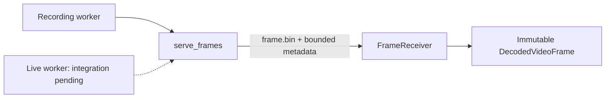

# Local decoded-frame transport

Shared infrastructure for trusted recording and live-source workers. This package
depends on media contracts, decoded-frame values and process-supervision wire
helpers. It has no decoder, model, business, identity or source-adapter dependency.

`serve_frames(directory, reader)` serves serialized increasing request IDs, writes
one packed frame file atomically, then publishes metadata and its SHA-256. A finite
reader may return `None` for EOF. Live readers must raise on loss instead. Read
failure publishes a generic message, never the source exception text. The caller
owns source construction and close, including when serving raises.

`FrameReceiver(max_frame_bytes).receive(directory, reply)` checks frame status,
bounded payload size, digest, dimensions, pixel format, rational presentation time,
increasing sequence/time and stable dimensions. History advances only after full
acceptance. Create a receiver for each source session; the adapter owns terminal
failure and EOF policy. EOF is deliberately not decoded as a frame.

This is a single-producer/single-consumer local copy transport. Callers serialize
requests and payload access, and keep the worker's directory private. SHA-256
detects payload mismatch; it does not authenticate a malicious worker. Process
deadlines, lifetime and cleanup remain with `WorkerProcess`; source authorization,
capture-clock trust, epochs, fan-out and resource scheduling remain with the host.
It is not shared memory, zero-copy delivery or an untrusted-worker sandbox.
